# MUCScope Player User Guide

**Language:** [한국어](MUCScope_User_Guide_KO.md) · [English](MUCScope_User_Guide_EN.md) · [日本語](MUCScope_User_Guide_JA.md)

MUCScope compiles MUC music sources on the MSX and plays the result with channel keyboards, levels, spectrum and SCC waveforms. You can browse or select another song during compilation. This guide covers installation, keyboard operation, browsing and settings for the SCREEN 2 player.

## Contents

- [Watch the video](#watch-the-video)
- [Screen tour](#screen-tour)
- [Requirements](#requirements)
- [Installation and startup](#installation-and-startup)
- [Keyboard controls](#keyboard-controls)
- [Normal Z80 mode](#normal-z80-mode)
- [File browser](#file-browser)
- [Playback modes and speed](#playback-modes-and-speed)
- [Display and skins](#display-and-skins)
- [Volume and song information](#volume-and-song-information)
- [Saved settings](#saved-settings)
- [MUC compilation](#muc-compilation)
- [Troubleshooting](#troubleshooting)

## Watch the video

See MUCScope compile and play MUC sources directly on the MSX. Click the picture to open the video on YouTube, or click a time in the table to start at that scene.

<a href="https://www.youtube.com/watch?v=CJvW9Itukdw"></a>

**[MucoMSX] MUCScope Player, the MUC player included in MucoMSX** (7:22, published 2026-10-16; the title on YouTube is in Korean). MUCScope opens, compiles and plays MUC files written for SCC, MSX-MUSIC and OPNA on a Panasonic FS-A1GT (turbo R) in openMSX. The window on the left is openMSX's Audio channel viewer.

| Time | Scene | Section in this guide |
| --- | --- | --- |
| [0:00](https://www.youtube.com/watch?v=CJvW9Itukdw) | Spectrum and S1–S5 waveforms of an SCC song | [Channel view and spectrum](#channel-view-and-spectrum) |
| [0:10](https://www.youtube.com/watch?v=CJvW9Itukdw&t=10s) | Opening another MUC starts compilation: stage (`PARSE`) and progress bar on the top line | [Progress display](#progress-display) |
| [0:20](https://www.youtube.com/watch?v=CJvW9Itukdw&t=20s) | The compiled MSX-MUSIC song plays: spectrum, channel view at [0:26](https://www.youtube.com/watch?v=CJvW9Itukdw&t=26s) | [Channel view and spectrum](#channel-view-and-spectrum) |
| [0:30](https://www.youtube.com/watch?v=CJvW9Itukdw&t=30s) | Channel skin selection, spectrum skins at [0:48](https://www.youtube.com/watch?v=CJvW9Itukdw&t=48s) | [Choosing a skin](#choosing-a-skin) |
| [1:40](https://www.youtube.com/watch?v=CJvW9Itukdw&t=100s) | Channel view of an MSX-MUSIC song | [Channel view and spectrum](#channel-view-and-spectrum) |
| [2:16](https://www.youtube.com/watch?v=CJvW9Itukdw&t=136s) | Channel view of an OPNA (MUCOM88) song | [Channel view and spectrum](#channel-view-and-spectrum) |
| [3:00](https://www.youtube.com/watch?v=CJvW9Itukdw&t=180s) | Spectrum of the OPNA song | [Channel view and spectrum](#channel-view-and-spectrum) |
| [4:40](https://www.youtube.com/watch?v=CJvW9Itukdw&t=280s) | Compiling an OPNA song from another folder (`PREPARE`), `LINK` stage at [5:40](https://www.youtube.com/watch?v=CJvW9Itukdw&t=340s) | [Progress display](#progress-display) |

### Scenes from the video

Click a picture to play the video from that point.

<table>
<tr>
<td align="center" valign="top" width="50%"><a href="https://www.youtube.com/watch?v=CJvW9Itukdw&t=2s">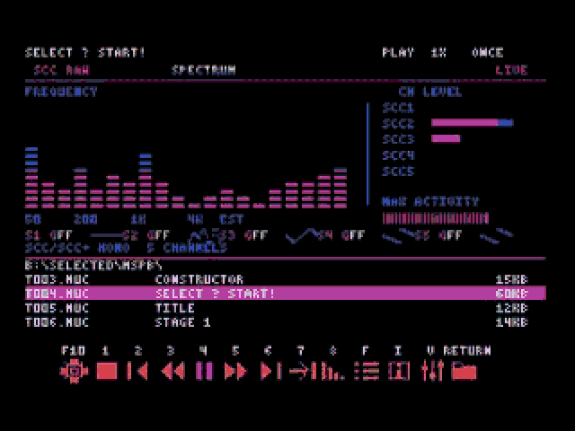</a><br><sub>0:02 SCC song, spectrum and waveforms</sub></td>
<td align="center" valign="top" width="50%"><a href="https://www.youtube.com/watch?v=CJvW9Itukdw&t=10s">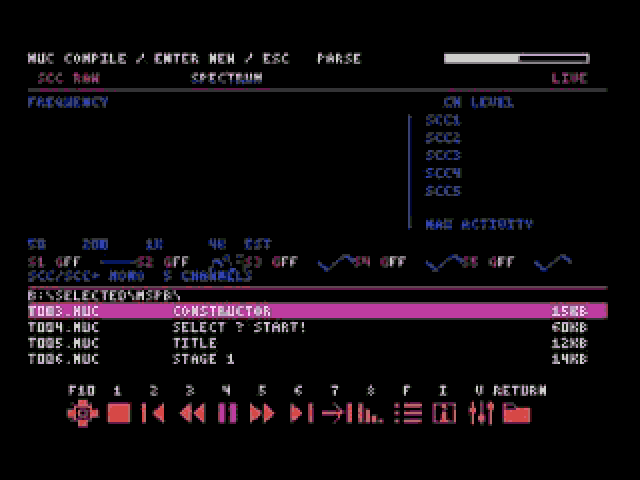</a><br><sub>0:10 Compiling (PARSE stage)</sub></td>
</tr>
<tr>
<td align="center" valign="top" width="50%"><a href="https://www.youtube.com/watch?v=CJvW9Itukdw&t=38s">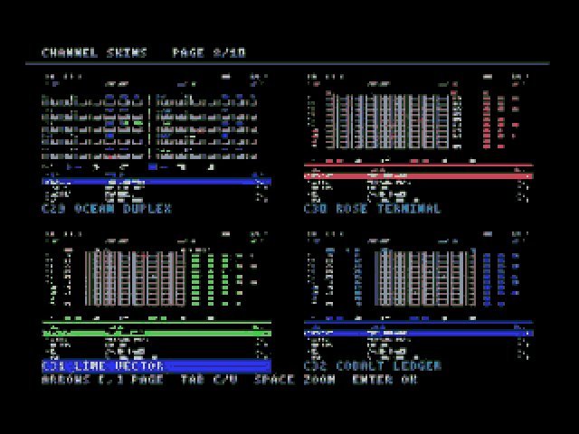</a><br><sub>0:38 Channel skin selection (page 8/10)</sub></td>
<td align="center" valign="top" width="50%"><a href="https://www.youtube.com/watch?v=CJvW9Itukdw&t=162s">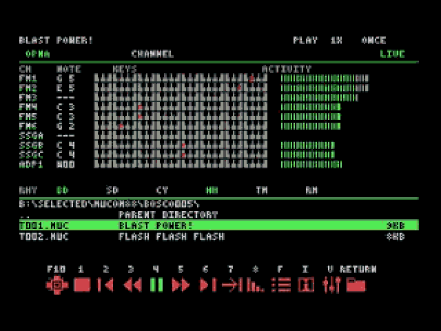</a><br><sub>2:42 OPNA song, channel view</sub></td>
</tr>
<tr>
<td align="center" valign="top" width="50%"><a href="https://www.youtube.com/watch?v=CJvW9Itukdw&t=192s">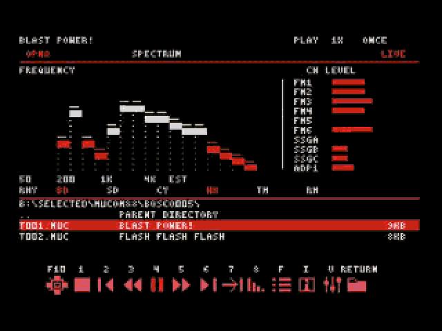</a><br><sub>3:12 OPNA song, spectrum</sub></td>
<td align="center" valign="top" width="50%"><a href="https://www.youtube.com/watch?v=CJvW9Itukdw&t=340s">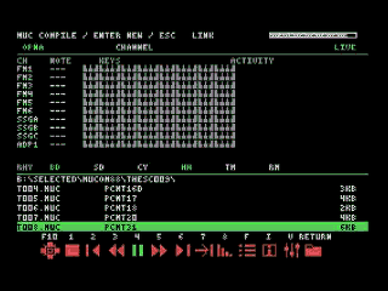</a><br><sub>5:40 Compiling (LINK stage)</sub></td>
</tr>
</table>

The video shows v1.0-Stable (2026-10-16). Compared with the current build, the chip line differs (`SCC RAW` → `SCC+/PSG` and so on) and SCC and PSG now share one page; the key layout, screen structure and compilation stages are the same. The other pictures in this guide were taken from the current build in WebMSX (turbo R configuration).

The MUBScope video shows the volume mixer and the spectrum skin selection: [[MucoMSX] v1.0-Stable released](https://www.youtube.com/watch?v=Xk4awiKuZGc) (2:15).

## Screen tour

<p align="center">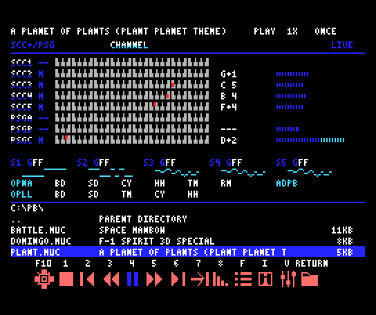<br><sub>Channel view in the current build: a MUC using SCC and PSG, compiled and playing on turbo R</sub></p>

| Area | What it shows |
| --- | --- |
| Top line | Song title, state (`PLAY`, `PAUSE`, `STOP`), speed (`1X`) and playback mode. During compilation: `MUC COMPILE / ENTER NEW / ESC`, the stage and a progress bar |
| Second line | Chips the song uses (`SCC+/PSG`, `OPNA`, `OPLL` and so on) and the current view (`CHANNEL` or `SPECTRUM`) |
| Channel rows | Channel name (`SCC1`–`SCC5`, `PSGA`–`PSGC` and so on), keyboard (a red dot marks the sounding note), note name and level bar |
| Waveform line | For SCC songs, the current waveform of each channel S1–S5 |
| Rhythm rows | OPNA and OPLL rhythm lamps and the ADPCM-B level (`ADPB`) |
| Mini file list | Current folder path and the MUC file names, titles and sizes |
| Bottom | Key labels (`F10 1 2 … V RETURN`) and the matching buttons |

See [Display and skins](#display-and-skins), [File browser](#file-browser) and [MUC compilation](#muc-compilation) for details.

## Requirements

- MSX1 or later. The display uses SCREEN 2, 256×192 pixels and the fixed 16-color palette. It works with 16KB VRAM on MSX1.
- MSX-DOS2 or Nextor and a RAM mapper are required. A mapper with at least 512KB RAM is recommended. Available memory depends on DOS, resident programs and song size. When an internal and an external mapper are both present, the player uses the one with more free memory at startup. It does not combine the two, and on some configurations it uses only the mapper DOS runs in.
- Use an SD card, HDD or other storage device with room for the player and the complete skin folder.

The hardware must provide the sound chips required by the song. The filename extension alone does not identify those chips.

| Song uses | Required hardware | Display |
| --- | --- | --- |
| MSX PSG | Built-in MSX PSG | 3 PSG channels |
| MSX-MUSIC / OPLL | Built-in MSX-MUSIC or a compatible device such as FM-PAC | MML playback: 6 FM channels and 5 drums; raw register playback: up to 9 FM channels |
| OPNA / YM2608 | Supported OPNA device, such as MAKOTO | FM, SSG, rhythm and ADPCM |
| SCC / SCC+ | Supported SCC/SCC+ cartridge or expansion | 3 or up to 5 SCC channels and waveforms, depending on the song format |
| Multiple chips | All devices specified by the song | Chip-specific channels and display pages |

`msPb` songs also require their actual sound chips. An OPNA device alone cannot play a song that requires SCC.

Supported Panasonic machines automatically use their fast mode (Z80 at 5.37 MHz); Turbo-R machines use R800 mode. Add `/N` at startup to disable automatic CPU acceleration.

On a One Chip MSX (OCM), with or without `/N`, the player sets the cartridge slot clock to 3.58 MHz, raises the CPU to 8.06 MHz and runs with the same full screen as a Turbo-R. The original CPU speed and slot clock are restored at exit.

The screen layout depends on the CPU. Music playback always takes priority over the display.

| CPU | Screen | Display updates |
| --- | --- | --- |
| Turbo-R (R800), OCM at 8.06 MHz | Full screen: channel view, spectrum, chip pages, menus | 30 per second |
| Panasonic fast mode (Z80 at 5.37 MHz) | Full screen | 15 per second |
| Normal Z80 (3.58 MHz) or started with `/N` | File browser only | See [Normal Z80 mode](#normal-z80-mode) |

The display follows the fixed rate above. When the music is running behind, the display waits for the next frame so the music is served first; songs that keep the CPU behind get fewer display updates.

## Installation and startup

Extract the distribution ZIP. Keep these files in the same player directory and preserve the subdirectory structure of `SKINS`.

```text
MUCSCOPE.COM
MUCSCPB.BIN
MUCSCPD.BIN
MUCSCPC.BIN
MUCSCPC0.BIN
MUCSCPU.BIN
MUCSCOPE.MXR
SKINS/
```

| File | Purpose |
| --- | --- |
| `MUCSCOPE.COM` | Player executable |
| `MUCSCPB.BIN` | File browser |
| `MUCSCPD.BIN` | Design and skin display |
| `MUCSCPC.BIN` | Compilation controller |
| `MUCSCPC0.BIN` | Compiler core |
| `MUCSCPU.BIN` | Toolbar and UI extension |
| `MUCSCOPE.MXR` | Native MSX score playback engine |

Use `MUCSCOPE.MXR` from the same build as the executable. Startup requires a matching module. Do not substitute an MXR file from another player or the toolchain.

Run the player from its directory, or put the player directory in `PATH` and start it from the directory that holds your songs. Wherever it starts, COM/BIN modules, the MXR, skins and `MUCSCOPE.CFG` are read from and written to the player directory; the file browser and relative song paths start from the directory you ran it in, and the player returns there at exit. Keep COM/BIN modules and skins from the same distribution together; replace the complete set when updating.

```text
MUCSCOPE
```

Select a song with the arrow keys and press `RETURN` to compile and play it.

You can also specify a song at startup:

```text
MUCSCOPE SONG.MUC
MUCSCOPE SONG.MUC /L1
MUCSCOPE SONG.MUC /L0
MUCSCOPE SONG.MUC /N
```

| Option | Behavior |
| --- | --- |
| No option, or `/L1` | Start in ONCE mode |
| `/L0` | Start in LOOP mode |
| `/N` | Disable automatic CPU acceleration; may be combined with a playback-mode option |

The default is **ONCE**. Only MUC files can be selected; MUB files are hidden. Use MUBScope for MUB playback.

On MSX2 or later with a MAKOTO, the player computes the start of the song ahead and fills one memory segment (16KB) before playback starts, so sound can take a moment to begin after you open a song; pressing a key during the fill starts playback at once. It keeps computing ahead while playing, so a short burst of display work does not delay the sound. If computing ahead cannot keep up, that song switches to direct output and keeps playing. Some native MSX scores use direct output from the start.

## Keyboard controls

The labels above the bottom toolbar appear in this order:

```text
F10  1  2  3  4  5  6  7  8  F  I  V  RETURN
```

| Key | Action |
| --- | --- |
| `F10` | Open the skin picker. On a real MSX, use `Shift+F5` or `Ctrl+L`. |
| `1` | Stop and retain the current song data for replay. |
| `2` | Previous song in the current browser directory. |
| `3` | Cycle 0.5× → 0.25× → normal speed. |
| `4` | Pause while playing; resume while paused; restart the current song while stopped. |
| `5` | Normal Z80: 2× → normal. Panasonic fast mode / R800: 2× → 4× → normal. |
| `6` | Next song in the current browser directory; choose randomly in RANDOM mode. |
| `7` | Cycle ONCE → LOOP → RANDOM. |
| `8` | Fade out, then stop. |
| `F` | Open or close the full file list. |
| `I` | Show the title, current file path, sound chips and keyboard help. |
| `V` | Open the master and sound-group volume mixer. |
| `RETURN` | Play the selected file or enter the selected directory. |
| `Tab` | Switch between channel view and spectrum on the playback screen. |
| `Shift+Tab` (or `C`) | Cycle chip pages used by the current song. |
| `Ctrl+Tab` | Cycle the six toolbar styles. |
| `Space` | Stop on the playback screen. |
| `Esc` | Close a list/info/mixer panel; exit the program from the playback screen. |

On a normal Z80, `F10`, `F`, `V`, `Tab`, `Shift+Tab` and `Ctrl+Tab` are not available; see [Normal Z80 mode](#normal-z80-mode).

The MSX key click is turned off during playback so that key sounds do not mix with the music. Your key-click setting is restored when the program exits.

`F`, `I`, `V`, `C` and `D` accept either case. Held keys do not auto-repeat; each press is entered once. List and page movement also move one line (one page) per press. Arrow keys repeat in the skin picker.

**F10 in openMSX:** load the supplied `openmsx-designs.tcl` at startup to bind the PC keyboard's `F10`, `Shift+F10`, `Ctrl+Tab` and `Shift+Tab`. If using album `.command`/TCL launchers, start through those launchers. If F10 does not work, send `Shift+F5` or `Ctrl+L` to the MSX.

The fixed lower monitor remains visible on every chip page: OPNA rhythm (BD, SD, CY, HH, TM, RM), OPLL rhythm (BD, SD, TM, CY, HH), and ADPCM-B level. The two rhythm chips have independent indicators; unused channels remain unlit. SCC waveforms appear above this monitor.

Each SCC waveform is 32 pixels wide, with one horizontal pixel for each of the 32 instrument samples, and is drawn compressed to six pixel rows. Channel names and gain values are on the row above. There is space between adjacent waveforms and between the waveforms and the rhythm monitor below. This is the instrument wavetable, not an audio waveform scaled by output volume. `GFF` means a gain value of FF (hexadecimal).

## Normal Z80 mode

On a normal Z80 (3.58 MHz), or when automatic acceleration is disabled with `/N`, the screen is reduced to the file browser so that as much CPU time as possible goes to the music.

- The top line shows the song title and status (PLAY, PAUSE or STOP, speed and playback mode); the rest of the screen is the file browser.
- Channel view, spectrum, chip pages, skin selection, the full file list and the volume mixer are not available. The `F10`, `F` and `V` toolbar icons are dimmed.
- No chip-state capture or drawing for the channel display runs during playback. The sound is the same as on the faster CPUs.

| Key | Action |
| --- | --- |
| `↑` `↓` `←` `→`, `RETURN`, `Backspace`, `+` `=` `-`, `D` | File browser |
| `1`–`8` | Stop, previous, slower, play/pause, faster, next, playback mode, fade-out |
| `Space` | Stop |
| `I` | Song information; `Esc`, `Tab` or `I` returns to the browser |
| `Esc` | Exit the program (from the browser) |
| `F10`, `F`, `V`, `Tab`, `Shift+Tab` (`C`), `Ctrl+Tab` | Not available |

The help text on the information screen still mentions `F10`, `F` and `Tab`, but those keys do not work on a normal Z80. Because the mixer is not available, volume always stays at the default (maximum).

When a song keeps the CPU almost fully busy with music, the information screen can take a while to appear. Some songs still exceed the capacity of a normal Z80 and play more slowly; play those in Panasonic fast mode or on a Turbo-R.

On a normal Z80, changing directory or drive pauses the music while the list is read and drawn, then playback continues from where it stopped. Larger directories pause longer (about 6 seconds for 60 songs). If you had paused the song yourself, it stays paused.

## File browser

The highlighted item and the currently playing song may differ. Moving the cursor does not change playback; pressing `RETURN` opens the selection.

<p align="center">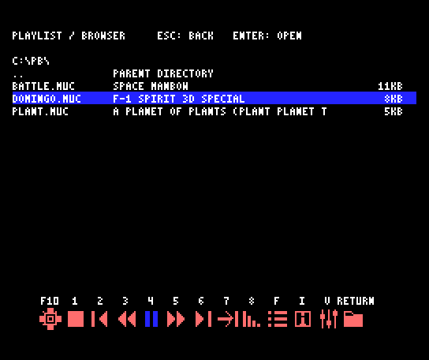<br><sub>Full file list opened with <code>F</code>, with MUC titles and sizes</sub></p>

| Key | Browser action |
| --- | --- |
| `↑` / `↓` | Move the selection |
| `RETURN` / `→` | Open a file or enter a directory |
| `Backspace` / `←` | Go to the parent directory |
| `+` or `=` | Next page |
| `-` | Previous page |
| `D` | Next available drive |
| `F` | Toggle the full file list |

Use MSX-DOS 8.3 filenames. The list shows the filename, title and size. If a title cannot be read, use the filename to identify the song. Long titles may be clipped to the display width. `~` and `$` in filenames and titles are displayed; characters the font does not contain (such as Japanese) appear as `?`.

Sizes are in **KB**, with 1KB = 1,024 bytes and partial kilobytes rounded up: 1,025 bytes is shown as `2KB`. Directories show `DIR`.

Music continues while you browse directories. On a normal Z80 it pauses only while the directory changes (see [Normal Z80 mode](#normal-z80-mode)). Opening a new song stops the previous song before preparing the new one. Previous/next and automatic advancement use playable files in the current browser directory.

A directory list holds up to 192 entries, including the parent-directory entry. Split larger collections into album directories if some songs are missing from the list.

Press `Esc` or `Tab` in the full list, info or mixer to return to playback. Arrow keys in the info/mixer panel belong to that panel.

## Playback modes and speed

### ONCE, LOOP and RANDOM

| Mode | Behavior |
| --- | --- |
| ONCE | For a song with a loop, play the initial pass, then traverse the authored loop section once more and advance to the next song. A song without a loop plays once. Stop after the last song in the directory. |
| LOOP | Repeat the current song. |
| RANDOM | Select another song in the current directory at random. |

The extra ONCE traversal starts at the song's loop point, not at the beginning of the intro. It uses the already loaded song data. Pressing `7` updates both the mode label and the toolbar mode icon. LOOP also uses the loaded result and never recompiles the MUC on each repetition.

### Pause, stop and fade

Press `4` to pause while preserving the current position. Press `4` again to resume at **normal 1× speed**. The toolbar shows a pause icon while playing and a play icon while paused or stopped.

If a song ends at the same moment you pause, automatic advance, random selection and loop restart wait. Press `4` to resume and process the pending song end, or stop to cancel it. Pausing during fade-out also freezes the fade. Resuming continues the remaining fade.

After stopping with `1`, press `4` to replay the current song from the beginning. Opening the same current file with `RETURN` also reuses retained data. The MUC is not recompiled in either case. Opening a different song or exiting frees the previous song data.

Press `8` to fade out. When the fade finishes, playback stops; fade-out does not automatically open the next song.

### Speed

- `3`: normal → 0.5× → 0.25× → normal.
- `5`, normal Z80: normal → 2× → normal.
- `5`, Panasonic fast mode / R800: normal → 2× → 4× → normal.

Pressing `3` while accelerated selects 0.5×; pressing `5` while slowed selects 2×. Actual performance depends on the machine, song and display workload.

## Display and skins

### Channel view and spectrum

Use `Tab` to switch views.

- **Channel view:** chip-specific channel names, keyboard notes, levels, note names and supported pan information. SCC songs also show waveforms and gain.
- **Spectrum:** frequency activity and per-channel levels. Layout and colors depend on the selected skin.

<table>
<tr>
<td align="center" valign="top" width="50%">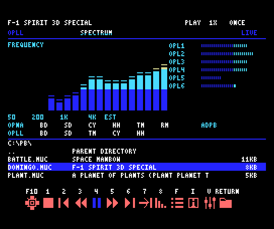<br><sub>Spectrum: an MSX-MUSIC song</sub></td>
<td align="center" valign="top" width="50%">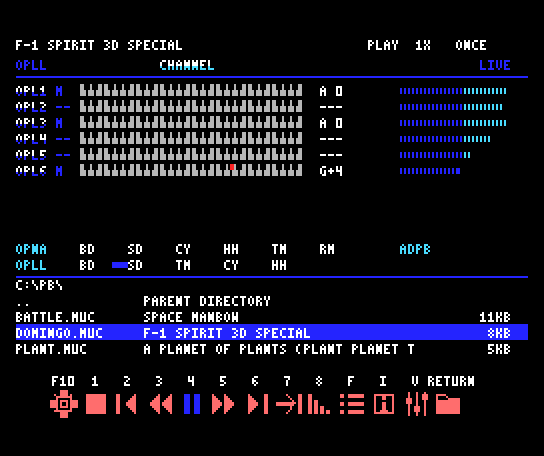<br><sub>Channel view of an MSX-MUSIC song: OPL1–OPL6 and rhythm</sub></td>
</tr>
</table>

▶ Video: [0:00 SCC spectrum and waveforms](https://www.youtube.com/watch?v=CJvW9Itukdw) · [0:26 MSX-MUSIC channel view](https://www.youtube.com/watch?v=CJvW9Itukdw&t=26s) · [2:16 OPNA channel view](https://www.youtube.com/watch?v=CJvW9Itukdw&t=136s) · [3:00 OPNA spectrum](https://www.youtube.com/watch?v=CJvW9Itukdw&t=180s)

The line under the title lists every chip the song uses, in the order `OPNA`, `SCC+`, `OPLL`, `PSG` — for example `OPNA/SCC+`, `SCC+/PSG` or `OPNA/OPLL`. The song data cannot tell SCC from SCC+, so SCC is always shown as `SCC+`. This line does not change when you switch chip pages.

Note names use the MUCOM spelling with `+`: `C+4` is C#4. The note cell of the ADP1 row shows the current ADPCM sample number in decimal, such as `P03` for MML `@3`.

The MSX PSG and OPLL rows also show the playing notes, keyboard and levels. An OPLL channel stays at half level after key-off while its note and volume are unchanged, to suggest the release. A resting channel shows level 0.

Spectrum and level displays are estimates from playback data and chip state. They are not audio FFT measurements or recording meters. A mono chip without pan information may have a stationary pan indicator. The RHY row flashes its per-drum indicators on rhythm hits: six drums for OPNA and five for OPLL. Indicators clear while paused or stopped. For native raw PSG streams, a channel with both tone and noise disabled shows zero level; noise-only activity has no keyboard pitch. OPLL channels 7–9 return to melodic display immediately when rhythm mode is disabled.

Use `Shift+Tab` or `C` to cycle the chip pages in channel or spectrum view. Only groups used by the song appear: OPNA, OPLL, and SCC(+)+PSG. SCC and PSG share one page with five SCC and three PSG channels; SCC-only songs show five channels. Info, mixer and full browser panels retain their focus. A switch pauses playback and restores the previous playing/paused state afterward. The `msPb` format alone does not imply OPLL channels.

When a new song is loaded, the player automatically selects its primary chip page from the used parts. Ordinary parts are compared by channel count, excluding rhythm, ADPCM-B and tempo-only parts. For raw streams that multiplex several channels, the detected chip capacities provide an estimate. SCC(+)+PSG counts as one combined page and wins a tie. A manual chip-page choice is retained through stop/replay and menu returns for the same song. Loading another song selects again; if an info or mixer panel is open, the new page appears after closing it.

**View changes briefly pause and mute the music.** In Panasonic fast mode a `Tab` change takes about 0.3 seconds and a chip-page change about 1 second. After the transition, the previous playback/pause, speed and fade state is restored. ADPCM is handled so its position is retained. Switching views while manually paused does not start playback automatically.

### Choosing a skin

1. Open the picker with `F10`, or `Shift+F5` / `Ctrl+L` on a real MSX.
2. Select one of the four previews with the arrow keys.
3. Use `[` / `]` for the previous/next page.
4. Use `Tab` inside the picker to switch channel/spectrum categories.
5. Press `Space` for a full-size preview; press a key to return.
6. Press `RETURN` to apply and save, or `Esc` to leave without applying.

Channel skins are **C01–C40** and spectrum skins are **V01–V40**. Each category has 10 pages with four previews per page. Channel and spectrum skins are selected independently.

<p align="center">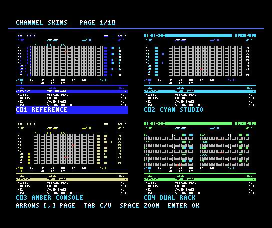<br><sub>Channel skin selection (page 1/10). The name of the selected skin is highlighted</sub></p>

▶ Video: [0:30 choosing a channel skin](https://www.youtube.com/watch?v=CJvW9Itukdw&t=30s) · [0:48 spectrum skins](https://www.youtube.com/watch?v=CJvW9Itukdw&t=48s)

### Toolbar styles

`Ctrl+Tab` cycles:

```text
SOLID → OUTLINE → BADGE → KEYCAP → CUTOUT → BRACKET → SOLID
```

Styles keep the same keys and functions. Icons and highlighting change with playback, pause, mode, fade and speed state.

## Volume and song information

Open the mixer with `V`. Choose a group with `↑` / `↓` and adjust it with `←` / `→` or `+` / `-`. **0 mutes; 15 is full volume.**

| Group | Controls |
| --- | --- |
| MASTER | Overall volume |
| OPNA FM | OPNA FM channels |
| OPNA SSG | OPNA SSG channels |
| ADPCM | OPNA ADPCM |
| OPNA RHYTHM | OPNA rhythm |
| MSX PSG | MSX PSG channels |
| MSX SCC | SCC/SCC+ channels and SSG extension played through SCC |
| MSX-MUSIC | OPLL FM channels and drums |

Use **MSX SCC** for SCC volume. It is independent of OPNA SSG and MSX PSG. Adjusting an unused group does not affect the song.

`I` opens song information: title, path, sound chips and keyboard help. Close info/mixer with `Esc`, `Tab` or the same menu key.

<table>
<tr>
<td align="center" valign="top" width="50%">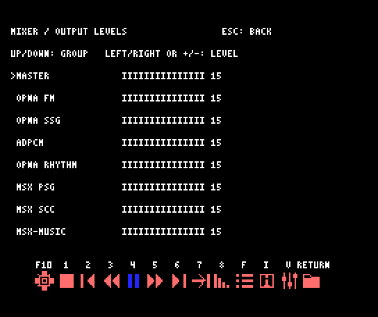<br><sub><code>V</code> volume mixer</sub></td>
<td align="center" valign="top" width="50%">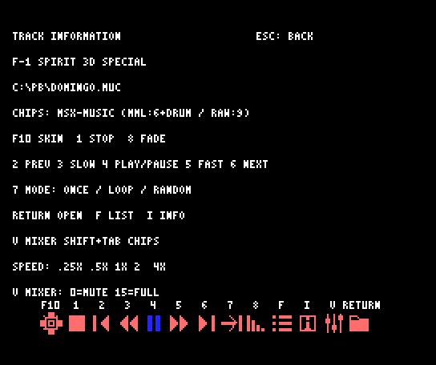<br><sub><code>I</code> song information: title, path, chips and key help</sub></td>
</tr>
</table>

## Saved settings

Channel/spectrum skins and toolbar style are saved in `MUCSCOPE.CFG` and restored on startup. The player directory must be writable to save settings. Settings are saved in the player directory even when you start from another directory.

Volume, speed and playback mode apply to the current session. The next startup defaults to ONCE; use `/L0` to start in LOOP mode.

To restore the default design, exit the player, move `MUCSCOPE.CFG` to another name and start again.

## MUC compilation

### Source, voice and PCM files

Keep each MUC with the assets it references. Use DOS 8.3 filenames, for example `TRACK01.MUC`, `VOICE.DAT` and `PCM.BIN`.

**Use only letters, digits, `-` and `_` in MUC filenames.** Copying long-named files to an SD card on a Mac or PC creates short names containing `~`, such as `03PRAC~1.MUC`. Such a MUC appears in the list but does not compile, and `MUCSCOPE.LOG` reports `Invalid 8.3 name`. Rename the file before opening it.

If `#voice` or `#pcm` names a long filename (for example `#voice shinobivoice.dat`), the file is visible on the SD card only under a short name such as `SHINOB~1.DAT`, so it is not found. Give the asset an 8.3 name and change the `#voice`/`#pcm` line in the MUC to match. In this case `MUCSCOPE.LOG` may not be written.

Files named by `#voice` and `#pcm` are resolved relative to **the MUC source directory**. Browsing elsewhere during compilation does not change that asset directory.

```text
ALBUM/
  TRACK01.MUC
  VOICE.DAT
  PCM.BIN
```

`#voice VOICE.DAT` uses the `VOICE.DAT` in that directory. Also supply any file specified by `#pcm`.

If the file named by `#pcm` is missing, compilation does not start and `code 19 PCM file in #pcm tag not found` is shown. A song without a `#pcm` line looks for the default PCM file `MUCOMPCM.BIN`; if it is missing, `WARNING: MUCOMPCM.BIN NOT FOUND - NO PCM` is shown and the song plays without its ADPCM part. The previous song's PCM is never played instead.

### Progress display

Opening a source stops the previous song and starts compilation. The top of the screen shows a phase and progress bar.

| Phase | Meaning |
| --- | --- |
| SETUP | Initialize compilation |
| READ | Read the source |
| PREPARE | Read voices and prepare source data |
| PARSE | Process channels and music commands |
| LINK | Adopt RAM music data and prepare PCM |
| READY | Ready to play |

The bar shows the current work position, not an overall percentage or time remaining. A long macro can keep the indicator at the same position for a while.

<table>
<tr>
<td align="center" valign="top" width="50%">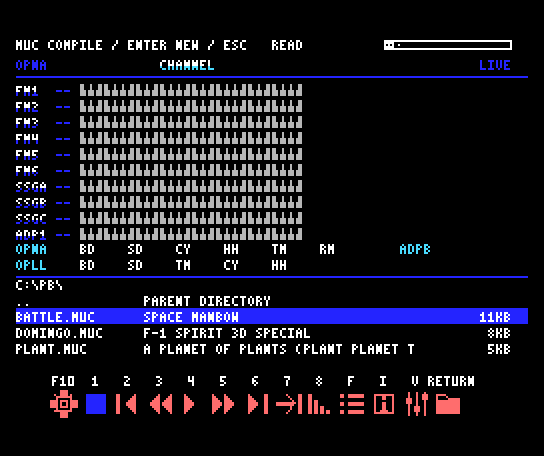<br><sub><code>READ</code> stage: reading the source</sub></td>
<td align="center" valign="top" width="50%">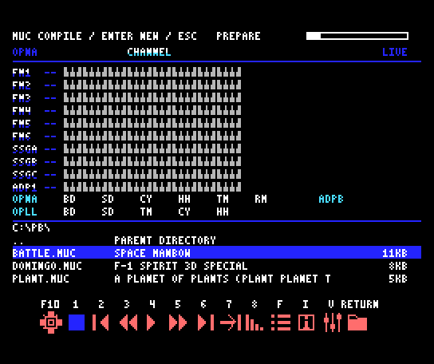<br><sub><code>PREPARE</code> stage: loading voices and preparing</sub></td>
</tr>
</table>

▶ Video: [0:10 PARSE](https://www.youtube.com/watch?v=CJvW9Itukdw&t=10s) · [4:40 PREPARE](https://www.youtube.com/watch?v=CJvW9Itukdw&t=280s) · [5:40 LINK](https://www.youtube.com/watch?v=CJvW9Itukdw&t=340s)

### Browsing and replacing a compilation

Arrow keys, page navigation and directory browsing remain available. Select another song and press `RETURN` to cancel the current compilation and compile the new source. If several songs are selected quickly, the latest selection wins. `2` and `6` can select the previous/next song.

`F`, `I` and `V` remain available. Info and mixer panels retain their contents while compilation continues.

Press **`1` or `Space`** to cancel compilation. `Esc` also cancels from the ordinary playback screen and from the browser screen of a normal Z80; when a list/info/mixer panel is open, `Esc` closes that panel first.

Browsing, information and mixer menus, cancellation and song selection remain available during PCM preparation. Input is processed between PCM transfer blocks. Selecting another song cancels the remaining transfer and prepares the new selection. A file read or transfer block may briefly delay input. Once preparation succeeds, playback starts and the progress display closes.

### Direct RAM playback and error logs

The playback engine directly adopts the compiler’s RAM mapper banks. MUCScope does not write a temporary MUB to SD, reread it, or copy the music data to a second buffer. Source and compiler work banks are released; music banks remain owned by the player. Songs using `#pcm` read the original PCM companion once for upload to OPNA.

Successful compilation does not write files in the source directory. On a compile error, MUCScope attempts to write `MUCSCOPE.LOG` there if the directory is writable. An older log may remain, so check the current on-screen error too.

Existing `MSCACHE*.MUB`, `M2MTEMP.$$$` and `M2MBACK.$$$` from other programs are neither used nor deleted.

You can select another song after a compile error. Syntax and source limits follow the MUCOMSX compiler included with MUCScope.


## Troubleshooting

### Missing module or skin at startup

Keep all required COM/BIN modules, `MUCSCPU.BIN` and the full `SKINS` tree in the player directory. Use one matching distribution. If you start from another directory, check that the player directory is in `PATH`. Copy `SKINS/0` through `SKINS/8` and `SKINS/TB0.BIN` through `SKINS/TB5.BIN` as well.

### Not enough memory

Check that MSX-DOS2/Nextor can access the RAM mapper. Close unnecessary resident programs and try a smaller song. MUC compilation and large songs need additional free RAM. At least 512KB mapper RAM is recommended.

### No songs in the file list

Check the drive, directory and `.MUC` extension. MUCScope hides MUB files. Split directories with too many entries into subdirectories.

### The display moves but there is no sound

Check playback with `4` and ensure MASTER and the relevant mixer group are not at 0. Check the OPNA, MSX-MUSIC or SCC/SCC+ device required by the song. Songs with conflicting SCC/SCC+ usage cannot be loaded.

### F10 or Ctrl+Tab does not work

On a normal Z80 (or when started with `/N`), `F10`, `F`, `V`, `Tab` and `Ctrl+Tab` are not available; see [Normal Z80 mode](#normal-z80-mode). On a real MSX, use `Shift+F5` or `Ctrl+L` for skins. In openMSX, load `openmsx-designs.tcl` at startup or use the album launcher containing the bindings. Check whether the host operating system intercepts the key combination.

### Music briefly pauses during view changes

`Tab` and chip-page changes pause playback for the transition, then restore its prior state. If playback does not resume, check for manual pause and press `4`. Transition time depends on the machine, storage and skin.

### Skin or toolbar settings are not retained

Check write access to the player directory and `MUCSCOPE.CFG`. Apply a skin with `RETURN`; previewing alone does not save it.

### Compilation fails

Read the on-screen error code/line number and `MUCSCOPE.LOG`. Check the `#voice`/`#pcm` names, asset files, source-directory write access and free storage. Correct the error and select again, or open another song.

- `Invalid 8.3 name`: the MUC filename contains a symbol such as `~`. Rename it using only letters, digits, `-` and `_`.
- "MUC COMPILE FAILED" with no log: a voice or PCM file named by `#voice`/`#pcm` may be missing. Check that the asset has an 8.3 name and that the MUC names it exactly.
- `code 11 Voice name not found`: the voice name was not found in the voice file. Check that the voice file is in the source folder under the expected name.
- `code 19 PCM file in #pcm tag not found`: the PCM file named by `#pcm` is not in the MUC's folder. Check its 8.3 name and location.
- `PCM LOAD FAILED - CHECK THE PCM FILE AND FREE RAM`: compilation finished but the PCM could not be read or uploaded to the OPNA. Check that the PCM file is intact and that enough RAM is free.

### An edited MUC still plays the old result

Stop/replay with `4` and reopening the current song reuse its compiled result. To recompile an edited source, open another song and return to it, or exit MUCScope and restart.

### Playback or display updates slow down

On a normal Z80 the screen is reduced to the file browser to leave the CPU to the music, but some songs still exceed its processing capacity and play more slowly. Use automatic acceleration on a supported Panasonic machine or Turbo-R R800; if you started with `/N`, try starting without it. A working display does not by itself confirm playback at the intended tempo.

Even on the faster CPUs, a large song can fall slightly behind just after it starts and then return to normal speed.

### A compiled song has too many FM voices

The playback loader supports up to 32 entries in the compiled FM voice table. A muPb/msPb result exceeding that limit produces a load error. Even a small source can exceed the supported voice count.

### Source size and driver mode

The maximum MUC source size is 65,536 bytes. A source of 65,537 bytes or more is rejected at compilation. Include files and macro processing can require additional memory.

A legacy source without a `#driver` tag uses the legacy default mode. Another program compiling the same source in mucomDotNET default mode can produce different playback. Use a driver tag appropriate to the mode in which the source was written.

## Five-channel SCC scores

The `msPb 0102` format supports five dedicated SCC parts (SCCA–SCCE), including songs combined with PSG, OPLL or OPNA. Each chip has its own display page. Ordinary SCC shares waveform storage between channels 4 and 5; SCC+ has five independent waveforms.

Define SCC voices with `#sccvoice SCCVOICE.DAT`, or embed a voice in the MUC as `@Wnumber : { 32 signed integers from -128 to 127 }`. Select it with `@number`. Keep external voice files beside the MUC. An inline-only song does not require the default SCCVOICE.DAT; a file explicitly named by `#sccvoice` must exist. Dedicated SCC parts and `#SSGExtend` cannot be combined in one song.

## Native MSX scores

PN1–PN6 musical objects and scores mixed with OPNA are supported. Channel pages follow the PSG, SCC/SCC+ and OPLL routes used by the score. The common OPNA/OPLL rhythm and ADPCM-B monitors remain available when changing chip pages.

The compiler accepts current MSX MML shared phrases (PSGS, SCCS and OPLS), functional controls and SCC waveform palettes. Keep external `#sccvoice` files beside the MUC. Compiled music plays directly from RAM. The compiled music-data limit is 96KiB; the source-file limit remains 65,536 bytes.

Native MSX scores count repeats per channel. One whole-song loop ends when every active channel has repeated at least once, so the channel with the longest repeat sets the loop; a channel that is still playing without repeating is waited for. ONCE plays the initial pass and one further loop. Finite repeats and phrase calls do not count as whole-song loops. Stopping and restarting the current song resets its loop count.

## Compact MSX syntax compatibility

Compile and play compact MSX scores using `|` separators, up to two nested `[ ... ]n` repeats, and `L` song loops. OPLL instrument/drum settings, rests, and SCC waveform morphing are supported. In ONCE mode, an `L` song loop is traversed once more before advancing to the next song.
