# MUCScope Player 사용설명서

**언어:** [한국어](MUCScope_User_Guide_KO.md) · [English](MUCScope_User_Guide_EN.md) · [日本語](MUCScope_User_Guide_JA.md)

MUCScope는 MUC 음악 소스를 MSX에서 컴파일한 뒤 재생하는 비주얼 플레이어입니다. 컴파일 중에도 파일을 탐색하거나 다른 곡을 선택할 수 있습니다. 이 설명서는 SCREEN 2 화면을 사용하는 플레이어의 설치, 키보드 조작, 파일 탐색과 설정 방법을 안내합니다.

## 목차

- [영상으로 보기](#영상으로-보기)
- [화면 둘러보기](#화면-둘러보기)
- [실행 환경](#실행-환경)
- [설치와 실행](#설치와-실행)
- [키보드 조작](#키보드-조작)
- [일반 Z80 모드](#일반-z80-모드)
- [파일 브라우저](#파일-브라우저)
- [재생 모드와 속도](#재생-모드와-속도)
- [화면과 스킨](#화면과-스킨)
- [음량과 곡 정보](#음량과-곡-정보)
- [설정 저장](#설정-저장)
- [MUC 컴파일](#muc-컴파일)
- [문제 해결](#문제-해결)

## 영상으로 보기

MUCScope가 MUC를 MSX에서 바로 컴파일하고 재생하는 모습을 먼저 영상으로 보세요. 그림을 누르면 YouTube에서 열리고, 표의 시각을 누르면 그 장면부터 재생합니다.

<a href="https://www.youtube.com/watch?v=CJvW9Itukdw"></a>

**[MucoMSX] MucoMSX에 포함된 MUC 전용 Player인 MUCScope Player도 많이 애용해 주세요.** (7분 22초, 2026-10-16 공개). openMSX의 Panasonic FS-A1GT(turbo R)에서 SCC, MSX-MUSIC, OPNA로 쓴 MUC를 열어 컴파일하고 재생합니다. 왼쪽 창은 openMSX의 Audio channel viewer입니다.

| 시각 | 장면 | 이 설명서의 절 |
| --- | --- | --- |
| [0:00](https://www.youtube.com/watch?v=CJvW9Itukdw) | SCC 곡의 스펙트럼과 S1~S5 파형 | [채널뷰와 스펙트럼](#채널뷰와-스펙트럼) |
| [0:10](https://www.youtube.com/watch?v=CJvW9Itukdw&t=10s) | 다른 MUC를 열면 바로 컴파일: 맨 윗줄에 단계(`PARSE`)와 진행 바 | [진행 표시](#진행-표시) |
| [0:20](https://www.youtube.com/watch?v=CJvW9Itukdw&t=20s) | 컴파일한 MSX-MUSIC 곡 재생: 스펙트럼, [0:26](https://www.youtube.com/watch?v=CJvW9Itukdw&t=26s) 채널뷰 | [채널뷰와 스펙트럼](#채널뷰와-스펙트럼) |
| [0:30](https://www.youtube.com/watch?v=CJvW9Itukdw&t=30s) | 채널 스킨 선택, [0:48](https://www.youtube.com/watch?v=CJvW9Itukdw&t=48s) 스펙트럼 스킨 선택 | [스킨 선택](#스킨-선택) |
| [1:40](https://www.youtube.com/watch?v=CJvW9Itukdw&t=100s) | MSX-MUSIC 곡의 채널뷰 | [채널뷰와 스펙트럼](#채널뷰와-스펙트럼) |
| [2:16](https://www.youtube.com/watch?v=CJvW9Itukdw&t=136s) | OPNA 곡(MUCOM88)의 채널뷰 | [채널뷰와 스펙트럼](#채널뷰와-스펙트럼) |
| [3:00](https://www.youtube.com/watch?v=CJvW9Itukdw&t=180s) | OPNA 곡의 스펙트럼 | [채널뷰와 스펙트럼](#채널뷰와-스펙트럼) |
| [4:40](https://www.youtube.com/watch?v=CJvW9Itukdw&t=280s) | 다른 폴더의 OPNA 곡 컴파일(`PREPARE`), [5:40](https://www.youtube.com/watch?v=CJvW9Itukdw&t=340s) `LINK` 단계 | [진행 표시](#진행-표시) |

### 영상 속 장면

그림을 누르면 그 시각부터 영상을 재생합니다.

<table>
<tr>
<td align="center" valign="top" width="50%"><a href="https://www.youtube.com/watch?v=CJvW9Itukdw&t=2s">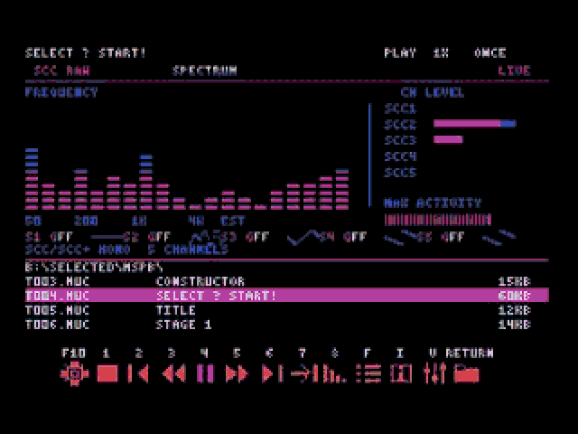</a><br><sub>0:02 SCC 곡의 스펙트럼과 파형</sub></td>
<td align="center" valign="top" width="50%"><a href="https://www.youtube.com/watch?v=CJvW9Itukdw&t=10s">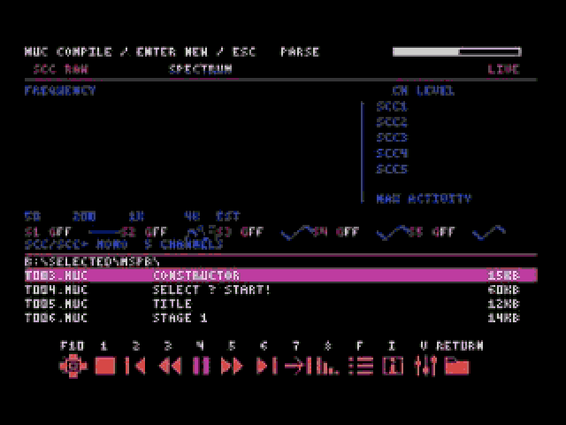</a><br><sub>0:10 컴파일 중(PARSE 단계)</sub></td>
</tr>
<tr>
<td align="center" valign="top" width="50%"><a href="https://www.youtube.com/watch?v=CJvW9Itukdw&t=38s">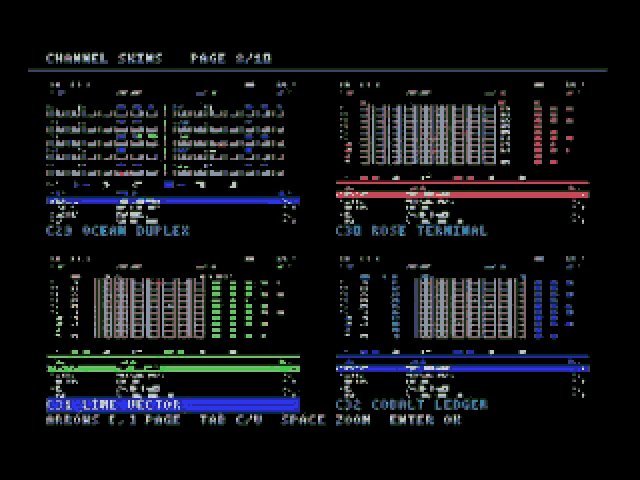</a><br><sub>0:38 채널 스킨 선택(8/10쪽)</sub></td>
<td align="center" valign="top" width="50%"><a href="https://www.youtube.com/watch?v=CJvW9Itukdw&t=162s">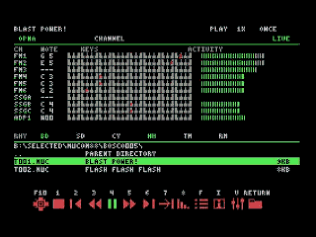</a><br><sub>2:42 OPNA 곡의 채널뷰</sub></td>
</tr>
<tr>
<td align="center" valign="top" width="50%"><a href="https://www.youtube.com/watch?v=CJvW9Itukdw&t=192s">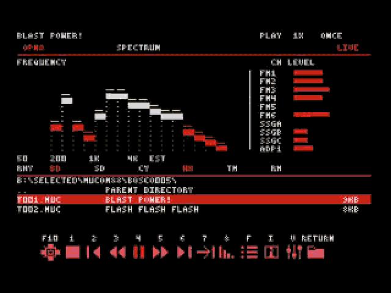</a><br><sub>3:12 OPNA 곡의 스펙트럼</sub></td>
<td align="center" valign="top" width="50%"><a href="https://www.youtube.com/watch?v=CJvW9Itukdw&t=340s">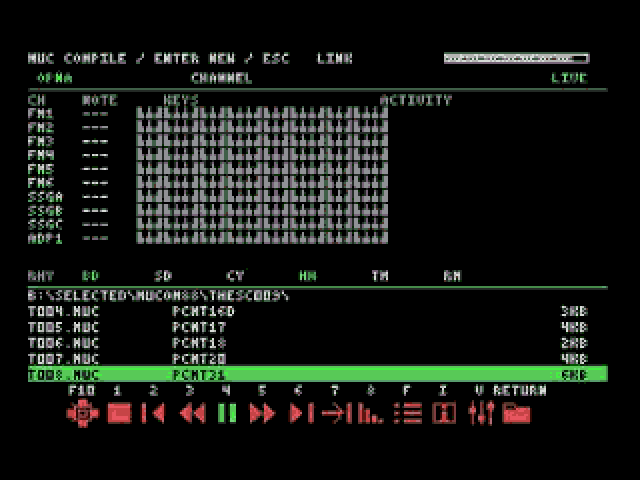</a><br><sub>5:40 컴파일 중(LINK 단계)</sub></td>
</tr>
</table>

영상은 v1.0-Stable(2026-10-16) 화면입니다. 지금 빌드와 비교하면 칩 표시 줄(`SCC RAW` → `SCC+/PSG` 등)과 SCC·PSG를 한 페이지에 함께 보여 주는 점이 다르고, 키 배치와 화면 구성, 컴파일 단계 표시는 같습니다. 이 설명서의 다른 그림은 지금 빌드를 WebMSX(turbo R 구성)에서 찍은 것입니다.

MUB를 재생하는 MUBScope 영상도 참고하세요. 볼륨 믹서와 스펙트럼 스킨 선택이 나옵니다: [[MucoMSX] v1.0-Stable released](https://www.youtube.com/watch?v=Xk4awiKuZGc) (2분 15초).

## 화면 둘러보기

<p align="center">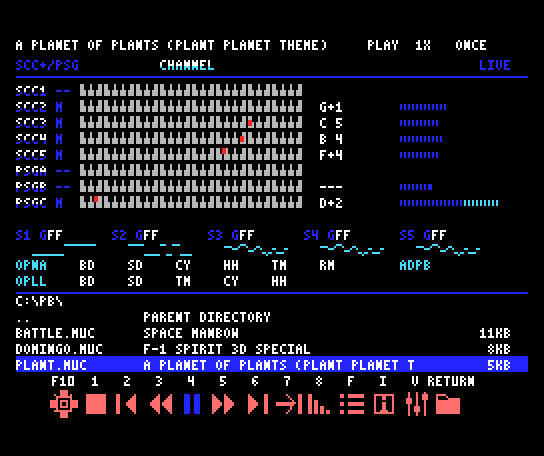<br><sub>지금 빌드의 채널뷰. turbo R에서 SCC와 PSG를 쓰는 MUC를 컴파일해 재생하는 중</sub></p>

| 영역 | 표시 내용 |
| --- | --- |
| 맨 윗줄 | 곡 제목, 상태(`PLAY`·`PAUSE`·`STOP`), 배속(`1X`), 재생 모드. 컴파일 중에는 `MUC COMPILE / ENTER NEW / ESC`와 단계, 진행 바 |
| 둘째 줄 | 곡이 쓰는 칩(`SCC+/PSG`, `OPNA`, `OPLL` 등)과 지금 화면(`CHANNEL` 또는 `SPECTRUM`) |
| 채널 행 | 채널 이름(`SCC1`~`SCC5`, `PSGA`~`PSGC` 등), 건반(지금 울리는 음은 빨간 점), 음 이름, 레벨 막대 |
| 파형 줄 | SCC 곡에서 S1~S5 각 채널의 현재 파형 |
| 리듬 행 | OPNA·OPLL 리듬 표시등과 ADPCM-B 레벨(`ADPB`) |
| 작은 파일 목록 | 현재 폴더 경로와 MUC 파일명·제목·크기 |
| 맨 아래 | 키 표시(`F10 1 2 … V RETURN`)와 그 키의 버튼 |

각 영역의 자세한 내용은 [화면과 스킨](#화면과-스킨), [파일 브라우저](#파일-브라우저), [MUC 컴파일](#muc-컴파일)에 있습니다.

## 실행 환경

- MSX1 이상. 화면은 SCREEN 2, 256×192, 고정 16색을 사용합니다. MSX1의 16KB VRAM에서도 표시할 수 있습니다.
- MSX-DOS2 또는 Nextor와 RAM 매퍼가 필요합니다. RAM 매퍼 512KB 이상의 구성을 권장합니다. DOS, 상주 프로그램과 곡의 크기에 따라 사용 가능한 메모리가 달라집니다. 내장 매퍼와 외장 매퍼가 함께 있으면 시작할 때 빈 메모리가 더 많은 매퍼를 골라 사용합니다. 두 매퍼를 합쳐 쓰지는 않으며, 구성에 따라 DOS가 쓰는 매퍼만 사용할 수도 있습니다.
- 플레이어와 전체 스킨 폴더를 저장할 수 있는 SD, HDD 등의 저장장치를 사용합니다.

곡이 사용하는 음원 칩을 준비해야 합니다. 파일의 확장자만으로 필요한 칩을 판단할 수는 없습니다.

| 곡의 음원 | 필요한 장치 | 화면에서 볼 수 있는 항목 |
| --- | --- | --- |
| MSX PSG | MSX 내장 PSG | PSG 3채널 |
| MSX-MUSIC 또는 OPLL | MSX-MUSIC 내장 기종 또는 FM-PAC 등 | MML 재생은 FM 6채널과 드럼 5종, 원시 레지스터 재생은 FM 최대 9채널 |
| OPNA 또는 YM2608 | MAKOTO 등 지원 OPNA 장치 | FM, SSG, 리듬, ADPCM |
| SCC 또는 SCC+ | 지원 SCC/SCC+ 카트리지 또는 확장장치 | 곡의 방식에 따라 SCC 3채널 또는 최대 5채널과 파형 |
| 여러 칩을 함께 사용 | 곡에 지정된 장치 모두 | 사용 칩에 맞는 채널 구성과 칩 페이지 |

`msPb` 곡도 곡에 지정된 실제 칩이 필요합니다. SCC를 사용하는 곡을 OPNA 장치만으로 재생할 수는 없습니다.

지원 Panasonic 기종에서는 고속 모드(Z80 5.37MHz), Turbo-R에서는 R800 모드를 자동으로 사용합니다. 자동 가속을 사용하지 않으려면 실행할 때 `/N`을 붙입니다.

One Chip MSX(OCM)에서는 `/N`과 관계없이 카트리지 슬롯 클럭을 3.58MHz로 맞춘 뒤 CPU를 8.06MHz로 올리고, Turbo-R과 같은 전체 화면으로 동작합니다. 종료하면 시작 전의 CPU 속도와 슬롯 클럭으로 되돌립니다.

CPU에 따라 화면 구성이 다릅니다. 음악 연주가 항상 화면보다 우선합니다.

| CPU | 화면 | 화면 갱신 |
| --- | --- | --- |
| Turbo-R (R800), OCM 8.06MHz | 전체 화면: 채널뷰, 스펙트럼, 칩 페이지, 메뉴 | 초당 30회 |
| Panasonic 고속 모드 (Z80 5.37MHz) | 전체 화면 | 초당 15회 |
| 일반 Z80 (3.58MHz) 또는 `/N` 실행 | 파일 브라우저 전용 화면 | [일반 Z80 모드](#일반-z80-모드) 참고 |

화면은 위의 고정 주기로 갱신합니다. 음악 처리가 밀린 프레임에서는 화면을 다음 프레임으로 미루고 음악을 먼저 처리하며, 음악 처리가 계속 밀리는 곡에서는 화면 갱신 횟수가 줄어듭니다.

## 설치와 실행

배포 ZIP을 풀고 아래 파일과 폴더를 같은 플레이어 폴더에 둡니다. `SKINS`의 하위 폴더 구조를 유지하세요.

```text
MUCSCOPE.COM
MUCSCPB.BIN
MUCSCPD.BIN
MUCSCPC.BIN
MUCSCPC0.BIN
MUCSCPU.BIN
MUCSCOPE.MXR
SKINS/
```

| 파일 | 용도 |
| --- | --- |
| `MUCSCOPE.COM` | 플레이어 실행 파일 |
| `MUCSCPB.BIN` | 파일 브라우저 |
| `MUCSCPD.BIN` | 디자인과 스킨 표시 |
| `MUCSCPC.BIN` | 컴파일 제어 모듈 |
| `MUCSCPC0.BIN` | 컴파일러 코어 |
| `MUCSCPU.BIN` | 버튼과 UI 확장 |
| `MUCSCOPE.MXR` | 네이티브 MSX 악보 재생 엔진 |

`MUCSCOPE.MXR`는 실행 파일과 같은 빌드의 파일을 함께 사용해야 합니다. 파일이 없거나 버전이 맞지 않으면 시작할 수 없습니다. 다른 플레이어나 툴체인의 MXR 파일로 대체하지 마세요.

플레이어 폴더에서 실행하거나, 플레이어 폴더를 `PATH`에 넣고 곡이 있는 다른 폴더에서 실행할 수 있습니다. 어느 폴더에서 실행하든 COM/BIN 모듈, MXR, 스킨과 `MUCSCOPE.CFG`는 플레이어 폴더에서 읽고 씁니다. 파일 브라우저의 시작 폴더와 상대 경로로 지정한 곡은 실행한 폴더를 기준으로 하며, 종료하면 실행한 폴더로 돌아옵니다. BIN 모듈이나 스킨을 다른 버전의 파일과 섞지 말고, 업데이트할 때는 배포 파일 전체를 함께 교체하세요.

```text
MUCSCOPE
```

파일 브라우저가 열립니다. 방향키로 곡을 고른 뒤 `RETURN`을 누르면 컴파일하고 재생합니다.

곡을 지정해 바로 시작할 수도 있습니다.

```text
MUCSCOPE SONG.MUC
MUCSCOPE SONG.MUC /L1
MUCSCOPE SONG.MUC /L0
MUCSCOPE SONG.MUC /N
```

| 옵션 | 동작 |
| --- | --- |
| 옵션 없음 또는 `/L1` | ONCE 모드로 시작 |
| `/L0` | LOOP 모드로 시작 |
| `/N` | CPU 자동 가속을 사용하지 않음. 반복 옵션과 함께 사용할 수 있음 |

기본 재생 모드는 **ONCE**입니다. MUC 파일만 선택할 수 있으며, MUB 파일은 목록에 표시하지 않습니다. MUB를 재생하려면 MUBScope를 사용하세요.

MSX2 이상에서 MAKOTO가 연결된 구성은 연주를 시작하기 전에 곡의 앞부분을 미리 계산해 메모리 세그먼트 하나(16KB)에 채워 둡니다. 그래서 곡을 연 뒤 소리가 나기까지 잠깐 걸릴 수 있으며, 채우는 동안 키를 누르면 채우기를 멈추고 바로 연주를 시작합니다. 연주 중에도 계속 미리 계산해 두므로 화면 처리가 잠깐 몰려도 소리가 밀리지 않습니다. 미리 계산이 연주를 따라가지 못하면 그 곡은 직접 출력 방식으로 바꿔 계속 연주합니다. 일부 네이티브 MSX 악보 곡은 처음부터 직접 출력 방식으로 연주합니다.

## 키보드 조작

화면 아래 아이콘의 키 표시는 다음 순서입니다.

```text
F10  1  2  3  4  5  6  7  8  F  I  V  RETURN
```

| 키 | 기능 | 사용 방법 |
| --- | --- | --- |
| `F10` | 스킨 선택 | 스킨 선택 화면 열기. 실제 MSX에서는 `Shift+F5` 또는 `Ctrl+L` 사용 |
| `1` | 정지 | 현재 곡을 정지하고 다시 재생할 수 있도록 데이터 보관 |
| `2` | 이전 곡 | 현재 브라우저 폴더의 이전 곡으로 이동 |
| `3` | 감속 | 0.5배속 → 0.25배속 → 정상 속도 순환 |
| `4` | 재생 또는 일시정지 | 재생 중에는 일시정지, 일시정지 중에는 재개, 정지 후에는 현재 곡을 처음부터 재생 |
| `5` | 가속 | 일반 Z80은 2배속 → 정상 속도. Panasonic 고속 모드와 R800은 2배속 → 4배속 → 정상 속도 |
| `6` | 다음 곡 | 현재 브라우저 폴더의 다음 곡으로 이동. RANDOM 모드에서는 무작위 곡 선택 |
| `7` | 재생 모드 | ONCE → LOOP → RANDOM 순환 |
| `8` | 페이드아웃 | 음량을 서서히 줄인 뒤 정지 |
| `F` | 전체 파일 목록 | 작은 파일 목록을 큰 브라우저 화면으로 전환 |
| `I` | 곡 정보 | 제목, 현재 파일 경로, 사용 칩과 주요 단축키 확인 |
| `V` | 볼륨 믹서 | 마스터와 음원 그룹별 음량 조절 |
| `RETURN` | 선택 열기 | 선택한 파일 재생 또는 선택한 폴더로 이동 |
| `Tab` | 화면 전환 | 재생 화면에서 채널뷰와 스펙트럼 전환 |
| `Shift+Tab` (`C`도 가능) | 칩 페이지 | 곡에서 사용하는 칩의 표시 페이지 순환 |
| `Ctrl+Tab` | 버튼 스타일 | 6가지 플레이어 버튼 스타일 순환 |
| `Space` | 정지 | 재생 화면에서 현재 곡 정지 |
| `Esc` | 복귀 또는 종료 | 목록·정보·믹서에서는 재생 화면으로 복귀. 재생 화면에서는 프로그램 종료 |

일반 Z80에서는 `F10`, `F`, `V`, `Tab`, `Shift+Tab`, `Ctrl+Tab`이 동작하지 않습니다. 자세한 내용은 [일반 Z80 모드](#일반-z80-모드)를 참고하세요.

재생 중에는 MSX의 키 클릭음을 끕니다. 키 소리가 음악에 섞이지 않게 하기 위해서이며, 프로그램을 종료하면 원래 키 클릭 설정으로 돌아옵니다.

`F`, `I`, `V`, `C`, `D`는 대소문자 모두 사용할 수 있습니다. 키를 길게 눌러도 자동 반복하지 않고 한 번만 입력됩니다. 목록의 위·아래 이동과 페이지 이동도 한 번 누를 때마다 한 칸(한 페이지)씩 움직입니다. 스킨 선택 화면에서는 방향키가 반복됩니다.

**openMSX의 F10 설정**: 동봉된 `openmsx-designs.tcl`을 시작 스크립트로 불러오면 PC 키보드의 `F10`, `Shift+F10`, `Ctrl+Tab`, `Shift+Tab`이 연결됩니다. 앨범 실행용 `.command`와 TCL을 사용 중이면 해당 실행 스크립트로 시작하세요. F10이 작동하지 않을 때는 MSX에 전달되는 `Shift+F5` 또는 `Ctrl+L`을 사용합니다.

칩 페이지와 관계없이 하단 공통 영역에 OPNA 리듬(BD·SD·CY·HH·TM·RM), OPLL 리듬(BD·SD·TM·CY·HH), ADPCM-B 레벨을 표시합니다. 두 리듬 칩의 신호는 별도로 표시하며 사용하지 않는 채널은 꺼진 상태로 유지됩니다. SCC 파형은 그 위에 표시됩니다.

SCC 파형은 채널당 가로 32픽셀로 표시합니다. 음색의 32개 샘플을 가로 한 픽셀씩 배치하고, 세로는 6줄로 줄여 그립니다. 채널명과 게인은 위쪽 줄에 표시합니다. 파형 사이와 아래 리듬 표시 줄 사이에는 여백이 있습니다. 이 표시는 SCC 음색 메모리의 파형이며, 출력 음량을 반영하는 오디오 파형은 아닙니다. `GFF`는 게인 값 FF(16진수)를 뜻합니다.

## 일반 Z80 모드

일반 Z80(3.58MHz)에서 실행하거나 `/N`으로 자동 가속을 끄면, CPU를 음악 연주에 최대한 쓰도록 화면을 파일 브라우저 하나로 줄입니다.

- 화면 맨 위 줄에 곡 제목과 상태(PLAY·PAUSE·STOP, 배속, 재생 모드)를 표시하고, 나머지 영역 전체를 파일 브라우저로 사용합니다.
- 채널뷰, 스펙트럼, 칩 페이지, 스킨 선택, 전체 파일 목록, 볼륨 믹서는 사용할 수 없습니다. 아래 버튼 중 `F10`, `F`, `V` 아이콘은 어둡게 표시됩니다.
- 재생 중에는 채널 표시를 위한 칩 상태 기록과 화면 처리를 하지 않습니다. 소리는 고속 CPU에서와 같습니다.

| 키 | 동작 |
| --- | --- |
| `↑` `↓` `←` `→`, `RETURN`, `Backspace`, `+` `=` `-`, `D` | 파일 브라우저 조작 |
| `1`~`8` | 정지, 이전 곡, 감속, 재생/일시정지, 가속, 다음 곡, 재생 모드, 페이드아웃 |
| `Space` | 정지 |
| `I` | 곡 정보 열기. `Esc`, `Tab`, `I`로 브라우저에 돌아옵니다 |
| `Esc` | 브라우저에서 누르면 프로그램 종료 |
| `F10`, `F`, `V`, `Tab`, `Shift+Tab`(`C`), `Ctrl+Tab` | 동작하지 않음 |

곡 정보 화면의 도움말에는 `F10`, `F`, `Tab` 안내가 그대로 나오지만, 일반 Z80에서는 이 키들이 동작하지 않습니다. 볼륨 믹서를 쓸 수 없으므로 음량은 항상 기본값(최대)입니다.

음악 처리만으로 CPU를 거의 다 쓰는 곡에서는 곡 정보 화면이 열리는 데 시간이 걸릴 수 있습니다. 그래도 일부 곡은 일반 Z80의 처리 능력을 넘어 원래보다 느리게 연주될 수 있습니다. 이런 곡은 Panasonic 고속 모드나 Turbo-R에서 재생하세요.

일반 Z80에서는 폴더나 드라이브를 옮길 때 목록을 읽고 그리는 동안 음악을 잠시 멈추고, 끝나면 멈춘 곳에서 이어서 재생합니다. 곡이 많은 폴더일수록 오래 멈춥니다(60곡 폴더에서 약 6초). 직접 일시정지한 상태였다면 그대로 일시정지로 남습니다.

## 파일 브라우저

커서로 선택한 항목과 현재 재생 중인 곡은 서로 다를 수 있습니다. 커서를 움직이기만 하면 재생곡은 바뀌지 않습니다. `RETURN`을 누르면 선택한 곡으로 바뀝니다.

<p align="center">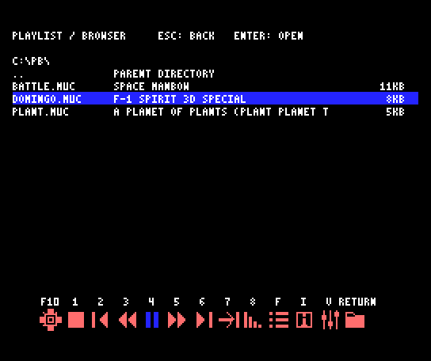<br><sub><code>F</code>로 연 전체 파일 목록. MUC의 제목과 크기를 표시</sub></p>

| 키 | 파일 목록에서의 동작 |
| --- | --- |
| `↑` / `↓` | 선택 항목 이동 |
| `RETURN` / `→` | 선택 파일 열기 또는 폴더 진입 |
| `Backspace` / `←` | 상위 폴더로 이동 |
| `+` 또는 `=` | 다음 페이지 |
| `-` | 이전 페이지 |
| `D` | 사용 가능한 다음 드라이브로 이동 |
| `F` | 전체 파일 목록 열기 또는 닫기 |

파일명은 MSX-DOS에서 사용할 수 있는 8.3 형식으로 준비하세요. 목록에는 파일명, 제목과 파일 크기를 표시합니다. 제목을 읽을 수 없는 파일은 파일명을 기준으로 확인하세요. 긴 제목은 화면 너비에 맞춰 잘릴 수 있습니다. 파일명과 제목의 `~`와 `$`도 표시합니다. 글꼴에 없는 글자(일본어 등)는 `?`로 표시합니다.

크기는 **KB 단위**이며 1KB는 1,024바이트입니다. 남는 바이트가 있으면 올림합니다. 예를 들어 1,025바이트는 `2KB`로 표시합니다. 폴더는 `DIR`로 표시합니다.

폴더를 탐색하는 동안 현재 곡은 계속 재생합니다. 일반 Z80에서는 폴더를 옮기는 동안만 음악을 잠시 멈춥니다([일반 Z80 모드](#일반-z80-모드) 참고). 새 곡을 열면 기존 곡을 먼저 정지한 뒤 새 곡을 준비합니다. 이전 곡이나 다음 곡, 자동 곡 전환은 현재 브라우저 폴더의 재생 가능한 파일을 대상으로 합니다.

한 폴더의 목록은 상위 폴더 항목을 포함해 최대 192개 항목을 보관합니다. 모든 곡이 표시되지 않는 큰 폴더는 앨범이나 하위 폴더로 나눠 사용하세요.

전체 목록, 곡 정보, 믹서에서 `Esc` 또는 `Tab`을 누르면 재생 화면으로 돌아갑니다. 정보와 믹서의 방향키는 그 화면의 기능에 사용됩니다.

## 재생 모드와 속도

### ONCE LOOP RANDOM

| 모드 | 곡이 끝났을 때 |
| --- | --- |
| ONCE | 루프가 있는 곡은 최초 연주 후 루프 구간을 한 번 더 재생하고 다음 곡으로 이동. 루프가 없는 곡은 한 번 재생. 마지막 곡 뒤에는 정지 |
| LOOP | 현재 곡을 반복 재생 |
| RANDOM | 현재 폴더의 다른 곡을 무작위로 선택해 재생 |

ONCE의 추가 연주는 곡의 루프 위치에서 시작합니다. 인트로부터 다시 재생하지 않으며, 보관된 데이터를 사용합니다.

`7`을 누르면 모드 표시와 아래 재생 모드 아이콘이 함께 바뀝니다. LOOP는 이미 준비한 곡 데이터를 사용합니다. 반복할 때마다 MUC를 다시 컴파일하지 않습니다.

### 일시정지와 정지

`4`로 일시정지하면 현재 연주 위치를 유지합니다. 다시 `4`를 누르면 **정상 속도인 1배속으로** 재개합니다. 재생 중에는 아래 4번 버튼이 일시정지 아이콘, 일시정지나 정지 중에는 재생 아이콘으로 표시됩니다.

곡 종료 시점과 일시정지 입력이 겹쳐도 자동 다음 곡·랜덤 선택·루프 재시작은 대기합니다. `4`로 재개하면 대기 중인 곡 종료 처리를 이어가며, 정지하면 이를 취소합니다. 페이드아웃 중 일시정지하면 페이드 진행도 멈추며, 재개하면 남은 페이드를 이어갑니다.

`1`로 정지한 뒤 `4`를 누르면 현재 곡을 처음부터 재생합니다. 현재 곡과 같은 파일을 `RETURN`으로 열어도 보관된 데이터를 사용합니다. 이 경우 MUC를 다시 컴파일하지 않습니다. 다른 곡을 열거나 프로그램을 종료하면 기존 곡 데이터는 해제됩니다.

페이드아웃은 `8`로 시작합니다. 페이드아웃이 끝나면 정지하며, 다음 곡을 자동으로 여는 동작과는 다릅니다.

### 배속

- `3`: 정상 속도 → 0.5배속 → 0.25배속 → 정상 속도.
- `5`: 일반 Z80에서는 정상 속도 → 2배속 → 정상 속도.
- `5`: Panasonic 고속 모드 또는 R800에서는 정상 속도 → 2배속 → 4배속 → 정상 속도.

가속 중 `3`을 누르면 0.5배속, 감속 중 `5`를 누르면 2배속으로 바뀝니다. 기종, 곡과 화면의 부하에 따라 실제 처리 속도가 달라질 수 있습니다.

## 화면과 스킨

### 채널뷰와 스펙트럼

`Tab`으로 두 화면을 전환합니다.

- **채널뷰**: 사용 칩에 맞춘 채널 이름, 건반의 현재 음, 음량, 음표와 지원되는 팬 정보를 표시합니다. SCC 곡은 파형과 게인도 확인할 수 있습니다.
- **스펙트럼**: 주파수별 활동 표시와 채널별 레벨을 보여줍니다. 배치와 색상은 선택한 스킨에 따라 달라집니다.

<table>
<tr>
<td align="center" valign="top" width="50%">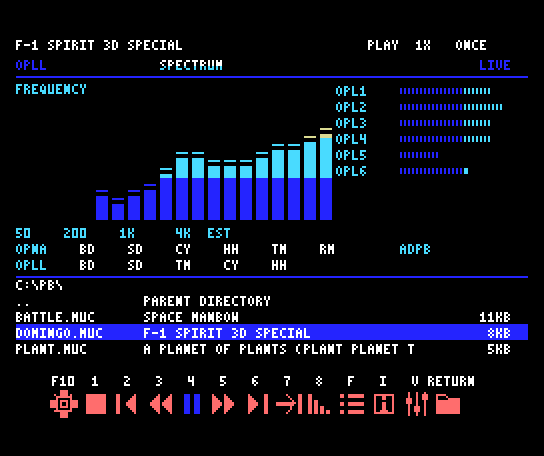<br><sub>스펙트럼: MSX-MUSIC 곡</sub></td>
<td align="center" valign="top" width="50%">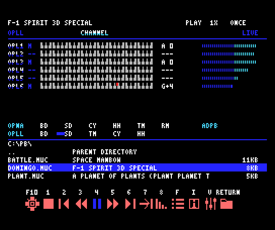<br><sub>MSX-MUSIC 곡의 채널뷰: OPL1~OPL6과 리듬</sub></td>
</tr>
</table>

▶ 영상: [0:00 SCC 스펙트럼과 파형](https://www.youtube.com/watch?v=CJvW9Itukdw) · [0:26 MSX-MUSIC 채널뷰](https://www.youtube.com/watch?v=CJvW9Itukdw&t=26s) · [2:16 OPNA 채널뷰](https://www.youtube.com/watch?v=CJvW9Itukdw&t=136s) · [3:00 OPNA 스펙트럼](https://www.youtube.com/watch?v=CJvW9Itukdw&t=180s)

제목 아래에는 곡이 사용하는 칩을 모두 `OPNA`, `SCC+`, `OPLL`, `PSG` 순서로 표시합니다. 예를 들어 `OPNA/SCC+`, `SCC+/PSG`, `OPNA/OPLL`처럼 나옵니다. 곡 데이터로는 SCC와 SCC+를 구분할 수 없으므로 SCC는 항상 `SCC+`로 표시합니다. 칩 페이지를 바꿔도 이 표시는 같습니다.

음 이름은 MUCOM 표기대로 `+`를 사용합니다. 예를 들어 `C+4`는 C#4입니다. ADP1 행의 음 칸에는 현재 ADPCM 샘플 번호를 `P03`처럼 10진수로 표시합니다. MML의 `@3`에 해당합니다.

MSX PSG와 OPLL 행도 연주 중의 음, 건반과 레벨을 표시합니다. OPLL은 키오프 뒤에도 같은 음과 음량이 유지되면 절반 레벨로 남아 릴리스를 나타냅니다. 쉬는 채널은 레벨 0입니다.

스펙트럼과 레벨은 연주 정보와 칩 상태를 바탕으로 계산한 표시입니다. 실제 오디오를 분석하는 FFT나 녹음 음량계는 아닙니다. 팬 정보가 없는 모노 음원에서는 팬 표시가 움직이지 않을 수 있습니다. RHY 행의 드럼 표시등은 리듬 타격에 맞춰 점멸합니다. OPNA는 6종, OPLL은 5종이며, 일시정지·정지 중에는 꺼집니다. 네이티브 raw PSG에서는 톤과 노이즈가 모두 꺼진 채널의 레벨이 0이며, 노이즈만 발음할 때는 건반 음정을 표시하지 않습니다. OPLL 리듬 모드를 해제하면 7~9번 채널은 즉시 멜로디 표시로 돌아옵니다.

여러 칩을 함께 쓰는 곡은 `Shift+Tab` 또는 `C`로 칩 페이지를 바꿉니다. 채널뷰와 스펙트럼 모두 적용됩니다. OPNA, OPLL, SCC(+)+PSG 페이지 중 곡에서 사용하는 구성을 순환합니다. SCC와 PSG가 함께 있으면 SCC 5채널과 PSG 3채널을 같은 페이지에서 표시합니다. SCC만 쓰면 5채널만 표시합니다. 정보·볼륨·목록 메뉴에서는 이 키로 화면을 전환하지 않습니다. 전환 중에는 음악을 일시정지하고 완료 후 이전 재생·일시정지 상태로 복원합니다. `msPb` 확장 형식이라는 이유만으로 OPLL 채널로 표시하지 않습니다. 곡에서 사용하지 않는 칩은 표시 구성이 달라지거나 해당 페이지가 나타나지 않을 수 있습니다.

새 곡을 불러오면 사용 파트 구성을 기준으로 주 칩 페이지를 자동 선택합니다. 일반 파트는 사용 채널 수를 비교하며 리듬·ADPCM-B와 템포 전용 파트는 제외합니다. 여러 채널을 한 스트림에 담은 raw 곡은 검출된 칩의 채널 수를 기준으로 추정합니다. SCC(+)+PSG가 함께 있으면 하나의 페이지로 계산하며, 동점이면 이 페이지를 우선합니다. 수동으로 바꾼 칩 페이지는 같은 곡을 정지·재개하거나 메뉴에서 돌아올 때 유지됩니다. 새 곡 선택 시 다시 자동 선택하며, 정보·볼륨 메뉴가 열려 있으면 닫은 뒤 표시합니다.

**Tab 전환 중에는 음악을 잠시 일시정지하고 무음으로 처리합니다.** Panasonic 고속 모드에서 `Tab`은 약 0.3초, 칩 페이지 전환은 약 1초 걸립니다. 전환이 끝나면 전환 전의 재생·일시정지 상태, 배속과 페이드 상태를 복원합니다. ADPCM도 현재 위치를 유지하도록 처리합니다. 수동으로 일시정지한 상태에서 화면을 바꿔도 음악을 자동으로 재개하지 않습니다.

### 스킨 선택

1. `F10` 또는 실제 MSX의 `Shift+F5` / `Ctrl+L`로 선택 화면을 엽니다.
2. 방향키로 한 화면의 네 스킨 중 하나를 고릅니다.
3. `[` / `]`로 이전·다음 페이지를 봅니다.
4. 선택 화면의 `Tab`으로 채널뷰와 스펙트럼 카테고리를 바꿉니다.
5. `Space`로 실제 크기 미리보기를 보고, 키를 눌러 선택 화면으로 돌아옵니다.
6. `RETURN`으로 적용하고 저장합니다. `Esc`는 적용하지 않고 돌아옵니다.

채널뷰는 **C01~C40**, 스펙트럼은 **V01~V40**입니다. 카테고리마다 4개씩 10페이지로 배치되어 있으며, 두 화면의 스킨은 따로 선택합니다.

<p align="center">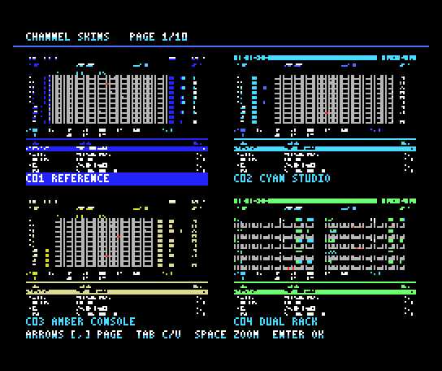<br><sub>채널뷰 스킨 선택 화면(1/10쪽). 선택한 스킨은 아래 이름 칸이 강조됨</sub></p>

▶ 영상: [0:30 채널 스킨 고르기](https://www.youtube.com/watch?v=CJvW9Itukdw&t=30s) · [0:48 스펙트럼 스킨](https://www.youtube.com/watch?v=CJvW9Itukdw&t=48s)

### 플레이어 버튼 스타일

`Ctrl+Tab`을 누를 때마다 다음 순서로 바뀝니다.

```text
SOLID → OUTLINE → BADGE → KEYCAP → CUTOUT → BRACKET → SOLID
```

버튼 스타일을 바꿔도 키 배치와 기능은 같습니다. 재생·일시정지, 모드, 페이드와 배속 등 현재 상태에 따라 아이콘이나 강조색이 바뀝니다.

## 음량과 곡 정보

`V`로 볼륨 믹서를 엽니다. `↑` / `↓`로 그룹을 선택하고 `←` / `→` 또는 `+` / `-`로 조절합니다. **0은 음소거, 15는 최대 음량**입니다.

| 그룹 | 조절 대상 |
| --- | --- |
| MASTER | 전체 음량 |
| OPNA FM | OPNA FM 채널 |
| OPNA SSG | OPNA SSG 채널 |
| ADPCM | OPNA ADPCM 채널 |
| OPNA RHYTHM | OPNA 리듬 |
| MSX PSG | MSX PSG 채널 |
| MSX SCC | SCC/SCC+ 채널 및 SCC로 재생하는 SSG 확장 |
| MSX-MUSIC | OPLL FM 채널과 드럼 |

SCC 음량은 **MSX SCC**에서 조절합니다. OPNA SSG나 MSX PSG와 별도입니다. 곡에서 사용하지 않는 그룹을 조절해도 소리가 달라지지 않습니다.

`I`로 곡 정보를 엽니다. 현재 제목, 파일 경로, 사용 칩과 키보드 도움말을 볼 수 있습니다. 정보·믹서를 닫으려면 `Esc`, `Tab`, 또는 같은 메뉴 키를 다시 누릅니다.

<table>
<tr>
<td align="center" valign="top" width="50%">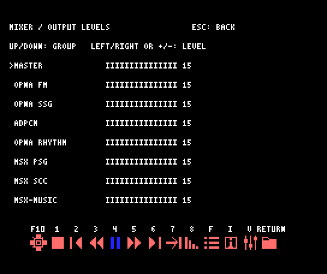<br><sub><code>V</code> 볼륨 믹서</sub></td>
<td align="center" valign="top" width="50%">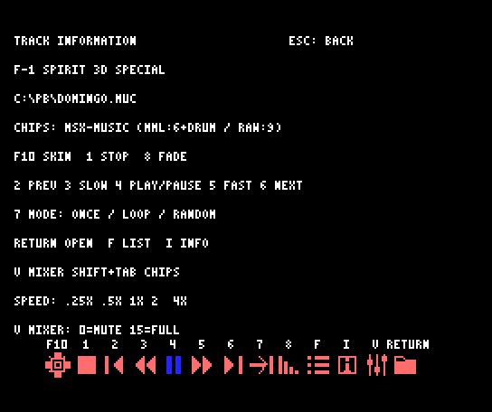<br><sub><code>I</code> 곡 정보: 제목, 경로, 사용 칩, 키 도움말</sub></td>
</tr>
</table>

## 설정 저장

선택한 채널뷰 스킨, 스펙트럼 스킨과 버튼 스타일은 `MUCSCOPE.CFG`에 저장됩니다. 다음 실행에도 복원됩니다. 설정을 저장하려면 플레이어 폴더에 쓰기 권한이 있어야 합니다. 다른 폴더에서 실행해도 설정은 플레이어 폴더에 저장합니다.

음량, 배속과 재생 모드는 현재 실행에 적용됩니다. 다음 실행의 기본 모드는 ONCE이며, LOOP로 시작하려면 `/L0`을 사용합니다.

기본 디자인으로 돌아가려면 프로그램을 종료한 뒤 `MUCSCOPE.CFG`를 다른 이름으로 옮기고 다시 실행합니다.

## MUC 컴파일

### 소스와 음색 PCM 파일

MUC와 소스에서 참조하는 파일을 함께 준비합니다. DOS에서 사용할 파일명은 8.3 형식으로 맞추세요. 예를 들어 `TRACK01.MUC`, `VOICE.DAT`, `PCM.BIN`처럼 이름은 8자, 확장자는 3자 이내로 둡니다.

**MUC 파일명에는 영문자, 숫자, `-`, `_`만 사용하세요.** Mac이나 Windows에서 긴 이름의 파일을 SD에 복사하면 `03PRAC~1.MUC`처럼 `~`가 들어간 짧은 이름이 생깁니다. 이런 이름의 MUC는 목록에 보이지만 컴파일되지 않고, `MUCSCOPE.LOG`에 `Invalid 8.3 name`이 남습니다. 파일 이름을 바꾼 뒤 열어 주세요.

`#voice`와 `#pcm`에 긴 파일명(예: `#voice shinobivoice.dat`)이 적혀 있으면, SD에서는 그 파일이 `SHINOB~1.DAT` 같은 짧은 이름으로만 보이므로 찾지 못합니다. 동반 파일 이름을 8.3 형식으로 바꾸고 MUC의 `#voice`·`#pcm` 줄도 같은 이름으로 고치세요. 이 경우에는 `MUCSCOPE.LOG`가 남지 않을 수 있습니다.

`#voice`와 `#pcm`에 적힌 파일은 **MUC가 있는 폴더**를 기준으로 찾습니다. 컴파일을 시작한 뒤 브라우저에서 다른 폴더로 이동하더라도 해당 소스의 참조 파일은 원래 소스 폴더에서 읽습니다.

```text
ALBUM/
  TRACK01.MUC
  VOICE.DAT
  PCM.BIN
```

소스가 참조하는 파일명을 확인하세요. `#voice VOICE.DAT`는 위 폴더의 `VOICE.DAT`를 사용합니다. PCM을 참조하는 곡은 `#pcm`에 지정된 파일도 함께 둡니다.

`#pcm`에 적힌 파일이 없으면 컴파일을 시작하지 않고 `code 19 PCM file in #pcm tag not found` 오류를 표시합니다. `#pcm` 줄이 없는 곡은 기본 PCM 파일 `MUCOMPCM.BIN`을 찾고, 없으면 `WARNING: MUCOMPCM.BIN NOT FOUND - NO PCM` 경고를 표시한 뒤 ADPCM 파트 없이 연주합니다. 앞 곡의 PCM이 대신 울리지 않습니다.

### 진행 표시

선택한 곡을 열면 이전 곡을 정지하고 컴파일을 시작합니다. 상단에 작업 단계와 진행 바가 나타납니다.

| 단계 | 의미 |
| --- | --- |
| SETUP | 컴파일 준비 |
| READ | 소스 읽기 |
| PREPARE | 음색 읽기와 소스 사전 준비 |
| PARSE | 채널과 음악 명령 처리 |
| LINK | RAM 음악 데이터 연결 및 PCM 준비 |
| READY | 재생 준비 완료 |

진행 바는 현재 작업 위치를 나타냅니다. 전체 완료 백분율이나 남은 시간이 아닙니다. 긴 매크로를 처리하면 같은 위치에서 오래 움직이지 않을 수 있습니다.

<table>
<tr>
<td align="center" valign="top" width="50%">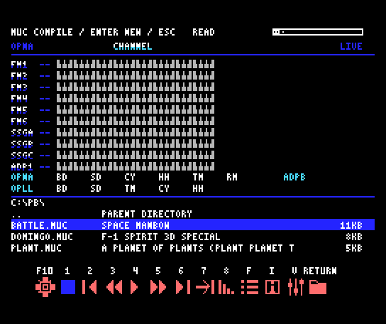<br><sub><code>READ</code> 단계: 소스를 읽는 중</sub></td>
<td align="center" valign="top" width="50%">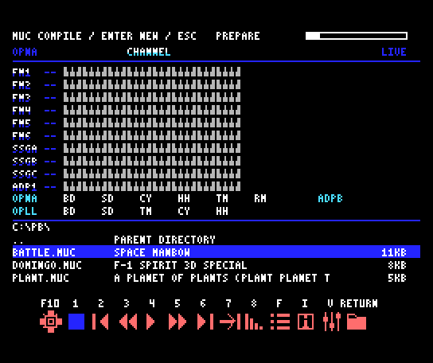<br><sub><code>PREPARE</code> 단계: 음색 읽기와 사전 준비</sub></td>
</tr>
</table>

▶ 영상: [0:10 PARSE](https://www.youtube.com/watch?v=CJvW9Itukdw&t=10s) · [4:40 PREPARE](https://www.youtube.com/watch?v=CJvW9Itukdw&t=280s) · [5:40 LINK](https://www.youtube.com/watch?v=CJvW9Itukdw&t=340s)

### 컴파일 중 탐색과 곡 변경

컴파일 중에도 방향키, 페이지 이동과 폴더 탐색을 사용할 수 있습니다. 다른 곡을 선택해 `RETURN`을 누르면 진행 중인 컴파일을 취소하고 새 곡을 컴파일합니다. 빠르게 여러 곡을 열면 마지막 선택을 사용합니다. `2`와 `6`으로 이전·다음 곡을 선택할 수도 있습니다.

`F`, `I`, `V` 메뉴도 사용할 수 있습니다. 정보나 믹서가 열린 동안에는 그 메뉴의 내용을 표시하며, 컴파일은 계속 진행합니다.

컴파일을 취소하려면 **`1` 또는 `Space`**를 누릅니다. 일반 재생 화면이나 일반 Z80의 브라우저 화면에서 컴파일 중이라면 `Esc`로도 취소합니다. 정보·목록·믹서 같은 메뉴가 열려 있다면 `Esc`는 먼저 메뉴를 닫습니다.

PCM 준비 중에도 파일 탐색, 정보·믹서 메뉴, 취소와 곡 변경을 사용할 수 있습니다. 입력은 PCM 전송 블록 사이에서 처리하며, 다른 곡을 선택하면 남은 전송을 중단하고 새 곡을 준비합니다. 한 번의 파일 읽기나 전송 블록이 끝날 때까지는 잠깐 기다릴 수 있습니다. 준비가 끝나면 재생을 시작하고 진행 표시를 닫습니다.

### RAM 직접 재생과 오류 로그

컴파일 결과의 음악 데이터는 RAM 매퍼 뱅크를 재생 엔진에 직접 넘깁니다. 임시 MUB를 SD에 저장하거나 다시 읽지 않으며, 음악 데이터를 별도 버퍼로 복사하지 않습니다. 컴파일에 쓰던 소스·작업용 메모리는 해제하고, 재생에 필요한 음악 데이터만 유지합니다. `#pcm`을 사용하는 곡은 원본 PCM 파일에서 음원 데이터를 한 번 읽어 OPNA에 올립니다.

성공한 컴파일은 소스 폴더에 파일을 쓰지 않습니다. 컴파일 실패 시 쓰기가 가능한 경우에만 소스 폴더에 `MUCSCOPE.LOG`를 남깁니다. 이전 로그가 남아 있을 수 있으므로 현재 화면의 오류와 함께 확인하세요.

다른 프로그램이 만든 `MSCACHE*.MUB`, `M2MTEMP.$$$`, `M2MBACK.$$$`는 사용하거나 삭제하지 않습니다.

컴파일 오류가 나도 다른 곡을 선택해 계속 사용할 수 있습니다. 문법과 소스 한도는 MUCScope에 포함된 MUCOMSX 컴파일러를 따릅니다.


## 문제 해결

### 실행 직후 모듈 또는 스킨 오류가 난다

필수 COM/BIN 파일, `MUCSCPU.BIN`과 전체 `SKINS` 폴더가 같은 플레이어 폴더에 있는지 확인합니다. 서로 다른 배포본의 모듈을 섞지 마세요. 다른 폴더에서 실행했다면 플레이어 폴더가 `PATH`에 들어 있는지 확인하세요. `SKINS/0`부터 `SKINS/8`, 버튼 자원 `SKINS/TB0.BIN`부터 `SKINS/TB5.BIN`도 함께 복사합니다.

### 메모리 부족 오류가 난다

RAM 매퍼를 사용할 수 있는 MSX-DOS2 또는 Nextor인지 확인합니다. 불필요한 상주 프로그램을 종료하고 더 작은 곡으로 확인하세요. 특히 MUC 컴파일이나 큰 곡은 여유 RAM이 많이 필요합니다. 512KB 이상의 RAM 매퍼 구성을 권장합니다.

### 파일 목록에 곡이 없다

현재 드라이브와 폴더, 파일의 `.MUC` 확장자를 확인합니다. MUB 파일은 MUCScope 목록에서 숨깁니다. 한 폴더에 항목이 너무 많으면 하위 폴더로 나눕니다.

### 화면은 움직이는데 소리가 나지 않는다

`4`가 재생 상태인지, 믹서의 MASTER와 해당 음원 그룹이 0인지 확인합니다. 곡이 요구하는 OPNA, MSX-MUSIC, SCC/SCC+ 장치가 연결되어 있는지도 확인하세요. SCC/SCC+ 사용 방식이 충돌하는 곡은 로드할 수 없습니다.

### F10이나 Ctrl+Tab이 작동하지 않는다

일반 Z80(또는 `/N` 실행)에서는 `F10`, `F`, `V`, `Tab`, `Ctrl+Tab`을 사용할 수 없습니다. [일반 Z80 모드](#일반-z80-모드)를 참고하세요. 실제 MSX의 스킨 선택은 `Shift+F5` 또는 `Ctrl+L`을 사용합니다. openMSX에서는 시작할 때 동봉된 `openmsx-designs.tcl`을 불러오거나, 해당 키 연결이 포함된 앨범 실행 스크립트를 사용합니다. PC 운영체제가 조합 키를 먼저 사용하는지도 확인하세요.

### 화면 전환 때 소리가 잠깐 멈춘다

`Tab`과 칩 페이지 전환은 화면을 바꾸는 동안 일시정지한 뒤 기존 상태로 복원합니다. 전환 후에도 재생되지 않으면 수동 일시정지 상태인지 확인하고 `4`를 누릅니다. 전환 시간은 기종, 저장장치와 스킨에 따라 달라집니다.

### 스킨이나 버튼 설정이 다음 실행에 남지 않는다

플레이어 폴더에 쓰기 권한이 있는지, `MUCSCOPE.CFG`를 저장할 수 있는지 확인합니다. 스킨은 미리보기만 하지 말고 `RETURN`으로 적용하세요.

### 컴파일이 실패한다

화면의 오류 코드와 행 번호, `MUCSCOPE.LOG`를 확인합니다. `#voice`와 `#pcm` 파일명, 소스 폴더의 참조 파일, 쓰기 권한과 저장장치 여유 공간을 확인하세요. 오류를 수정한 뒤 다시 선택하거나 다른 곡을 열 수 있습니다.

- `Invalid 8.3 name`: MUC 파일명에 `~` 같은 기호가 들어 있습니다. 영문자, 숫자, `-`, `_`만 쓰는 이름으로 바꾸세요.
- "MUC COMPILE FAILED"인데 로그가 없음: `#voice`·`#pcm`이 가리키는 동반 파일을 찾지 못했을 수 있습니다. 동반 파일 이름이 8.3 형식이고 MUC의 지정과 같은지 확인하세요.
- `code 11 Voice name not found`: 음색 파일에서 지정한 음색 이름을 찾지 못했습니다. 음색 파일이 소스와 같은 폴더에 맞는 이름으로 있는지 확인하세요.
- `code 19 PCM file in #pcm tag not found`: `#pcm`에 적힌 PCM 파일이 MUC와 같은 폴더에 없습니다. 파일 이름(8.3 형식)과 위치를 확인하세요.
- `PCM LOAD FAILED - CHECK THE PCM FILE AND FREE RAM`: 컴파일은 끝났지만 PCM을 읽거나 OPNA에 올리지 못했습니다. PCM 파일이 손상되지 않았는지, 여유 RAM이 충분한지 확인하세요.

### MUC를 수정했는데 이전 내용이 재생된다

정지 후 `4`를 누르거나 현재 곡을 다시 열면 보관된 컴파일 결과를 재생합니다. 수정한 소스를 다시 컴파일하려면 다른 곡을 연 뒤 수정한 곡으로 돌아오거나, MUCScope를 종료하고 다시 실행합니다.

### 곡이 느리게 재생되거나 연주 중 표시가 늦어짐

일반 Z80에서는 화면을 파일 브라우저로 줄여 연주에 CPU를 최대한 쓰지만, 일부 곡은 명령 처리량이 CPU 성능을 넘어서 연주 속도가 느려질 수 있습니다. 지원 Panasonic 고속 모드나 Turbo-R의 R800 자동 가속을 사용하고, `/N`으로 실행했다면 옵션 없이 다시 실행해 보세요. 화면 표시가 정상이라는 것만으로 원래 속도로 연주된다는 뜻은 아닙니다.

고속 CPU에서도 큰 곡은 시작 직후 잠깐 밀렸다가 곧 정상 속도로 돌아올 수 있습니다.

### 컴파일한 곡의 FM 음색 수가 너무 많음

재생 로더는 컴파일 결과의 FM 음색 테이블을 최대 32개까지 지원합니다. muPb/msPb 결과가 이 상한을 넘으면 로드 오류로 처리합니다. 소스 파일이 작더라도 사용 음색 수에 따라 재생할 수 없는 곡이 있습니다.

### 소스 크기와 드라이버 모드

컴파일할 수 있는 MUC 소스의 최대 크기는 65,536바이트입니다. 65,537바이트 이상은 컴파일 오류로 처리합니다. 포함 파일과 매크로 처리에는 추가 메모리가 필요할 수 있습니다.

`#driver` 태그가 없는 레거시 소스는 레거시 기본 모드로 컴파일합니다. 다른 프로그램이 같은 소스를 mucomDotNET 기본 모드로 컴파일하면 연주 결과가 달라질 수 있습니다. 소스가 작성된 드라이버에 맞는 태그를 사용하세요.

## SCC 5채널 악보

`msPb 0102` 형식의 SCC 전용 5채널(SCCA–SCCE)을 지원합니다. PSG·OPLL·OPNA와 함께 사용하는 곡도 각 칩 페이지에서 확인할 수 있습니다. 일반 SCC에서는 4·5번 채널이 파형을 공유하며, SCC+에서는 다섯 파형이 독립적입니다.

SCC 음색은 `#sccvoice SCCVOICE.DAT`로 지정하거나, MUC 안에 `@W번호 : { 32개의 -128…127 정수 }`로 정의할 수 있습니다. 음색 번호는 `@번호`로 선택합니다. 외부 음색 파일은 MUC와 같은 폴더에 두세요. 인라인 정의만 사용하는 곡에는 기본 SCCVOICE.DAT가 없어도 되지만, `#sccvoice`로 명시한 파일은 있어야 합니다. 전용 SCC 파트와 `#SSGExtend` 방식은 한 곡에서 함께 사용할 수 없습니다.

## 네이티브 MSX 악보

PN1–PN6 형식의 MSX 악보와 OPNA가 함께 들어 있는 MUB를 지원합니다. 사용된 PSG·SCC/SCC+·OPLL 경로에 맞춰 채널 페이지를 표시합니다. 칩 페이지를 바꾸어도 OPNA·OPLL 리듬과 ADPCM-B 모니터는 공통으로 유지됩니다.

최신 MSX MML의 공통 프레이즈(PSGS·SCCS·OPLS), 기능 명령과 SCC 파형 팔레트를 컴파일합니다. 외부 `#sccvoice` 파일은 MUC와 함께 두세요. 컴파일 결과는 메모리에서 직접 재생합니다. 생성되는 음악 데이터의 상한은 96KiB이며 소스 파일의 상한은 65,536바이트입니다.

네이티브 MSX 악보는 채널마다 반복을 따로 셉니다. 살아 있는 모든 채널이 한 번 이상 반복했을 때를 한 바퀴로 보므로, 반복 구간이 가장 긴 채널이 곡의 한 바퀴가 됩니다. 반복하지 않고 연주 중인 채널이 있으면 그 채널이 끝날 때까지 기다립니다. ONCE에서는 처음 연주 후 이 한 바퀴를 한 번 더 연주합니다. 악보 안의 유한 반복문이나 프레이즈 호출은 곡 전체 루프 횟수에 포함하지 않습니다. 재생을 정지한 뒤 현재 곡을 다시 재생하면 루프 횟수도 처음부터 시작합니다.

## 압축 MSX 문법 호환

`|` 구분선, 최대 두 겹의 `[ ... ]n` 반복과 `L` 루프를 사용하는 압축 MSX 악보를 컴파일하여 바로 재생합니다. OPLL 음색·드럼 설정과 쉼표, SCC 파형 모핑을 지원합니다. `L`로 지정한 곡 루프도 ONCE에서는 한 번 더 연주한 뒤 다음 곡으로 넘어갑니다.
