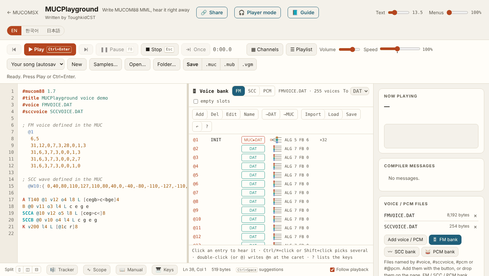
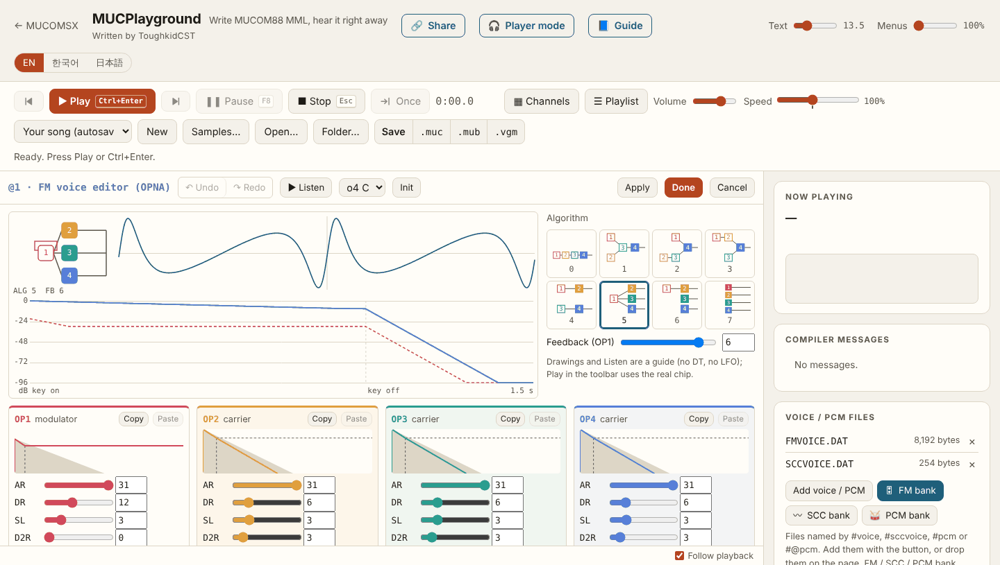
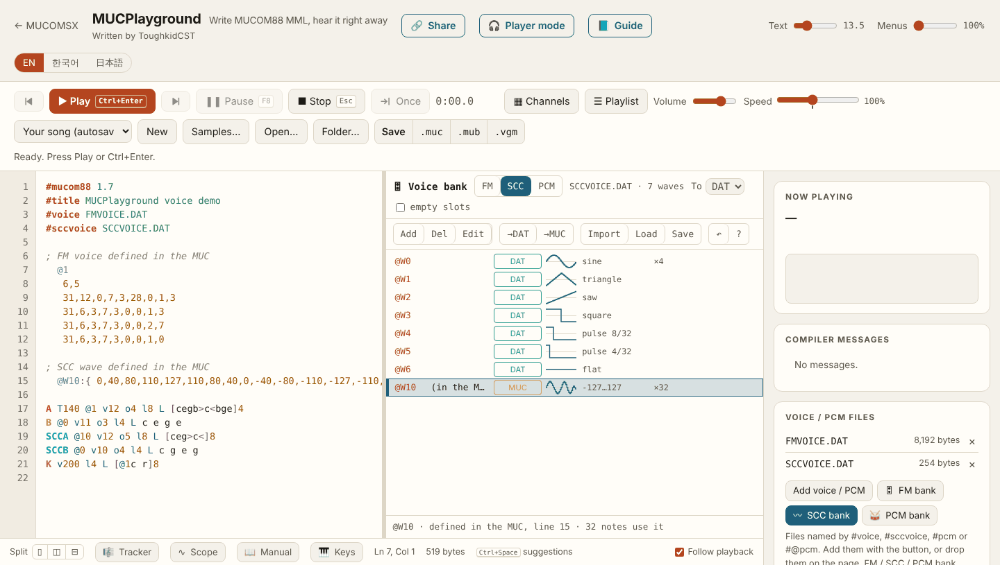
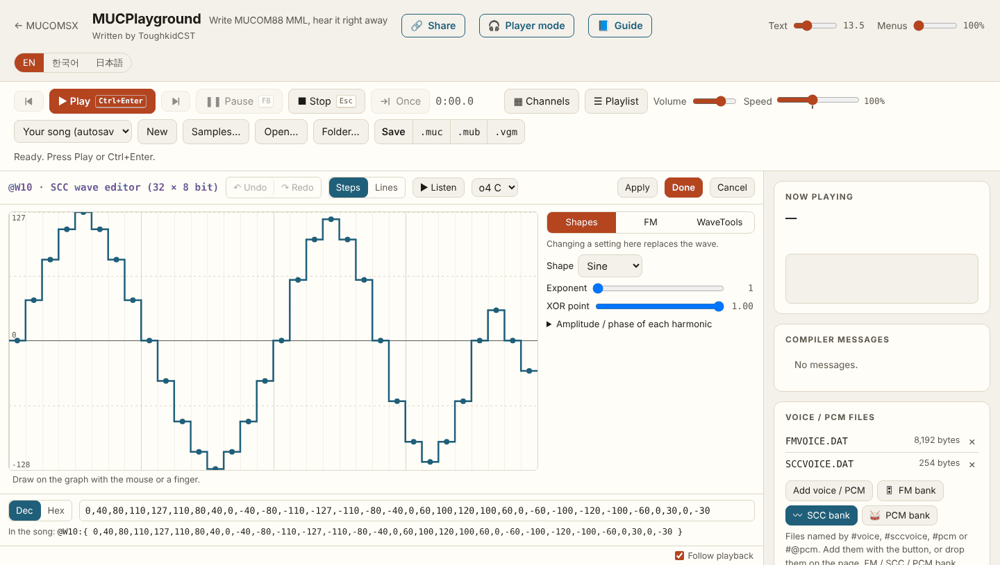
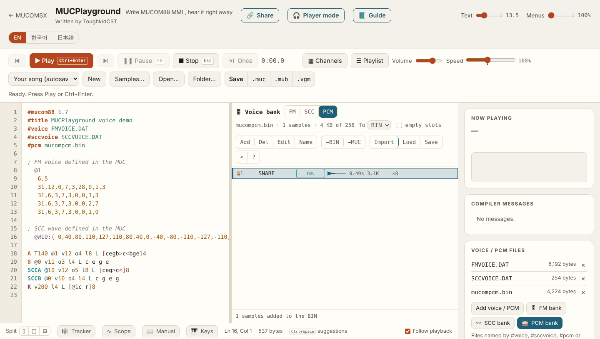
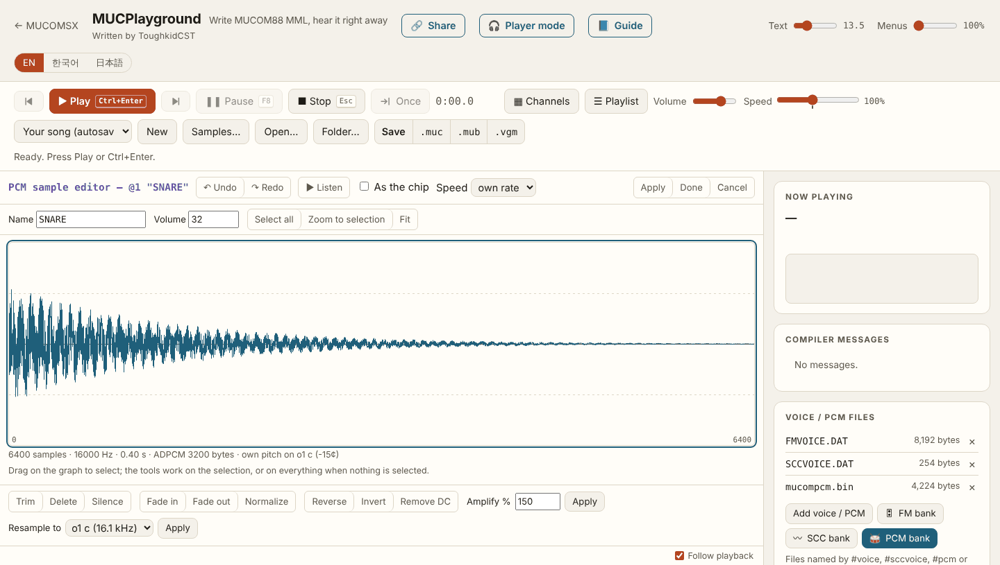

# Editing FM voices, SCC waves and PCM with MUCPlayground

[한국어](MUCPLAYGROUND.md) · [日本語](MUCPLAYGROUND.ja.md)

The MucoMSX toolchain is made of four tools that run on the MSX (MUCEDIT, MUCPLAY, MUC2MUB and MUBPLAY) and **MUCPlayground**, which runs in a web browser on a PC or tablet. MUCVOICE, the MSX voice editor of earlier releases, has been removed in this version. FM voices, SCC waves and ADPCM PCM are all edited in MUCPlayground. Nothing needs to be installed.

| | Address |
|---|---|
| MUCPlayground | https://toughkiddev.github.io/MUCOMSX/MUCPlayground/ |
| MUCPlayground user's guide (official) | https://toughkiddev.github.io/MUCOMSX/MUCPlayground/Manual/?lang=en |
| Open this page's example | [Open the example (with the starter FM and SCC banks and a PCM bank)](https://toughkiddev.github.io/MUCOMSX/MUCPlayground/#s=z7Vvfd6s4kv5XfDKPSXdwAjbp_XFaEjIIQbAAx4G-_YAdRwiBBca-YM-Z_32U3O2-Pb07Z3ee9sXKIYCqSp8kSlWfOPivN19vfpre3exvfrpxcBj9GK7Qzd3NUd_-pTltVWPbk-mP8y_7vxzFsd5NtHhZF2d-UKf92-SrEtvd5G3XKK3w7WYRvkQE4R8dkOq6frv9Vp0g9Mf6dttMPpvXFz9uxP6L_vs3bft7i-9iv3ubiP3kWH6CftlPJj9PP_5PZnfW5_lxejd9uDPu5nePdw-2vpjePf4mmOm6j3rjn1c_3M3_Z23jW2d0jydD8fWfdmY9NX7668S4M407W5tN9fEw_zzbn5XG3Q_6_w_65oePyh8-pN-u7G8i426mbYwPu2_n2afR7EPX-DT47epT8PgpfTQmf_voH5ikU9PQUzL5On2YKHNS25Ng8st2xzf_uf33Dd_9an7Zw8nPhpZPJ-pxUptavp3sJnyy-7LXgwPa2PhmbX231sa_2p_y_zI2Phv_Zsw_zL_s6eTrg2F8q_zl5-l2cvgw0V7zfvPTL7_e3bzp0y83f3AELQIAQ8AW9--PT_feaL97A_i9OIO9dIbt9wqmdeNS62o9rQv5bwJIPnShUUfJC-NEV3zofrT5Pn7qfm8DfLRpe9_v_0X816ff8f_Q6PIT_7vtFf-Kf8W_4l_xr_hX_Cv-Ff-Kf8W_4l_xr_hX_Cv-Ff-Kf8W_4l_xr_hX_Cv-Ff-Kf8W_4l_xr_hX_Cv-Ff-Kf8W_4l_xr_hX_Cv-Ff__H_8_bn69--Xmjx8s6-9XV8bzawww0NjiQykxtv39RxtQjvG07d5ep_fvry_dWm5Hlzn7y7xpanVyeBYFdVdYl9stBAQxFTjAiJxB95yHGLLMg_dbFzLmAI51T8xnB_QUMcARED7KFBXDKXSI8Vzx2dIxAeDMRUCFTgmSBcwytxx2IASfc_Dnw0SAkz8fehDed53_Lv_HAzL4f9L7PEAG_oXybZ7_-BX45zxbcCVXf-ryP5TPr4HfwQCu5Vqu5Vqu5X8py7f76DWw1vFQHrMBBcTlJEDO11cerAPAPdSco9AZIyvMBhjNAjMrRBIVaUmVvNgcxcofLckEBNTIWIaW0VYsOqcr6VDkHkJql5MdQEciapHTWJ4W5BgkVOz7satRLkjU1RZaORxYJwdH1F-Wyhks1yxbGrkZJKh0z6dqh86Od-4WPe4YsJOqIq48uyoXLygEiSJ91yS7Epw4YSFnaBbte9z6QexO-7GxnsNlOiSANCGthbUjvBCkbd2xgYVyLQbUYGcyDpceILeEkiD0Q_AwlLFpys16Kmj4TIhInaQr62HIJEmZW-nEWkSGi2ZIFGJ_1GMzmMw8R4DEd2fHFQ2KyyA-pISsS3cT8SqBOntf_GxztETlmsszLWhQzuqco6F0kDpkQdl6TgNwSB9k1sT9Qh3CZ8kHsnrjA-rSRLGGFUzNw9LmA6TGfjEglZPh1ulztECwEdFtbXEgzqhR-mcw4zYig9NhI5OJN8o5L7s1oihVC3e-XkkizRlE5-BFcOSocKdKSoHM9iNoZVAUMOgWfIu3fMbTiq_pMqY0idG59nlymyJeq_2iYYH-7Q1SiITviGPyWrqZxEKgN3BIWg858aKtA5y1lNZ7lpg4HbhZKp9FLuwB5s0SF_grHZeQcwM1U0WLGI08NlDHwkUf0pcOonSqGkGhw0TmNgicnLTgwnCCUpwlrvgSigy_NKJvdxeZBxAxtG-ChJMtMKuUknVmx8dDdEEXY46kKg-18EFBi_U4HNYDchpPAMcZ2podA9KajM9cMoVDy4XdupdhpQqOqhKg_dgwmCGrAAPDtNkj0jl46QKcc1K5vQXy1yxRWK8ZSXrzaLVIlA8lQjNYtirtaNsnF6WdDZPniF7UpiilBd7KghRHpWCbocroJFhzV4Aj8U_dTjRjkVSiV9GBBIthj-WmLGRVYe63Ba0GeHoJHB4UWf-05oDwuHduQRnyGOcHFW4T7oC1iQ8cBSt3h9Wggpg8E9CGHClSzvQ6xj3U6_GsoHAenGOHBjAsy64icA8aXD-XvnQObCkCiDvB6KNhNoLEt2Sdk6LNlYWUfuJDxEXZefyZMnfEB-2vtprvHIls7V_tcAbhG1cNBKgjekRgWHlZ6jjOGYKcvoGnJNB-G_O4yAJWM7EpuVRi4NAErDX4aaHmemxcvIO0Gwqhme9sN5ATOABaaMsU8LSf1wX3Hbgb-CEclqNCUXoLOifIfD86n_KZ6zGATnAZ95UJBdCjZCkn75pAa2LabBk0DivfpXUuhWvYBX6iqAKRtc5dgowlPOc77dnSXp5VJoXpdM4etbmH-9kyIx2q6qxTO5qMAeNQ-AkaujTWa_AFDV7SEI-UBSNjCJgabyEO8djHt0jO8b2b4M6IAarMxBg6gETrMuKaTPlFS2AzHTrts5GbuqNT6jW4kYctrF7EmVYNat5Jjl6GtonxG-QK9CW16hkvjvFp2F16YUDu66jU7qreL30P4exI5FG9gjDym1dEcXG0EKVjkSmTI4OAZ-6vk_Oij0Wb1MeQMn5IHVQNGG3X4gRC-xhXpYsa0j3KPoob1qdGIp9QKu8lcgB9GOYhcM7Id6vjG63c83nRVHr8DDCCnDGIKW-zE2XKJDpWWAf3DCIqzSDgK_p1zRQJj8gvhxMSOspLMm4wcjh3-k6q0NZ9ej0TF0Y5WXpI5LCsSsk658gHs7fqHAP1FTBpBfhIZZ9Ak7VAwt45IPzOuchfiY5JlRGjqk8GfMswc15UR0OKB1KDNkiSXueD_tUwlc4mR1MhdwbkwUrkYJ5eetg44J2Xfb8i3UoBvfbz7T3OA4SG9dllxw2GBqwL_cvJJYYdFSgZW7P33Rd1jGgIunNwEcC2XJ_EtuIUPSLmITc1ubIlXIMOlM9c5wdFlOtgtSk3fE5uI6C2RJkzkLWgGqhaj8AUh51u3EFGrBLtUV1kJfEDdNVOhb5hRwNaodh0ejW4oiiV0LFW2SzQrSV73vI-Ey86Jyf9GxiPQQ3QEzhim7YuKS2R6Ugh9sHuTEe1yQIeA-vWqTMUrFteNz4ERqYOBfOw6BIamTWsiM5GzYenpFgQD_YYW_YMqTDdn92hnNOkaRoO_LXPO-YHZ9V2i646wxQPRQJAINvefE9A4Sz6DsyoFUpHdgLvkgL3uI9oyqIC3_KWmqEdBs1TIiQrN9NM6RVv64jTUDArZylwXxoeKfHa6CRdDUAziuLA8uM2upwAKT4yB4lAhzMRm_M6bjZR1Ty44SpYwiCWLNqyoIQGWHIdFizsH98iFSmZ06J_BbsoSIh8446XJQHP5GufiJZCuTdjzY8uivO3aIM85UfFOhYqzZJYbo4FIDhKRBfr3ITFxZiRmQwDnJxde5fJoZF9HuYG8Dsvo2xZfTzvSK0D5O9Yk7SZXkuaDZw8oedc9TRcD9iuydEHpjtHpl7PxhjWPiKN7g3fHPuodEtkzLTHRu0iXwpFkouA1YW_gTbREVF7zMW5dOjk9ooro-x0pToPuo1lCd6SCwcmk_HgnF5UERZ1LmondmUPW4szCZq8SI1WxsgqmecnsT1zTQ52xboUiUfA_OQpq1u0lCteDJ4YeULb11SPUR1noOAsqmzuZDQeC52X_USofATisA1BLHXUOr2qGQFOhQ47n6uWqbwlXirhMDjPehZXGo3SYP0cVWbLUedUsci40_YLWoduUlKy1E-WBKVMDR0rpV6TXAmztPU7krJ3bJ11EXsAyG3MkPV8upELvaAVv3UJzvtVM0bt0pOg1EwzEntQ-gKuSTW6lzGAYTQ0CG22eY9UVgRF3ADx2DDc1lswQwaOCNDMSvNScO8KpCDpD1z1ntGvL33vJp5TB0r7pPh4oTMvc9cXlVzJmTe6oDPAdk34V0DcrHeaDah7zaXxUpr0bGsepxS6tD5-R7UQFJx9kFq5ywMCiEy1xz6iTc_LWTA2el57VMQe6F8c5kIv43E741huda7xAVysTtnRRLlb7s4BabzGXyIXPBDsS_M4x4TGnqE2-EBskNpWVy6C3jvqp6ujE6N-ynmCihQiESSGJZ80j2BHJTIJ5W4NekKeAqdB-BkELLHjHpI3zCuk_J3fS2MmS4M3SeWKpHto8iSnsMl3oT4zzXBXJj_6KBmUnmnQx2zrTkEwZAlfarayzoTUq6s0yjMhPdkmSrwIE-hnwECPLB100bCj1I82hej8yK_9BTSeQdyf-YbeR2FiOOiMB97kRPdSPrrnxk-JbIxBhLRCXj-XylsEokldhkL0AMBwWGbAD4tXhTf85QRw61G0l0TN4DzK1mLIU5BkfDgFUV3n7oaW00GYmvxlRYaIZtHnSNkb10lNzM5rRbglFlXaQzfYEUw5M_V-Jkndi01QBTWn6vU7Qpl1KzvjRYB5gaA0D9Yq1BzYxi3tsVUoxPhrP4d-t1e8o4XonRNbzDmULc5vcVM3RLOufLEx0jMpoAyjOLg0JVbqlKI2iHxpubPVW7IBF1sJPbkCUBr2NfjqNungNAT5kaHCcvDOAnLCD0JOKdmsrYJLcYI0tgezc1FvuuoBRs812GNBaTztNLvvssDNma_fWTZoC7rFHEOao67o1tR9AQEPfcrvAdExe6-yfuZTFEZV5evdRabD80EW4WLAphIIUFUwzS6k2ue7UnMNPXq9yelJq461rxnwXtlU8CXJm4xnYavD4SHrxoI7jlDzRKE4WAgeII1WAKfPzuw56yxoSj_MTyrSrBX6B9E4-AkcAv3iMNBjbXR84iGQ6rng9FKhYw42rc9vOW8uyVuUDBk94ENtKk1wk8JFOv8Jmo1BERA9e2hs6I7qmMR3BA0UCu7q8Q2jXIZk7xy1JceVg1ATN_sTLPOP1R-QRAxgnTWrXvs3rZQp32RLHwXT1uaOoYy8Y8IV2uziY4gQf1pC0Kk5u3d9_IQBit1Nu5F5hMZNnSMF8hQFyM2GHs9OLi_0_lrx-CQU0ntBK10p6J4NRgfN9PIl03tPfwxS1AAPK0eQQbPzUFVCxUefJigb_HWJGPzIQSXvBoWdU9lkyQBSg7nx6TJ2YIMdUwEaWcrxyNpkel8vYs_xeOTrR8KNlrZRpVlXvAfYj54TzTbBNhJ9x1tBJBr1Xkg8Kt4UkKEiYWMBcsJ0Bqd83MMUckdvkxHtkI6OIsC0yDDFYQgMoKnTqmmxT6jONs7Nr7_-7e8) |

This page follows the chapter [Voice, wave and PCM banks and editors](https://toughkiddev.github.io/MUCOMSX/MUCPlayground/Manual/?lang=en#banks) of the official user's guide, arranged in the order you work with the MSX toolchain. For each button, key and part of the screen, the official user's guide is the reference.

## 1. What it does in the toolchain

| You want to | Use | Result |
|---|---|---|
| Make or change FM voices | MUCPlayground **FM bank** and **FM voice editor** | A voice file in `VOICE.DAT` form (`#voice`) or voice definitions in the MUC |
| Make or change SCC/SCC+ waves | MUCPlayground **SCC bank** and **SCC wave editor** | `SCCVOICE.DAT` (SCWD v1, `#sccvoice`) or `@Wn:{…}` definitions in the MUC |
| Add and shape ADPCM samples | MUCPlayground **PCM bank** and **PCM sample editor** | A PCM bank file (`#pcm`, default name `mucompcm.bin`) |
| Edit MML | MSX: MUCEDIT / PC: the MUCPlayground editor | `.MUC` |
| Compile and make a MUB | MSX: MUCPLAY, MUC2MUB | `.MUB` |
| Listen to a finished song | MSX: MUBPLAY | |

MUCPlayground's compiler, driver and chip emulation are MDPlayer4Mac's, built for the browser. It reads songs by the same rules as MucoMSX and plays FM, SSG, rhythm, ADPCM and the MSX-MUSIC, PSG and SCC parts. The final check of a song meant for the MSX is still MUC2MUB or MUCPLAY on the MSX, which has its own conditions: 65,536 bytes of MUC input, 60,000 bytes in MUCEDIT, 98,304 bytes of music DATA, a 512KiB mapper and DOS 8.3 filenames.

## 2. Getting ready

- **Browser:** Chrome or Edge is recommended (they remember a folder opened with **Folder…**). Safari and Firefox work too. An internet connection is needed.
- **Starter data in the toolchain ZIP:**
  - `FMVOICE.DAT` — an FM voice file with one `INIT` voice and empty slots (an empty slot is a silent voice with every TL at 127). **Load** it as the starting point of your own voice bank.
  - `SCCVOICE.DAT` — an SCWD v1 file with sine, triangle, saw, square, pulse 8/32, pulse 4/32 and flat waves in `@W0`–`@W6`.
  - `INIT.TFI` — one FM voice in TFI form. MUCPlayground does not read TFI; use it with another editor that does.
- **Opening a song together with its files** (official guide: [Opening and saving files](https://toughkiddev.github.io/MUCOMSX/MUCPlayground/Manual/?lang=en#files)):
  - **Open…** — pick the `.muc` together with its `.dat`, `.bin` and `.wav` files; they are attached before the song opens.
  - **Folder…** — open the working folder on your PC and pick a song; every file named by `#voice`, `#sccvoice` and `#pcm` is found by name, whatever its case, and attached.
  - You can also drop files on the page or attach them with **Add voice / PCM**.
  - When a file the song names is not attached, Compiler messages show warning **PG03** with **Attach file…** and **Find in folder** buttons.
- **Autosave:** the song and its attached files are kept in the browser (IndexedDB). This is not a backup. Always download the files you take to the MSX with **Save**.

## 3. The round trip with the MSX

1. Copy the MUC and its voice/PCM files from the MSX working folder to the PC (SD card, emulator disk and so on). For a new song you can start from `FMVOICE.DAT` and `SCCVOICE.DAT` from the toolchain ZIP.
2. Open the song in MUCPlayground with **Folder…** or **Open…**.
3. Open the banks with **🎛 FM bank**, **〰 SCC bank** and **🥁 PCM bank** in the *Voice / PCM files* card and edit (chapters 4–6). Listen right away with **Play** (`Ctrl+Enter`). **▶ Listen** inside an editor is an approximate sound for guidance; **Play** in the toolbar plays the chip emulation.
4. Download the files with the bank's **Save**. A file you loaded keeps its name; a new file is saved as `VOICE.DAT`, `SCCVOICE.DAT` or `mucompcm.bin`. Download the MUC with **.muc** in the **Save** row at the top (`Ctrl+S`), in Shift_JIS like MUCOM88.
5. Give the files DOS 8.3 names (for example `MYVOICE.DAT`, `DRUMS.BIN`) and check that they match the MUC's `#voice`, `#sccvoice` and `#pcm` lines. The MSX ignores case.
6. Copy the MUC and its files into one working folder on the MSX.
7. On the MSX, check the song with `MUCPLAY SONG.MUC` (or F1→2 compile and F1→3 play in MUCEDIT), make the MUB with `MUC2MUB SONG.MUC`, and listen with `MUBPLAY SONG.MUB`. For a MUB without embedded PCM, MUBPLAY reads the `#pcm` file from the MUB's folder, so keep the BIN file there too.

## 4. FM voices

### 4.1 FM bank

**🎛 FM bank** opens the song's FM voices to the right of the editor. The voices of the voice file (`#voice`, or `voice.dat` without a tag) and the voices defined in the MUC (`  @n`, `  @%n`) are listed together, marked `DAT`, `MUC` and `MUC▸DAT`. `MUC▸DAT` means the number is in both, and the MUC's wins, as in the compiler. Each line shows the name, algorithm, feedback and how many notes use it. Click an entry to hear it, double-click to write `@n` at the caret.

| Button | Key | What it does |
|---|---|---|
| Add | `Insert` `N` | Adds Furnace's default voice at a free number |
| Del | `Delete` | Deletes a voice (asks first if notes use it) |
| Edit | `Enter` `E` | Opens the FM voice editor |
| Name | `F2` `R` | Names a file voice (6 characters) |
| →DAT / →MUC | `D` / `M` | Moves an MUC voice into the file under the same number / copies a file voice into the MUC |
| Import | `I` | Takes the voices the bank does not have yet from `.dat`, `.muc`, `.mub`, `.vgm`/`.vgz` files |
| Load / Save | `L` / `S` | Picks the `.dat` file for this song / downloads the voice file |
| ↶ | `U` `Ctrl+Z` | Undoes a change to the file |

Pick several with `Ctrl`/`⌘`+click or `Shift`+click to delete or move them at once. `F6` switches between the text and the bank, and `?` lists the keys.

**To (DAT/MUC)** sets where added and imported voices go.

- **DAT** — when several songs share a voice file. The first voice added to a song without a voice file creates a new `VOICE.DAT` and a `#voice` tag.
- **MUC** — when the song should stand on its own. No voice file has to go to the MSX.

From a VGM, the voice of every key-on is taken (YM2203, YM2608, YM2610, YM2612; YM2151 converted without DT2 and LFO). Importing a voice from someone else's song or a game does not give you the right to redistribute it.

### 4.2 FM voice editor

Open it with **Edit** in the FM bank, or with **✎ Edit** on the preview that appears when the caret is on an inline voice in the MUC. The screen is modelled on Furnace's FM instrument editor.

- Overview at the top: the algorithm (which operators are heard, OP1 feedback), the output wave and each operator's envelope (1 s key-on, then key-off).
- On the right: the algorithms 0–7 as pictures to pick from, and **Feedback (OP1)**.
- Four operator cards: **AR, DR (D1R), SL (D1L), D2R, RR, TL, KS, MULT (ML), DT** as sliders with number boxes. Each card says whether the operator is a carrier or a modulator, and a carrier whose TL is not 0 gets a warning (W0408).
- **Copy** and **Paste** move operators; **Init** starts again from Furnace's default FM voice. The five lines can also be typed. **Undo** and **Redo** cover every change.
- **▶ Listen** (o1–o7) is an approximate sound in the page (no DT or LFO). **Play** in the toolbar applies the voice first and plays the real chip emulation.
- **Apply** writes, **Done** writes and returns to the text, **Cancel** returns without writing. For an MUC voice the `FB,ALG` line and the four operator lines are written back, keeping their layout, indents and comments; for a file voice the voice file is written.

Voices in MUCOM88's 25-byte form (`  @%n`) are previewed but do not open the editor; edit them in the text.

### 4.3 Using them on the MSX

- Voice file: write `#voice MYVOICE.DAT` at the top of the MUC and pick voices with `@n` in the parts. The file is in MUCOM88 form, 256 records of 32 bytes (8,192 bytes).
- Inline voices: the definitions in the MUC are compiled as they are. When the file has the same number, the MUC's is used.
- MUCPlayground's voice file format was checked against the compiler: a song plays the same with its voices written into a file.

## 5. SCC waves

### 5.1 SCC bank

**〰 SCC bank** handles the waves of the `SCCA`–`SCCE` parts the same way as the FM bank.

- Wave file: `#sccvoice` (`SCCVOICE.DAT` without a tag). SCWD v1 with its CRC, up to 256 waves `@W0`–`@W255`. In SCC parts, `@0`–`@255` picks a wave.
- Waves in the MUC: `  @Wn:{ 32 values }` or MucoMSX's `?WDn={…}`. A definition in the MUC wins over the file's wave with the same number. A wave added to a song that uses `?WD` is written in that form ([SCC control](SCC_CONTROL.en.md)).
- Each line shows a small picture, the shape (sine, saw, square, pulse, triangle) and how many notes use it.
- **Import:** `.dat` (SCWD), `.muc`, `.vgm`/`.vgz` (what the K051649/K052539 plays at each key-on) and Furnace `.fur`/`.fuw` (32-sample wavetables).
- The buttons and keys are the same as in the FM bank (→DAT, →MUC, Load, Save and so on). A wave file with no waves left is removed with its `#sccvoice` tag.

### 5.2 SCC wave editor

Open it with **Edit** in the SCC bank, or with **✎ Edit** on the wave preview that appears when the caret is on an `@Wn:{…}` line. The screen is modelled on Furnace's wavetable editor.

- **Draw** on the graph with the mouse or a finger, in the **Steps** or **Lines** view.
- **Shapes** tab: sine, triangle, saw or pulse (duty), exponent, XOR point and 16 harmonics (amp and phase).
- **FM** tab: four operators (level, mult, feedback, Furnace's 32 operator waveforms and a connection matrix).
- **WaveTools** tab: **Offset X**, **Offset Y**, **Smooth**, **Amplify %**, **Normalize**, **Invert**, **Reverse**, **Half**, **Double**, **Randomize**, **Clear**.
- The 32 values can be typed in **Dec** or **Hex** below the graph, and the line as it goes into the song is shown under them.
- **▶ Listen** plays the wave as a held note in o2–o6. **Play** in the toolbar while the editor is open applies first, so you hear what you drew.
- **Apply** writes one `@Wn:{…}` line (`?WDn={…}` for a MucoMSX wave), **Done** applies and returns, **Cancel** returns without writing. For a file wave the wave file is written.

### 5.3 Using them on the MSX

- A wave is 32 signed 8-bit values (-128–127).
- Ordinary SCC shares wave RAM between channels 4 and 5 (`SCCD` and `SCCE`). Five different waves at once need SCC+.
- The 64-sample `@W` of `#SSGExtend On` is a different feature; do not mix it with SCC-only scores. MUCPlayground previews and edits 64-sample `@W` too, but the MSX SCC parts use 32 samples.
- A `#sccvoice` file named in the MUC but missing from the MSX working folder is a compile error. Keep the file beside the MUC under a DOS 8.3 name. See the SCC section of [Native MSX targets](MSX_TARGETS.en.md) for the syntax.

## 6. PCM

### 6.1 PCM bank

**🥁 PCM bank** shows the samples `@1`–`@32` of the ADPCM part (`K`): each sample's wave, length, size and how many notes use it, and at the top how much of the chip's 256 KB is in use. Click a sample to hear it as the chip plays it.

- **Import:** `.wav` (any PCM or float WAV, mixed to mono, brought down to 16.1 kHz when higher), audio the browser can decode (mp3, ogg, flac and so on), PCM banks, `.mub` (the bank inside) and `.vgm`/`.vgz` (samples keyed on by a YM2608, YM2610 or Y8950).
- **Load / Save:** pick a bank file or download it. A new bank is saved in MUCOM88 form (`mucompcm.bin`).

> **For the MSX toolchain, set To to BIN.** The `#@pcm n,"name","file.wav",volume` lines in a MUC (a mucomDotNET extension) make the compiler convert the WAV itself, and MUC2MUB and MUCPLAY on the MSX do not do that conversion. With To set to **BIN**, imported samples go into the PCM bank file, and a song without a bank file gets a `#pcm` line. For a song that already has `#@pcm` lines, move them all into the bank file with **→BIN**, then **Save**.

### 6.2 PCM sample editor

Open it with **Edit** in the PCM bank. The screen is in the style of Furnace's sample editor.

- Drag on the wave to select a range and zoom with the wheel (**Select all**, **Zoom to selection**, **Fit**). The name and volume are edited here too.
- Tools: **Trim**, **Delete**, **Silence**, **Fade in**, **Fade out**, **Normalize**, **Amplify %**, **Reverse**, **Invert**, **Remove DC** and **Resample to** (o1 c 16.1 kHz, o2 c 8.1 kHz, o3 c or any rate). Without a selection a tool works on the whole sample.
- Under the wave you see the sample count, rate, length, ADPCM size and the note that plays the sample at its own pitch. A sample made at 16.1 kHz plays at its own pitch on o1 c, one made at 8.1 kHz on o2 c. **Resample to** o2 c (8.1 kHz) halves the data, saving some of the 256 KB, and the sample then plays at its own pitch on o2 c.
- **▶ Listen** plays at the sample's own speed or a chosen pitch; with **As the chip** on, you hear it encoded to ADPCM-B and decoded again.
- ADPCM-B loses detail, so while the page is open edits start from the audio the sample was imported from, and **Apply** encodes it again.

### 6.3 Using them on the MSX

- Write a DOS 8.3 name such as `#pcm DRUMS.BIN` at the top of the MUC, and pick samples with `@n` in part `K`.
- MUC2MUB, MUCPLAY and MUCEDIT need the PCM file when compiling. A file named by `#pcm` that is missing stops with error 19; without `#pcm` and without the default `MUCOMPCM.BIN`, compilation goes on without ADPCM after a warning.
- When MUBPLAY plays a MUB without embedded PCM, it reads the `#pcm` file from the MUB's folder.
- Banks read and written again by MUCPlayground were checked against mucomDotNET's encoder and bank format to play the same as before.

## 7. Checklist

- [ ] Filenames are DOS 8.3 and match the MUC's `#voice`, `#sccvoice` and `#pcm` names.
- [ ] PCM is saved as a BIN bank (no `#@pcm` lines left).
- [ ] The MUC and its files are in one working folder on the MSX. When you move a MUB elsewhere, move its PCM bank with it.
- [ ] The song compiles again on the MSX with MUC2MUB or MUCPLAY without errors or warnings (the MSX side sets the size limits).
- [ ] You keep the downloaded files yourself instead of relying on the browser's autosave.

## 8. The official user's guide

| Chapter | 한국어 | English | 日本語 |
|---|---|---|---|
| Getting started | [열기](https://toughkiddev.github.io/MUCOMSX/MUCPlayground/Manual/?lang=ko#start) | [Open](https://toughkiddev.github.io/MUCOMSX/MUCPlayground/Manual/?lang=en#start) | [開く](https://toughkiddev.github.io/MUCOMSX/MUCPlayground/Manual/?lang=ja#start) |
| Opening and saving files | [열기](https://toughkiddev.github.io/MUCOMSX/MUCPlayground/Manual/?lang=ko#files) | [Open](https://toughkiddev.github.io/MUCOMSX/MUCPlayground/Manual/?lang=en#files) | [開く](https://toughkiddev.github.io/MUCOMSX/MUCPlayground/Manual/?lang=ja#files) |
| Voice, wave and PCM banks and editors | [열기](https://toughkiddev.github.io/MUCOMSX/MUCPlayground/Manual/?lang=ko#banks) | [Open](https://toughkiddev.github.io/MUCOMSX/MUCPlayground/Manual/?lang=en#banks) | [開く](https://toughkiddev.github.io/MUCOMSX/MUCPlayground/Manual/?lang=ja#banks) |
| Shortcuts | [열기](https://toughkiddev.github.io/MUCOMSX/MUCPlayground/Manual/?lang=ko#keys) | [Open](https://toughkiddev.github.io/MUCOMSX/MUCPlayground/Manual/?lang=en#keys) | [開く](https://toughkiddev.github.io/MUCOMSX/MUCPlayground/Manual/?lang=ja#keys) |
| Troubleshooting | [열기](https://toughkiddev.github.io/MUCOMSX/MUCPlayground/Manual/?lang=ko#faq) | [Open](https://toughkiddev.github.io/MUCOMSX/MUCPlayground/Manual/?lang=en#faq) | [開く](https://toughkiddev.github.io/MUCOMSX/MUCPlayground/Manual/?lang=ja#faq) |
| MML reference (MUCOM88, mucomDotNET, MucoMSX chip extensions) | [열기](https://toughkiddev.github.io/MUCOMSX/MUCPlayground/Manual/?lang=ko#part-ref) | [Open](https://toughkiddev.github.io/MUCOMSX/MUCPlayground/Manual/?lang=en#part-ref) | [開く](https://toughkiddev.github.io/MUCOMSX/MUCPlayground/Manual/?lang=ja#part-ref) |
| Messages | [열기](https://toughkiddev.github.io/MUCOMSX/MUCPlayground/Manual/?lang=ko#part-msg) | [Open](https://toughkiddev.github.io/MUCOMSX/MUCPlayground/Manual/?lang=en#part-msg) | [開く](https://toughkiddev.github.io/MUCOMSX/MUCPlayground/Manual/?lang=ja#part-msg) |

The screenshots were taken with MUCPlayground as of 2026-11-14. If the buttons have moved, follow the official user's guide.
