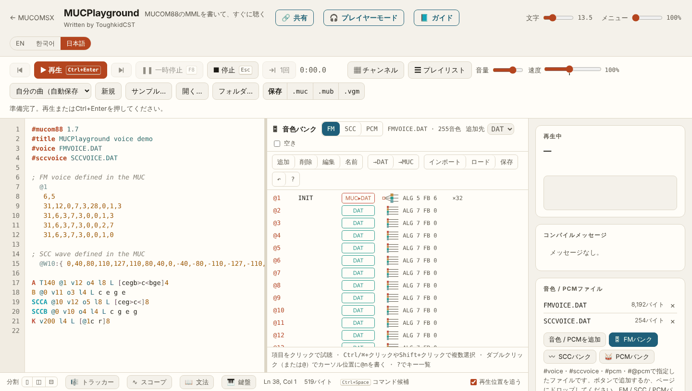
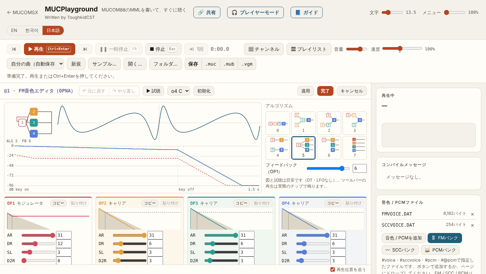
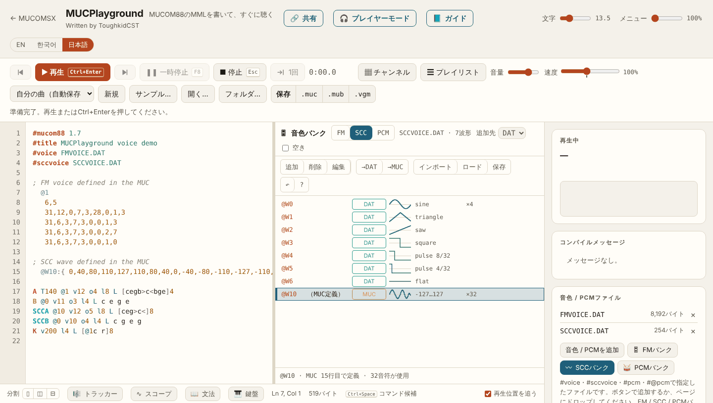
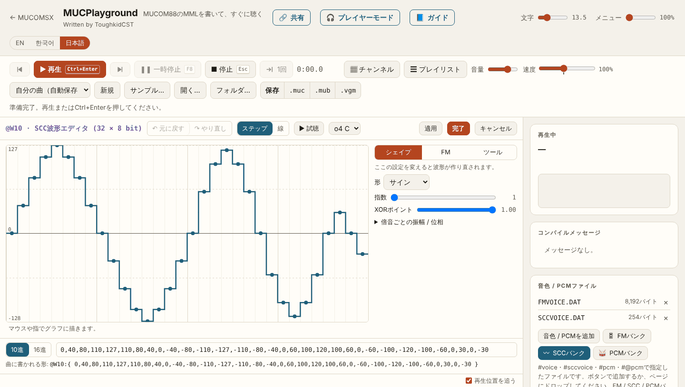
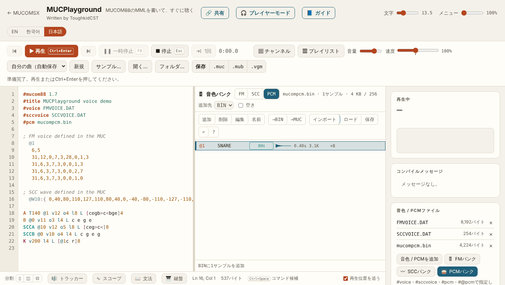
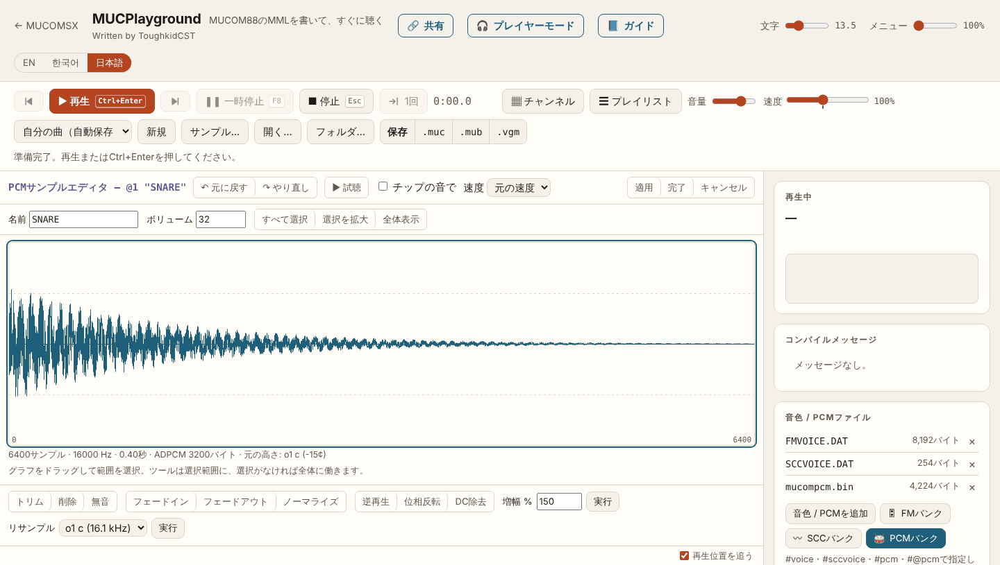

# MUCPlaygroundでFM音色・SCC波形・PCMを編集する

[한국어](MUCPLAYGROUND.md) · [English](MUCPLAYGROUND.en.md)

MucoMSXツールチェーンは、MSXで動く4つのツール（MUCEDIT・MUCPLAY・MUC2MUB・MUBPLAY）と、PCやタブレットのWebブラウザーで動く**MUCPlayground**でできています。以前の配布にあったMSX用音色エディタMUCVOICEは今回のバージョンで削除し、FM音色・SCC波形・ADPCMのPCMの編集はすべてMUCPlaygroundで行います。インストールは不要です。

| | アドレス |
|---|---|
| MUCPlayground | https://toughkiddev.github.io/MUCOMSX/MUCPlayground/ |
| MUCPlayground公式ユーザーガイド | https://toughkiddev.github.io/MUCOMSX/MUCPlayground/Manual/?lang=ja |
| この文書の例をすぐ開く | [体験用の例を開く（初期FM・SCCバンクとPCMバンク付き）](https://toughkiddev.github.io/MUCOMSX/MUCPlayground/#s=z7Vvfd6s4kv5XfDKPSXdwAjbp_XFaEjIIQbAAx4G-_YAdRwiBBca-YM-Z_32U3O2-Pb07Z3ee9sXKIYCqSp8kSlWfOPivN19vfpre3exvfrpxcBj9GK7Qzd3NUd_-pTltVWPbk-mP8y_7vxzFsd5NtHhZF2d-UKf92-SrEtvd5G3XKK3w7WYRvkQE4R8dkOq6frv9Vp0g9Mf6dttMPpvXFz9uxP6L_vs3bft7i-9iv3ubiP3kWH6CftlPJj9PP_5PZnfW5_lxejd9uDPu5nePdw-2vpjePf4mmOm6j3rjn1c_3M3_Z23jW2d0jydD8fWfdmY9NX7668S4M407W5tN9fEw_zzbn5XG3Q_6_w_65oePyh8-pN-u7G8i426mbYwPu2_n2afR7EPX-DT47epT8PgpfTQmf_voH5ikU9PQUzL5On2YKHNS25Ng8st2xzf_uf33Dd_9an7Zw8nPhpZPJ-pxUptavp3sJnyy-7LXgwPa2PhmbX231sa_2p_y_zI2Phv_Zsw_zL_s6eTrg2F8q_zl5-l2cvgw0V7zfvPTL7_e3bzp0y83f3AELQIAQ8AW9--PT_feaL97A_i9OIO9dIbt9wqmdeNS62o9rQv5bwJIPnShUUfJC-NEV3zofrT5Pn7qfm8DfLRpe9_v_0X816ff8f_Q6PIT_7vtFf-Kf8W_4l_xr_hX_Cv-Ff-Kf8W_4l_xr_hX_Cv-Ff-Kf8W_4l_xr_hX_Cv-Ff-Kf8W_4l_xr_hX_Cv-Ff-Kf8W_4l_xr_hX_Cv-Ff__H_8_bn69--Xmjx8s6-9XV8bzawww0NjiQykxtv39RxtQjvG07d5ep_fvry_dWm5Hlzn7y7xpanVyeBYFdVdYl9stBAQxFTjAiJxB95yHGLLMg_dbFzLmAI51T8xnB_QUMcARED7KFBXDKXSI8Vzx2dIxAeDMRUCFTgmSBcwytxx2IASfc_Dnw0SAkz8fehDed53_Lv_HAzL4f9L7PEAG_oXybZ7_-BX45zxbcCVXf-ryP5TPr4HfwQCu5Vqu5Vqu5X8py7f76DWw1vFQHrMBBcTlJEDO11cerAPAPdSco9AZIyvMBhjNAjMrRBIVaUmVvNgcxcofLckEBNTIWIaW0VYsOqcr6VDkHkJql5MdQEciapHTWJ4W5BgkVOz7satRLkjU1RZaORxYJwdH1F-Wyhks1yxbGrkZJKh0z6dqh86Od-4WPe4YsJOqIq48uyoXLygEiSJ91yS7Epw4YSFnaBbte9z6QexO-7GxnsNlOiSANCGthbUjvBCkbd2xgYVyLQbUYGcyDpceILeEkiD0Q_AwlLFpys16Kmj4TIhInaQr62HIJEmZW-nEWkSGi2ZIFGJ_1GMzmMw8R4DEd2fHFQ2KyyA-pISsS3cT8SqBOntf_GxztETlmsszLWhQzuqco6F0kDpkQdl6TgNwSB9k1sT9Qh3CZ8kHsnrjA-rSRLGGFUzNw9LmA6TGfjEglZPh1ulztECwEdFtbXEgzqhR-mcw4zYig9NhI5OJN8o5L7s1oihVC3e-XkkizRlE5-BFcOSocKdKSoHM9iNoZVAUMOgWfIu3fMbTiq_pMqY0idG59nlymyJeq_2iYYH-7Q1SiITviGPyWrqZxEKgN3BIWg858aKtA5y1lNZ7lpg4HbhZKp9FLuwB5s0SF_grHZeQcwM1U0WLGI08NlDHwkUf0pcOonSqGkGhw0TmNgicnLTgwnCCUpwlrvgSigy_NKJvdxeZBxAxtG-ChJMtMKuUknVmx8dDdEEXY46kKg-18EFBi_U4HNYDchpPAMcZ2podA9KajM9cMoVDy4XdupdhpQqOqhKg_dgwmCGrAAPDtNkj0jl46QKcc1K5vQXy1yxRWK8ZSXrzaLVIlA8lQjNYtirtaNsnF6WdDZPniF7UpiilBd7KghRHpWCbocroJFhzV4Aj8U_dTjRjkVSiV9GBBIthj-WmLGRVYe63Ba0GeHoJHB4UWf-05oDwuHduQRnyGOcHFW4T7oC1iQ8cBSt3h9Wggpg8E9CGHClSzvQ6xj3U6_GsoHAenGOHBjAsy64icA8aXD-XvnQObCkCiDvB6KNhNoLEt2Sdk6LNlYWUfuJDxEXZefyZMnfEB-2vtprvHIls7V_tcAbhG1cNBKgjekRgWHlZ6jjOGYKcvoGnJNB-G_O4yAJWM7EpuVRi4NAErDX4aaHmemxcvIO0Gwqhme9sN5ATOABaaMsU8LSf1wX3Hbgb-CEclqNCUXoLOifIfD86n_KZ6zGATnAZ95UJBdCjZCkn75pAa2LabBk0DivfpXUuhWvYBX6iqAKRtc5dgowlPOc77dnSXp5VJoXpdM4etbmH-9kyIx2q6qxTO5qMAeNQ-AkaujTWa_AFDV7SEI-UBSNjCJgabyEO8djHt0jO8b2b4M6IAarMxBg6gETrMuKaTPlFS2AzHTrts5GbuqNT6jW4kYctrF7EmVYNat5Jjl6GtonxG-QK9CW16hkvjvFp2F16YUDu66jU7qreL30P4exI5FG9gjDym1dEcXG0EKVjkSmTI4OAZ-6vk_Oij0Wb1MeQMn5IHVQNGG3X4gRC-xhXpYsa0j3KPoob1qdGIp9QKu8lcgB9GOYhcM7Id6vjG63c83nRVHr8DDCCnDGIKW-zE2XKJDpWWAf3DCIqzSDgK_p1zRQJj8gvhxMSOspLMm4wcjh3-k6q0NZ9ej0TF0Y5WXpI5LCsSsk658gHs7fqHAP1FTBpBfhIZZ9Ak7VAwt45IPzOuchfiY5JlRGjqk8GfMswc15UR0OKB1KDNkiSXueD_tUwlc4mR1MhdwbkwUrkYJ5eetg44J2Xfb8i3UoBvfbz7T3OA4SG9dllxw2GBqwL_cvJJYYdFSgZW7P33Rd1jGgIunNwEcC2XJ_EtuIUPSLmITc1ubIlXIMOlM9c5wdFlOtgtSk3fE5uI6C2RJkzkLWgGqhaj8AUh51u3EFGrBLtUV1kJfEDdNVOhb5hRwNaodh0ejW4oiiV0LFW2SzQrSV73vI-Ey86Jyf9GxiPQQ3QEzhim7YuKS2R6Ugh9sHuTEe1yQIeA-vWqTMUrFteNz4ERqYOBfOw6BIamTWsiM5GzYenpFgQD_YYW_YMqTDdn92hnNOkaRoO_LXPO-YHZ9V2i646wxQPRQJAINvefE9A4Sz6DsyoFUpHdgLvkgL3uI9oyqIC3_KWmqEdBs1TIiQrN9NM6RVv64jTUDArZylwXxoeKfHa6CRdDUAziuLA8uM2upwAKT4yB4lAhzMRm_M6bjZR1Ty44SpYwiCWLNqyoIQGWHIdFizsH98iFSmZ06J_BbsoSIh8446XJQHP5GufiJZCuTdjzY8uivO3aIM85UfFOhYqzZJYbo4FIDhKRBfr3ITFxZiRmQwDnJxde5fJoZF9HuYG8Dsvo2xZfTzvSK0D5O9Yk7SZXkuaDZw8oedc9TRcD9iuydEHpjtHpl7PxhjWPiKN7g3fHPuodEtkzLTHRu0iXwpFkouA1YW_gTbREVF7zMW5dOjk9ooro-x0pToPuo1lCd6SCwcmk_HgnF5UERZ1LmondmUPW4szCZq8SI1WxsgqmecnsT1zTQ52xboUiUfA_OQpq1u0lCteDJ4YeULb11SPUR1noOAsqmzuZDQeC52X_USofATisA1BLHXUOr2qGQFOhQ47n6uWqbwlXirhMDjPehZXGo3SYP0cVWbLUedUsci40_YLWoduUlKy1E-WBKVMDR0rpV6TXAmztPU7krJ3bJ11EXsAyG3MkPV8upELvaAVv3UJzvtVM0bt0pOg1EwzEntQ-gKuSTW6lzGAYTQ0CG22eY9UVgRF3ADx2DDc1lswQwaOCNDMSvNScO8KpCDpD1z1ntGvL33vJp5TB0r7pPh4oTMvc9cXlVzJmTe6oDPAdk34V0DcrHeaDah7zaXxUpr0bGsepxS6tD5-R7UQFJx9kFq5ywMCiEy1xz6iTc_LWTA2el57VMQe6F8c5kIv43E741huda7xAVysTtnRRLlb7s4BabzGXyIXPBDsS_M4x4TGnqE2-EBskNpWVy6C3jvqp6ujE6N-ynmCihQiESSGJZ80j2BHJTIJ5W4NekKeAqdB-BkELLHjHpI3zCuk_J3fS2MmS4M3SeWKpHto8iSnsMl3oT4zzXBXJj_6KBmUnmnQx2zrTkEwZAlfarayzoTUq6s0yjMhPdkmSrwIE-hnwECPLB100bCj1I82hej8yK_9BTSeQdyf-YbeR2FiOOiMB97kRPdSPrrnxk-JbIxBhLRCXj-XylsEokldhkL0AMBwWGbAD4tXhTf85QRw61G0l0TN4DzK1mLIU5BkfDgFUV3n7oaW00GYmvxlRYaIZtHnSNkb10lNzM5rRbglFlXaQzfYEUw5M_V-Jkndi01QBTWn6vU7Qpl1KzvjRYB5gaA0D9Yq1BzYxi3tsVUoxPhrP4d-t1e8o4XonRNbzDmULc5vcVM3RLOufLEx0jMpoAyjOLg0JVbqlKI2iHxpubPVW7IBF1sJPbkCUBr2NfjqNungNAT5kaHCcvDOAnLCD0JOKdmsrYJLcYI0tgezc1FvuuoBRs812GNBaTztNLvvssDNma_fWTZoC7rFHEOao67o1tR9AQEPfcrvAdExe6-yfuZTFEZV5evdRabD80EW4WLAphIIUFUwzS6k2ue7UnMNPXq9yelJq461rxnwXtlU8CXJm4xnYavD4SHrxoI7jlDzRKE4WAgeII1WAKfPzuw56yxoSj_MTyrSrBX6B9E4-AkcAv3iMNBjbXR84iGQ6rng9FKhYw42rc9vOW8uyVuUDBk94ENtKk1wk8JFOv8Jmo1BERA9e2hs6I7qmMR3BA0UCu7q8Q2jXIZk7xy1JceVg1ATN_sTLPOP1R-QRAxgnTWrXvs3rZQp32RLHwXT1uaOoYy8Y8IV2uziY4gQf1pC0Kk5u3d9_IQBit1Nu5F5hMZNnSMF8hQFyM2GHs9OLi_0_lrx-CQU0ntBK10p6J4NRgfN9PIl03tPfwxS1AAPK0eQQbPzUFVCxUefJigb_HWJGPzIQSXvBoWdU9lkyQBSg7nx6TJ2YIMdUwEaWcrxyNpkel8vYs_xeOTrR8KNlrZRpVlXvAfYj54TzTbBNhJ9x1tBJBr1Xkg8Kt4UkKEiYWMBcsJ0Bqd83MMUckdvkxHtkI6OIsC0yDDFYQgMoKnTqmmxT6jONs7Nr7_-7e8) |

この文書は、公式ユーザーガイドの[音色・波形・PCMバンクとエディタ](https://toughkiddev.github.io/MUCOMSX/MUCPlayground/Manual/?lang=ja#banks)の章を、MSXツールチェーンの作業順に合わせて説明したものです。ボタン一つひとつの説明、ショートカット、画面構成は公式ユーザーガイドが基準です。

## 1. ツールチェーンでの役割

| したいこと | 使うもの | 結果のファイル |
|---|---|---|
| FM音色を作る・直す | MUCPlaygroundの**FMバンク**・**FM音色エディタ** | `VOICE.DAT`形式の音色ファイル（`#voice`）またはMUC内の音色定義 |
| SCC/SCC+波形を作る・直す | MUCPlaygroundの**SCCバンク**・**SCC波形エディタ** | `SCCVOICE.DAT`（SCWD v1、`#sccvoice`）またはMUC内の`@Wn:{…}`定義 |
| ADPCMサンプルを入れる・整える | MUCPlaygroundの**PCMバンク**・**PCMサンプルエディタ** | PCMバンクファイル（`#pcm`、既定名`mucompcm.bin`） |
| MML編集 | MSX: MUCEDIT / PC: MUCPlaygroundのエディタ | `.MUC` |
| コンパイル・MUB作成 | MSX: MUCPLAY、MUC2MUB | `.MUB` |
| 完成曲を聴く | MSX: MUBPLAY | |

MUCPlaygroundのコンパイラ・ドライバ・チップエミュレーションはMDPlayer4Macをブラウザ向けにビルドしたもので、MucoMSXと同じ規則で曲を読み、FM・SSG・リズム・ADPCMとMSX-MUSIC・PSG・SCCパートを演奏します。ただし、MSXで使う曲の最終確認はMSXのMUC2MUB・MUCPLAYで行います。MSX側にはMUC入力65,536バイト、MUCEDIT編集60,000バイト、音楽DATA 98,304バイト、512KiBマッパー、DOS 8.3ファイル名といった条件が別にあります。

## 2. 準備

- **ブラウザ:** Chrome・Edgeを推奨します（**フォルダ…**で開いたフォルダを覚えます）。Safari・Firefoxも使えます。インターネット接続が必要です。
- **ツールチェーンZIPの初期データ:**
  - `FMVOICE.DAT` — `INIT`音色1つと空きスロットからなるFM音色ファイルです（空きスロットはTLがすべて127の無音音色）。自分の音色バンクを作る出発点として**ロード**してください。
  - `SCCVOICE.DAT` — `@W0`〜`@W6`にサイン、三角、のこぎり、矩形、パルス8/32、パルス4/32、フラットの波形を収めたSCWD v1ファイルです。
  - `INIT.TFI` — TFI形式のFM音色1つです。MUCPlaygroundはTFIを読まないため、TFI対応の別のエディタで使います。
- **曲とファイルを一緒に開く方法**（公式ガイド[ファイルを開く・保存](https://toughkiddev.github.io/MUCOMSX/MUCPlayground/Manual/?lang=ja#files)）:
  - **開く…** — `.muc`と`.dat`・`.bin`・`.wav`を一緒に選んで開くと、ファイルが曲に添付された状態で開きます。
  - **フォルダ…** — PCの作業フォルダを開いて曲を選ぶと、`#voice`・`#sccvoice`・`#pcm`に書かれたファイルを大文字小文字に関係なく探して添付します。
  - ファイルをページにドロップするか、**音色 / PCMを追加**で添付してもかまいません。
  - 曲が指定したファイルが添付されていないと、コンパイルメッセージに警告**PG03**が出て、**ファイルを添付…**・**フォルダから探す**ボタンですぐ添付できます。
- **自動保存:** 曲と添付ファイルはブラウザ内（IndexedDB）に自動保存されます。これはバックアップではありません。MSXに持っていくファイルは必ず**保存**でダウンロードしてください。

## 3. MSXとの往復の手順

1. MSXの作業フォルダのMUCと音色・PCMファイルをPCへコピーします（SDカード、エミュレータのディスクなど）。新しい曲ならツールチェーンZIPの`FMVOICE.DAT`・`SCCVOICE.DAT`から始めてもかまいません。
2. MUCPlaygroundで**フォルダ…**または**開く…**で曲を開きます。
3. 右の**音色 / PCMファイル**カードの**🎛 FMバンク**・**〰 SCCバンク**・**🥁 PCMバンク**でバンクを開いて編集します（4〜6章）。**再生**（`Ctrl+Enter`）ですぐに聴けます。エディタ内の**▶ 試聴**は目安の近似音で、ツールバーの**再生**はチップエミュレーションで演奏します。
4. バンクの**保存**でファイルをダウンロードします。ロードしたファイルはその名前で、新しくできたファイルは`VOICE.DAT`・`SCCVOICE.DAT`・`mucompcm.bin`として保存されます。MUCは上の**保存**の行の**.muc**（`Ctrl+S`）で保存します（MUCOM88と同じShift_JIS）。
5. ファイル名をDOS 8.3形式（例: `MYVOICE.DAT`、`DRUMS.BIN`）にそろえ、MUCの`#voice`・`#sccvoice`・`#pcm`行と同じ名前か確認します。MSXでは大文字小文字を区別しません。
6. MUCとファイルをMSXの同じ作業フォルダにコピーします。
7. MSXで`MUCPLAY SONG.MUC`（またはMUCEDITのF1→2コンパイル、F1→3演奏）で確認し、`MUC2MUB SONG.MUC`でMUBを作って`MUBPLAY SONG.MUB`で聴きます。PCMを内蔵しないMUBは、MUBPLAYが`#pcm`のファイルをMUBと同じフォルダから読むため、BINファイルも一緒に置いてください。

## 4. FM音色の編集

### 4.1 FMバンク

**🎛 FMバンク**を押すと、エディタの右に曲のFM音色の一覧が開きます。音色ファイル（`#voice`、タグがなければ`voice.dat`）の音色とMUCの中で定義した音色（`  @n`、`  @%n`）が一緒に表示され、それぞれ`DAT`、`MUC`、`MUC▸DAT`と表示されます。`MUC▸DAT`は同じ番号が両方にあるという意味で、コンパイラと同じくMUC側が優先されます。名前、アルゴリズム、フィードバック、曲で使われている回数も表示されます。項目をクリックすると試聴でき、ダブルクリックするとカーソル位置に`@n`を書きます。

| ボタン | キー | はたらき |
|---|---|---|
| 追加 | `Insert` `N` | 空き番号にFurnaceの初期音色を追加 |
| 削除 | `Delete` | 音色を削除（曲で使われていれば確認） |
| 編集 | `Enter` `E` | FM音色エディタを開く |
| 名前 | `F2` `R` | ファイルの音色の名前（6文字） |
| →DAT / →MUC | `D` / `M` | MUCの音色を同じ番号でファイルへ移す / ファイルの音色をMUCの定義へコピー |
| インポート | `I` | `.dat`、`.muc`、`.mub`、`.vgm`/`.vgz`から、まだない音色を取り込む |
| ロード / 保存 | `L` / `S` | この曲で使う`.dat`ファイルを選ぶ / 音色ファイルをダウンロード |
| ↶ | `U` `Ctrl+Z` | ファイルの変更を元に戻す |

`Ctrl`/`⌘`+クリック、`Shift`+クリックで複数を選び、まとめて削除・移動できます。`F6`はテキストとバンクを行き来し、`?`はキー一覧を表示します。

**追加先（DAT/MUC）** で、追加・インポートした音色の行き先を決めます。

- **DAT** — 複数の曲で同じ音色ファイルを共有するとき。音色ファイルのない曲で最初にDATへ入れると、新しい`VOICE.DAT`と`#voice`タグが自動で作られます。
- **MUC** — 曲だけで完結させたいとき。MSXに持っていく音色ファイルは不要です。

VGMからはキーオンごとの音色を集めます（YM2203・YM2608・YM2610・YM2612。YM2151はDT2・LFOなしで変換）。他人の曲やゲームから取り込んだ音色に再配布の権利は生じない点に注意してください。

### 4.2 FM音色エディタ

FMバンクの**編集**、またはMUC内のインライン音色にカーソルを置くと出るプレビューの**✎ 編集**で開きます。FurnaceのFM楽器エディタを模した画面です。

- 上の概要: アルゴリズムの図（聞こえるオペレータ、OP1のフィードバック）、出力波形、オペレータごとのエンベロープ（1秒キーオンのあとキーオフ）。
- 右: アルゴリズム0〜7の図から選択、**フィードバック（OP1）**。
- オペレータのカード4枚: **AR、DR（D1R）、SL（D1L）、D2R、RR、TL、KS、MULT（ML）、DT**をスライダーと数値欄で直します。キャリアかモジュレータかが表示され、キャリアのTLが0でないと警告（W0408）が出ます。
- **コピー**・**貼り付け**でオペレータを移し、**初期化**でFurnaceの初期FM音色からやり直せます。5行の値を直接入力してもかまいません。**元に戻す**・**やり直し**ですべての変更を戻せます。
- **▶ 試聴**（o1〜o7）はページ内の近似音（DT・LFOなし）です。ツールバーの**再生**は音色を先に適用して実際のチップエミュレーションで演奏します。
- **適用**は書き込みのみ、**完了**は書き込んでテキストに戻る、**キャンセル**は書き込まずに戻ります。MUCの音色なら`FB,ALG`行とオペレータ4行を、元の行の形・インデント・コメントを保ったまま書き直します。ファイルの音色なら音色ファイルに書き込みます。

MUCOM88の25バイト形式（`  @%n`）の音色はプレビューのみで、エディタは開きません。テキストで直してください。

### 4.3 MSXで使う

- 音色ファイル: MUCの先頭に`#voice MYVOICE.DAT`と書き、パートで`@n`で選びます。ファイルは256レコード×32バイト（8,192バイト）のMUCOM88形式です。
- インライン音色: MUC内の定義がそのままコンパイルされます。同じ番号がファイルにもあればMUC側が使われます。
- 音色をファイルへ書き移しても曲が同じに演奏されることは、MUCPlayground側でコンパイラと照合して確認されています。

## 5. SCC波形の編集

### 5.1 SCCバンク

**〰 SCCバンク**は、`SCCA`〜`SCCE`パートが使うSCC波形をFMバンクと同じ方法で扱います。

- 波形ファイル: `#sccvoice`（なければ`SCCVOICE.DAT`）。CRC付きのSCWD v1形式で、`@W0`〜`@W255`の256個まで収めます。SCCパートでは`@0`〜`@255`で選びます。
- MUC内の波形: `  @Wn:{ 32個の値 }`またはMucoMSXの`?WDn={…}`。MUC内の定義がファイルの同じ番号より優先されます。`?WD`を使う曲に追加した波形は`?WD`形式で書かれます（[SCC制御](SCC_CONTROL.ja.md)）。
- 一覧には小さな波形の図と形（サイン、のこぎり、矩形、パルス、三角）、使われている回数が表示されます。
- **インポート:** `.dat`（SCWD）、`.muc`、`.vgm`/`.vgz`（K051649/K052539がキーオン時に鳴らした波形）、Furnaceの`.fur`/`.fuw`（32サンプルのウェーブテーブル）。
- ボタンとキーはFMバンクと同じです（→DAT、→MUC、ロード、保存など）。波形が1つも残らない波形ファイルは`#sccvoice`タグと一緒に削除されます。

### 5.2 SCC波形エディタ

SCCバンクの**編集**、または`@Wn:{…}`行にカーソルを置くと出る波形プレビューの**✎ 編集**で開きます。Furnaceのウェーブテーブルエディタを模した画面です。

- **描く:** マウスや指でグラフに直接描きます。表示は**ステップ**と**線**から選びます。
- **シェイプ**タブ: サイン・三角・のこぎり・パルス（デューティ）、指数、XORポイント、倍音16個（振幅・位相）で波形を作ります。
- **FM**タブ: オペレータ4個（レベル、倍率、フィードバック、Furnaceの32種類のオペレータ波形、接続マトリクス）で波形を作ります。
- **ツール**タブ: **Xオフセット**、**Yオフセット**、**スムーズ**、**増幅 %**、**ノーマライズ**、**上下反転**、**左右反転**、**ハーフ**、**ダブル**、**ランダム**、**クリア**。
- グラフの下の欄に32個の値を**10進**・**16進**で直接入力でき、そのすぐ下に曲に書かれる形が表示されます。
- **▶ 試聴**はo2〜o6で伸ばした音として聴かせます。エディタを開いたままツールバーの**再生**を押すと、先に適用してから演奏します。
- **適用**は`@Wn:{…}`の1行（MucoMSXの波形は`?WDn={…}`）で曲に書き、**完了**は適用して戻り、**キャンセル**は書き込まずに戻ります。ファイルの波形なら波形ファイルに書き込みます。

### 5.3 MSXで使う

- 波形は符号付き8ビット値（-128〜127）32個です。
- 通常のSCCはチャンネル4・5（`SCCD`・`SCCE`）が波形RAMを共有します。5チャンネルに別々の波形を同時に使うにはSCC+が必要です。
- `#SSGExtend On`の64サンプル`@W`は別の機能です。SCC専用の楽譜と混ぜないでください。MUCPlaygroundは64サンプル`@W`もプレビュー・編集しますが、MSXのSCCパートで使うのは32サンプルです。
- 名前を書いた`#sccvoice`ファイルがMSXの作業フォルダになければコンパイルエラーです。ファイルはMUCと同じフォルダにDOS 8.3名で置いてください。詳しい文法は[MSX対象](MSX_TARGETS.ja.md)のSCCの節を参照してください。

## 6. PCMの編集

### 6.1 PCMバンク

**🥁 PCMバンク**は、ADPCMパート（`K`）が使うサンプル`@1`〜`@32`を表示します。サンプルごとに波形、長さ、サイズ、使われている回数が表示され、一番上にチップメモリ256KBのうちの使用量が表示されます。項目をクリックするとチップと同じ音で聴けます。

- **インポート:** `.wav`（どのPCM・float WAVでもモノラルに混ぜ、16.1kHzより高ければ下げる）、ブラウザが読める音声（mp3、ogg、flacなど）、PCMバンク、`.mub`（中のバンク）、`.vgm`/`.vgz`（YM2608・YM2610・Y8950がキーオンしたサンプル）。
- **ロード / 保存:** バンクファイルを選ぶ、またはダウンロードします。新しいバンクはMUCOM88形式（`mucompcm.bin`）で保存されます。

> **MSXツールチェーンでは追加先をBINにしてください。** MUC内の`#@pcm n,"name","file.wav",volume`行（mucomDotNET拡張）はコンパイラがWAVを直接変換する方式ですが、MSXのMUC2MUB・MUCPLAYはこのWAV変換に対応していません。追加先が**BIN**なら、取り込んだサンプルはPCMバンクファイルに入り、バンクファイルのなかった曲には`#pcm`行が自動で作られます。すでに`#@pcm`行がある曲は、**→BIN**ですべてバンクファイルへ移してから**保存**してください。

### 6.2 PCMサンプルエディタ

PCMバンクの**編集**で開きます。Furnaceのサンプルエディタ風の画面です。

- 波形をドラッグして範囲を選び、ホイールで拡大します（**すべて選択**、**選択を拡大**、**全体表示**）。名前とボリュームもここで直します。
- ツール: **トリム**、**削除**、**無音**、**フェードイン**、**フェードアウト**、**ノーマライズ**、**増幅 %**、**逆再生**、**位相反転**、**DC除去**、**リサンプル**（o1 c 16.1kHz、o2 c 8.1kHz、o3 c、任意のレート）。範囲を選ばなければ全体にかかります。
- 波形の下にサンプル数、周波数、長さ、ADPCMサイズと、サンプルを元の音の高さで鳴らす音が表示されます。16.1kHzで作ったサンプルはo1 cで、8.1kHzで作ったサンプルはo2 cで元の高さで鳴ります。**リサンプル**をo2 c（8.1kHz）にするとデータが半分になって256KBを節約でき、そのサンプルはo2 cで元の高さで鳴ります。
- **▶ 試聴**は元の速度か選んだ音の高さで聴かせ、**チップの音で**をオンにするとADPCM-Bにエンコードしてから戻した音で聴かせます。
- ADPCM-Bは非可逆圧縮のため、ページを開いている間は取り込んだ元の音から編集をやり直し、**適用**のときに再びエンコードします。

### 6.3 MSXで使う

- MUCの先頭に`#pcm DRUMS.BIN`のようにDOS 8.3名を書き、パート`K`で`@n`で選びます。
- MUC2MUB・MUCPLAY・MUCEDITはコンパイル時にPCMファイルが必要です。`#pcm`に書いたファイルがないとエラー19で止まり、`#pcm`がなく既定の`MUCOMPCM.BIN`もない場合は警告のあとADPCMなしで進みます。
- MUBPLAYはPCMを内蔵しないMUBを再生するとき、`#pcm`のファイルをMUBと同じフォルダから読みます。
- MUCPlaygroundで読み込み・書き直したバンクが元と同じ音で演奏されることは、mucomDotNETのエンコーダ・バンク形式と照合して確認されています。

## 7. 確認リスト

- [ ] ファイル名がDOS 8.3で、MUCの`#voice`・`#sccvoice`・`#pcm`の名前と同じ。
- [ ] PCMはBINバンクで保存した（`#@pcm`行を残していない）。
- [ ] MUCとファイルをMSXの同じ作業フォルダに置いた。MUBを別の場所へ移すときはPCMバンクも一緒に移す。
- [ ] MSXのMUC2MUBまたはMUCPLAYで再コンパイルし、エラー・警告がない（サイズ上限はMSX側が基準）。
- [ ] ブラウザの自動保存だけに頼らず、ダウンロードしたファイルを別に保管した。

## 8. 公式ユーザーガイドへのリンク

| 章 | 한국어 | English | 日本語 |
|---|---|---|---|
| はじめに | [열기](https://toughkiddev.github.io/MUCOMSX/MUCPlayground/Manual/?lang=ko#start) | [Open](https://toughkiddev.github.io/MUCOMSX/MUCPlayground/Manual/?lang=en#start) | [開く](https://toughkiddev.github.io/MUCOMSX/MUCPlayground/Manual/?lang=ja#start) |
| ファイルを開く・保存 | [열기](https://toughkiddev.github.io/MUCOMSX/MUCPlayground/Manual/?lang=ko#files) | [Open](https://toughkiddev.github.io/MUCOMSX/MUCPlayground/Manual/?lang=en#files) | [開く](https://toughkiddev.github.io/MUCOMSX/MUCPlayground/Manual/?lang=ja#files) |
| 音色・波形・PCMバンクとエディタ | [열기](https://toughkiddev.github.io/MUCOMSX/MUCPlayground/Manual/?lang=ko#banks) | [Open](https://toughkiddev.github.io/MUCOMSX/MUCPlayground/Manual/?lang=en#banks) | [開く](https://toughkiddev.github.io/MUCOMSX/MUCPlayground/Manual/?lang=ja#banks) |
| ショートカット | [열기](https://toughkiddev.github.io/MUCOMSX/MUCPlayground/Manual/?lang=ko#keys) | [Open](https://toughkiddev.github.io/MUCOMSX/MUCPlayground/Manual/?lang=en#keys) | [開く](https://toughkiddev.github.io/MUCOMSX/MUCPlayground/Manual/?lang=ja#keys) |
| トラブルシューティング | [열기](https://toughkiddev.github.io/MUCOMSX/MUCPlayground/Manual/?lang=ko#faq) | [Open](https://toughkiddev.github.io/MUCOMSX/MUCPlayground/Manual/?lang=en#faq) | [開く](https://toughkiddev.github.io/MUCOMSX/MUCPlayground/Manual/?lang=ja#faq) |
| MMLリファレンス（MUCOM88・mucomDotNET・MucoMSXチップ拡張） | [열기](https://toughkiddev.github.io/MUCOMSX/MUCPlayground/Manual/?lang=ko#part-ref) | [Open](https://toughkiddev.github.io/MUCOMSX/MUCPlayground/Manual/?lang=en#part-ref) | [開く](https://toughkiddev.github.io/MUCOMSX/MUCPlayground/Manual/?lang=ja#part-ref) |
| メッセージの説明 | [열기](https://toughkiddev.github.io/MUCOMSX/MUCPlayground/Manual/?lang=ko#part-msg) | [Open](https://toughkiddev.github.io/MUCOMSX/MUCPlayground/Manual/?lang=en#part-msg) | [開く](https://toughkiddev.github.io/MUCOMSX/MUCPlayground/Manual/?lang=ja#part-msg) |

画面の図は2026-11-14時点のMUCPlaygroundで撮影しました。ボタンの配置が変わった場合は公式ユーザーガイドに従ってください。
