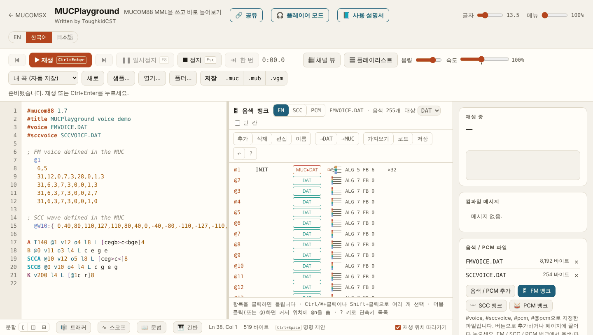
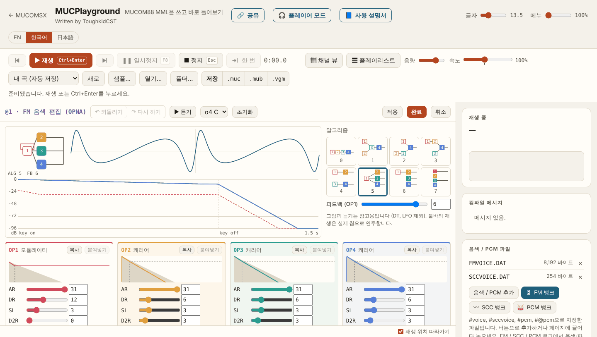
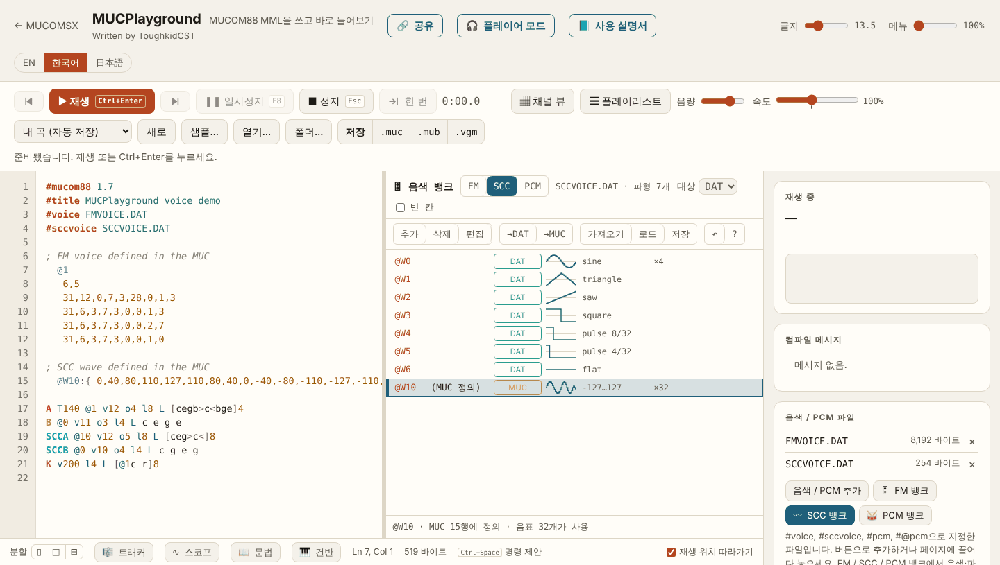
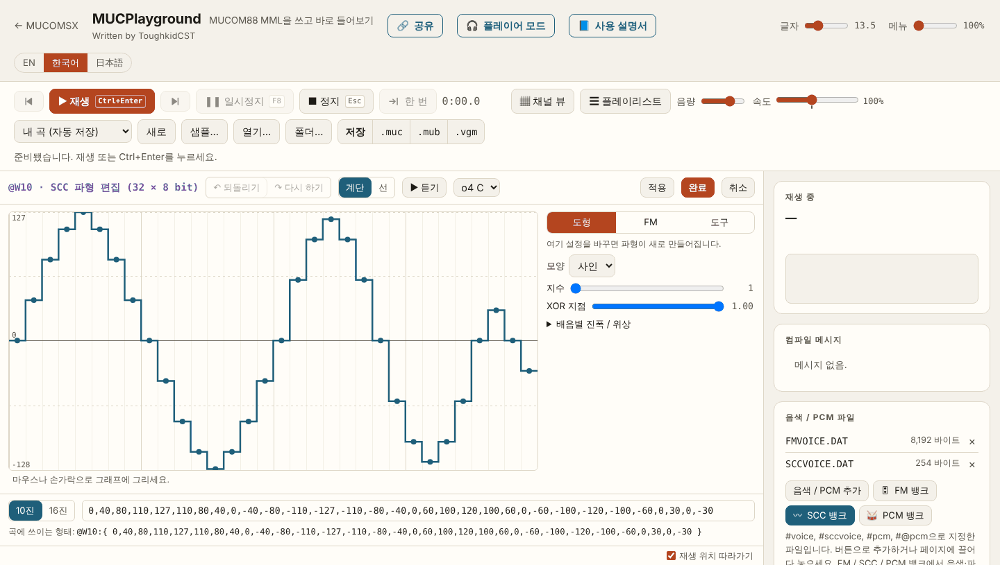
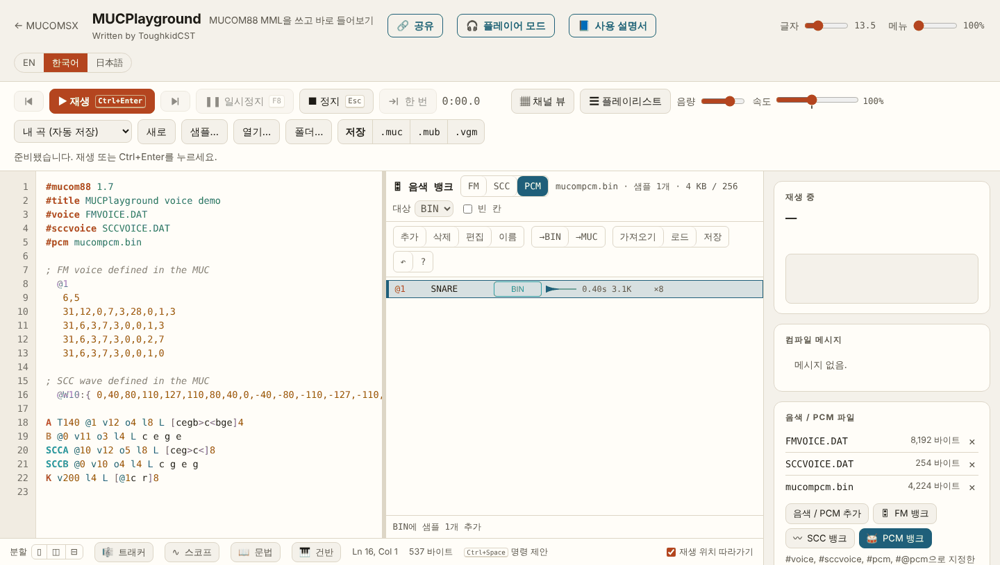
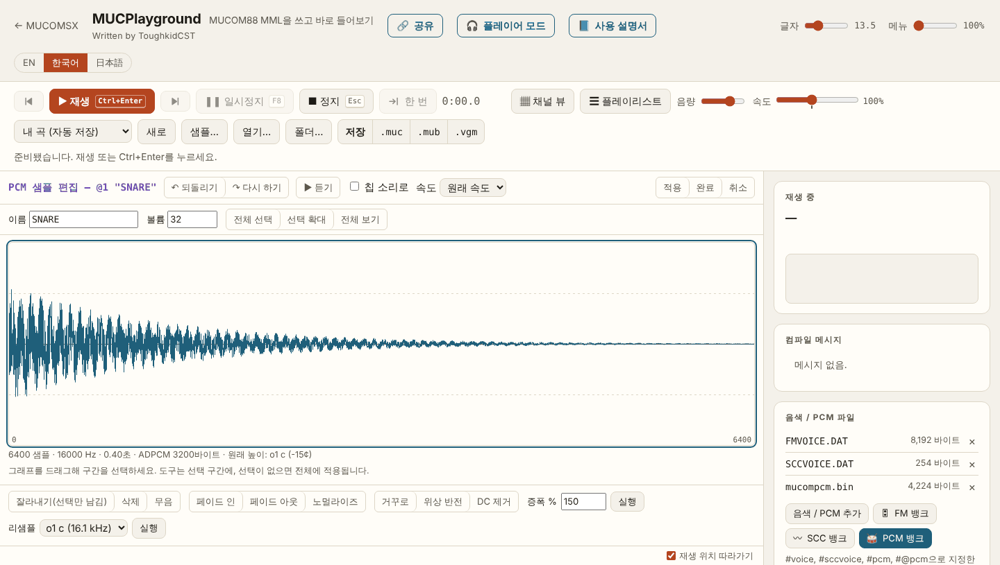

# MUCPlayground로 FM 음색·SCC 파형·PCM 편집하기

[English](MUCPLAYGROUND.en.md) · [日本語](MUCPLAYGROUND.ja.md)

MucoMSX 툴체인은 MSX에서 돌아가는 네 도구(MUCEDIT·MUCPLAY·MUC2MUB·MUBPLAY)와, PC·태블릿의 웹 브라우저에서 돌아가는 **MUCPlayground**로 이루어집니다. 이전 배포의 MSX용 음색 편집기 MUCVOICE는 이번 버전에서 빠졌고, FM 음색·SCC 파형·ADPCM PCM 편집은 모두 MUCPlayground에서 합니다. 설치할 것은 없습니다.

| | 주소 |
|---|---|
| MUCPlayground | https://toughkiddev.github.io/MUCOMSX/MUCPlayground/ |
| MUCPlayground 공식 사용 설명서 | https://toughkiddev.github.io/MUCOMSX/MUCPlayground/Manual/?lang=ko |
| 이 문서의 예제를 바로 열기 | [체험용 예제 열기 (시작용 FM·SCC 뱅크와 PCM 뱅크 포함)](https://toughkiddev.github.io/MUCOMSX/MUCPlayground/#s=z7Vvfd6s4kv5XfDKPSXdwAjbp_XFaEjIIQbAAx4G-_YAdRwiBBca-YM-Z_32U3O2-Pb07Z3ee9sXKIYCqSp8kSlWfOPivN19vfpre3exvfrpxcBj9GK7Qzd3NUd_-pTltVWPbk-mP8y_7vxzFsd5NtHhZF2d-UKf92-SrEtvd5G3XKK3w7WYRvkQE4R8dkOq6frv9Vp0g9Mf6dttMPpvXFz9uxP6L_vs3bft7i-9iv3ubiP3kWH6CftlPJj9PP_5PZnfW5_lxejd9uDPu5nePdw-2vpjePf4mmOm6j3rjn1c_3M3_Z23jW2d0jydD8fWfdmY9NX7668S4M407W5tN9fEw_zzbn5XG3Q_6_w_65oePyh8-pN-u7G8i426mbYwPu2_n2afR7EPX-DT47epT8PgpfTQmf_voH5ikU9PQUzL5On2YKHNS25Ng8st2xzf_uf33Dd_9an7Zw8nPhpZPJ-pxUptavp3sJnyy-7LXgwPa2PhmbX231sa_2p_y_zI2Phv_Zsw_zL_s6eTrg2F8q_zl5-l2cvgw0V7zfvPTL7_e3bzp0y83f3AELQIAQ8AW9--PT_feaL97A_i9OIO9dIbt9wqmdeNS62o9rQv5bwJIPnShUUfJC-NEV3zofrT5Pn7qfm8DfLRpe9_v_0X816ff8f_Q6PIT_7vtFf-Kf8W_4l_xr_hX_Cv-Ff-Kf8W_4l_xr_hX_Cv-Ff-Kf8W_4l_xr_hX_Cv-Ff-Kf8W_4l_xr_hX_Cv-Ff-Kf8W_4l_xr_hX_Cv-Ff__H_8_bn69--Xmjx8s6-9XV8bzawww0NjiQykxtv39RxtQjvG07d5ep_fvry_dWm5Hlzn7y7xpanVyeBYFdVdYl9stBAQxFTjAiJxB95yHGLLMg_dbFzLmAI51T8xnB_QUMcARED7KFBXDKXSI8Vzx2dIxAeDMRUCFTgmSBcwytxx2IASfc_Dnw0SAkz8fehDed53_Lv_HAzL4f9L7PEAG_oXybZ7_-BX45zxbcCVXf-ryP5TPr4HfwQCu5Vqu5Vqu5X8py7f76DWw1vFQHrMBBcTlJEDO11cerAPAPdSco9AZIyvMBhjNAjMrRBIVaUmVvNgcxcofLckEBNTIWIaW0VYsOqcr6VDkHkJql5MdQEciapHTWJ4W5BgkVOz7satRLkjU1RZaORxYJwdH1F-Wyhks1yxbGrkZJKh0z6dqh86Od-4WPe4YsJOqIq48uyoXLygEiSJ91yS7Epw4YSFnaBbte9z6QexO-7GxnsNlOiSANCGthbUjvBCkbd2xgYVyLQbUYGcyDpceILeEkiD0Q_AwlLFpys16Kmj4TIhInaQr62HIJEmZW-nEWkSGi2ZIFGJ_1GMzmMw8R4DEd2fHFQ2KyyA-pISsS3cT8SqBOntf_GxztETlmsszLWhQzuqco6F0kDpkQdl6TgNwSB9k1sT9Qh3CZ8kHsnrjA-rSRLGGFUzNw9LmA6TGfjEglZPh1ulztECwEdFtbXEgzqhR-mcw4zYig9NhI5OJN8o5L7s1oihVC3e-XkkizRlE5-BFcOSocKdKSoHM9iNoZVAUMOgWfIu3fMbTiq_pMqY0idG59nlymyJeq_2iYYH-7Q1SiITviGPyWrqZxEKgN3BIWg858aKtA5y1lNZ7lpg4HbhZKp9FLuwB5s0SF_grHZeQcwM1U0WLGI08NlDHwkUf0pcOonSqGkGhw0TmNgicnLTgwnCCUpwlrvgSigy_NKJvdxeZBxAxtG-ChJMtMKuUknVmx8dDdEEXY46kKg-18EFBi_U4HNYDchpPAMcZ2podA9KajM9cMoVDy4XdupdhpQqOqhKg_dgwmCGrAAPDtNkj0jl46QKcc1K5vQXy1yxRWK8ZSXrzaLVIlA8lQjNYtirtaNsnF6WdDZPniF7UpiilBd7KghRHpWCbocroJFhzV4Aj8U_dTjRjkVSiV9GBBIthj-WmLGRVYe63Ba0GeHoJHB4UWf-05oDwuHduQRnyGOcHFW4T7oC1iQ8cBSt3h9Wggpg8E9CGHClSzvQ6xj3U6_GsoHAenGOHBjAsy64icA8aXD-XvnQObCkCiDvB6KNhNoLEt2Sdk6LNlYWUfuJDxEXZefyZMnfEB-2vtprvHIls7V_tcAbhG1cNBKgjekRgWHlZ6jjOGYKcvoGnJNB-G_O4yAJWM7EpuVRi4NAErDX4aaHmemxcvIO0Gwqhme9sN5ATOABaaMsU8LSf1wX3Hbgb-CEclqNCUXoLOifIfD86n_KZ6zGATnAZ95UJBdCjZCkn75pAa2LabBk0DivfpXUuhWvYBX6iqAKRtc5dgowlPOc77dnSXp5VJoXpdM4etbmH-9kyIx2q6qxTO5qMAeNQ-AkaujTWa_AFDV7SEI-UBSNjCJgabyEO8djHt0jO8b2b4M6IAarMxBg6gETrMuKaTPlFS2AzHTrts5GbuqNT6jW4kYctrF7EmVYNat5Jjl6GtonxG-QK9CW16hkvjvFp2F16YUDu66jU7qreL30P4exI5FG9gjDym1dEcXG0EKVjkSmTI4OAZ-6vk_Oij0Wb1MeQMn5IHVQNGG3X4gRC-xhXpYsa0j3KPoob1qdGIp9QKu8lcgB9GOYhcM7Id6vjG63c83nRVHr8DDCCnDGIKW-zE2XKJDpWWAf3DCIqzSDgK_p1zRQJj8gvhxMSOspLMm4wcjh3-k6q0NZ9ej0TF0Y5WXpI5LCsSsk658gHs7fqHAP1FTBpBfhIZZ9Ak7VAwt45IPzOuchfiY5JlRGjqk8GfMswc15UR0OKB1KDNkiSXueD_tUwlc4mR1MhdwbkwUrkYJ5eetg44J2Xfb8i3UoBvfbz7T3OA4SG9dllxw2GBqwL_cvJJYYdFSgZW7P33Rd1jGgIunNwEcC2XJ_EtuIUPSLmITc1ubIlXIMOlM9c5wdFlOtgtSk3fE5uI6C2RJkzkLWgGqhaj8AUh51u3EFGrBLtUV1kJfEDdNVOhb5hRwNaodh0ejW4oiiV0LFW2SzQrSV73vI-Ey86Jyf9GxiPQQ3QEzhim7YuKS2R6Ugh9sHuTEe1yQIeA-vWqTMUrFteNz4ERqYOBfOw6BIamTWsiM5GzYenpFgQD_YYW_YMqTDdn92hnNOkaRoO_LXPO-YHZ9V2i646wxQPRQJAINvefE9A4Sz6DsyoFUpHdgLvkgL3uI9oyqIC3_KWmqEdBs1TIiQrN9NM6RVv64jTUDArZylwXxoeKfHa6CRdDUAziuLA8uM2upwAKT4yB4lAhzMRm_M6bjZR1Ty44SpYwiCWLNqyoIQGWHIdFizsH98iFSmZ06J_BbsoSIh8446XJQHP5GufiJZCuTdjzY8uivO3aIM85UfFOhYqzZJYbo4FIDhKRBfr3ITFxZiRmQwDnJxde5fJoZF9HuYG8Dsvo2xZfTzvSK0D5O9Yk7SZXkuaDZw8oedc9TRcD9iuydEHpjtHpl7PxhjWPiKN7g3fHPuodEtkzLTHRu0iXwpFkouA1YW_gTbREVF7zMW5dOjk9ooro-x0pToPuo1lCd6SCwcmk_HgnF5UERZ1LmondmUPW4szCZq8SI1WxsgqmecnsT1zTQ52xboUiUfA_OQpq1u0lCteDJ4YeULb11SPUR1noOAsqmzuZDQeC52X_USofATisA1BLHXUOr2qGQFOhQ47n6uWqbwlXirhMDjPehZXGo3SYP0cVWbLUedUsci40_YLWoduUlKy1E-WBKVMDR0rpV6TXAmztPU7krJ3bJ11EXsAyG3MkPV8upELvaAVv3UJzvtVM0bt0pOg1EwzEntQ-gKuSTW6lzGAYTQ0CG22eY9UVgRF3ADx2DDc1lswQwaOCNDMSvNScO8KpCDpD1z1ntGvL33vJp5TB0r7pPh4oTMvc9cXlVzJmTe6oDPAdk34V0DcrHeaDah7zaXxUpr0bGsepxS6tD5-R7UQFJx9kFq5ywMCiEy1xz6iTc_LWTA2el57VMQe6F8c5kIv43E741huda7xAVysTtnRRLlb7s4BabzGXyIXPBDsS_M4x4TGnqE2-EBskNpWVy6C3jvqp6ujE6N-ynmCihQiESSGJZ80j2BHJTIJ5W4NekKeAqdB-BkELLHjHpI3zCuk_J3fS2MmS4M3SeWKpHto8iSnsMl3oT4zzXBXJj_6KBmUnmnQx2zrTkEwZAlfarayzoTUq6s0yjMhPdkmSrwIE-hnwECPLB100bCj1I82hej8yK_9BTSeQdyf-YbeR2FiOOiMB97kRPdSPrrnxk-JbIxBhLRCXj-XylsEokldhkL0AMBwWGbAD4tXhTf85QRw61G0l0TN4DzK1mLIU5BkfDgFUV3n7oaW00GYmvxlRYaIZtHnSNkb10lNzM5rRbglFlXaQzfYEUw5M_V-Jkndi01QBTWn6vU7Qpl1KzvjRYB5gaA0D9Yq1BzYxi3tsVUoxPhrP4d-t1e8o4XonRNbzDmULc5vcVM3RLOufLEx0jMpoAyjOLg0JVbqlKI2iHxpubPVW7IBF1sJPbkCUBr2NfjqNungNAT5kaHCcvDOAnLCD0JOKdmsrYJLcYI0tgezc1FvuuoBRs812GNBaTztNLvvssDNma_fWTZoC7rFHEOao67o1tR9AQEPfcrvAdExe6-yfuZTFEZV5evdRabD80EW4WLAphIIUFUwzS6k2ue7UnMNPXq9yelJq461rxnwXtlU8CXJm4xnYavD4SHrxoI7jlDzRKE4WAgeII1WAKfPzuw56yxoSj_MTyrSrBX6B9E4-AkcAv3iMNBjbXR84iGQ6rng9FKhYw42rc9vOW8uyVuUDBk94ENtKk1wk8JFOv8Jmo1BERA9e2hs6I7qmMR3BA0UCu7q8Q2jXIZk7xy1JceVg1ATN_sTLPOP1R-QRAxgnTWrXvs3rZQp32RLHwXT1uaOoYy8Y8IV2uziY4gQf1pC0Kk5u3d9_IQBit1Nu5F5hMZNnSMF8hQFyM2GHs9OLi_0_lrx-CQU0ntBK10p6J4NRgfN9PIl03tPfwxS1AAPK0eQQbPzUFVCxUefJigb_HWJGPzIQSXvBoWdU9lkyQBSg7nx6TJ2YIMdUwEaWcrxyNpkel8vYs_xeOTrR8KNlrZRpVlXvAfYj54TzTbBNhJ9x1tBJBr1Xkg8Kt4UkKEiYWMBcsJ0Bqd83MMUckdvkxHtkI6OIsC0yDDFYQgMoKnTqmmxT6jONs7Nr7_-7e8) |

이 문서는 공식 사용 설명서의 [음색·파형·PCM 뱅크와 편집기](https://toughkiddev.github.io/MUCOMSX/MUCPlayground/Manual/?lang=ko#banks) 장을 MSX 툴체인 작업 순서에 맞춰 풀어 쓴 것입니다. 버튼 하나하나의 설명, 단축키, 화면 구성은 공식 사용 설명서가 기준입니다.

## 1. 툴체인 안에서 맡는 일

| 하고 싶은 일 | 쓰는 도구 | 결과 파일 |
|---|---|---|
| FM 음색 만들기·고치기 | MUCPlayground **FM 뱅크**·**FM 음색 편집기** | `VOICE.DAT` 형식 음색 파일(`#voice`) 또는 MUC 안의 음색 정의 |
| SCC/SCC+ 파형 만들기·고치기 | MUCPlayground **SCC 뱅크**·**SCC 파형 편집기** | `SCCVOICE.DAT`(SCWD v1, `#sccvoice`) 또는 MUC 안의 `@Wn:{…}` 정의 |
| ADPCM 샘플 넣기·다듬기 | MUCPlayground **PCM 뱅크**·**PCM 샘플 편집기** | PCM 뱅크 파일(`#pcm`, 기본 이름 `mucompcm.bin`) |
| MML 편집 | MSX: MUCEDIT / PC: MUCPlayground 편집기 | `.MUC` |
| 컴파일·MUB 만들기 | MSX: MUCPLAY, MUC2MUB | `.MUB` |
| 완성곡 듣기 | MSX: MUBPLAY | |

MUCPlayground의 컴파일러·드라이버·칩 에뮬레이션은 MDPlayer4Mac을 브라우저용으로 빌드한 것으로, MucoMSX와 같은 규칙으로 곡을 읽고 FM·SSG·리듬·ADPCM과 MSX-MUSIC·PSG·SCC 파트를 연주합니다. 다만 MSX에서 돌릴 곡의 최종 확인은 MSX의 MUC2MUB·MUCPLAY로 합니다. MSX 쪽에는 MUC 입력 65,536바이트, MUCEDIT 편집 60,000바이트, 음악 DATA 98,304바이트, 512KiB 매퍼, DOS 8.3 파일 이름 같은 조건이 따로 있습니다.

## 2. 준비

- **브라우저:** Chrome·Edge를 권합니다(**폴더…**로 연 폴더를 기억합니다). Safari·Firefox도 쓸 수 있습니다. 인터넷 연결이 필요합니다.
- **툴체인 ZIP의 시작용 데이터:**
  - `FMVOICE.DAT` — `INIT` 음색 하나와 빈 슬롯으로 된 FM 음색 파일입니다(빈 슬롯은 모든 TL이 127인 무음 음색). 자기 음색 뱅크를 만드는 출발점으로 **로드**하세요.
  - `SCCVOICE.DAT` — `@W0`~`@W6`에 사인, 삼각, 톱니, 사각, 펄스 8/32, 펄스 4/32, 평탄 파형이 들어 있는 SCWD v1 파일입니다.
  - `INIT.TFI` — TFI 형식 FM 음색 하나입니다. MUCPlayground는 TFI를 읽지 않으므로 TFI를 지원하는 다른 편집기에서 씁니다.
- **곡과 파일을 함께 여는 방법** (공식 설명서 [파일 열기·저장](https://toughkiddev.github.io/MUCOMSX/MUCPlayground/Manual/?lang=ko#files)):
  - **열기…** — `.muc`와 `.dat`·`.bin`·`.wav`를 함께 골라 열면 파일이 곡에 붙은 채로 열립니다.
  - **폴더…** — PC의 작업 폴더를 열고 곡을 고르면 `#voice`·`#sccvoice`·`#pcm`에 적힌 파일을 대소문자와 상관없이 찾아 붙입니다.
  - 파일을 페이지에 끌어다 놓거나 **음색 / PCM 추가**로 붙여도 됩니다.
  - 곡에 적힌 파일이 붙어 있지 않으면 컴파일 메시지에 경고 **PG03**이 나오고, **파일 첨부…**·**폴더에서 찾기** 버튼으로 바로 붙일 수 있습니다.
- **자동 저장:** 곡과 붙은 파일은 브라우저 안(IndexedDB)에 자동 저장됩니다. 이것은 백업이 아닙니다. MSX로 가져갈 파일은 반드시 **저장**으로 내려받으세요.

## 3. MSX와 오가는 기본 순서

1. MSX 작업 폴더의 MUC와 음색·PCM 파일을 PC로 복사합니다(SD 카드, 에뮬레이터 디스크 등). 새 곡이면 툴체인 ZIP의 `FMVOICE.DAT`·`SCCVOICE.DAT`부터 시작해도 됩니다.
2. MUCPlayground에서 **폴더…** 또는 **열기…**로 곡을 엽니다.
3. 오른쪽 **음색 / PCM 파일** 카드의 **🎛 FM 뱅크**·**〰 SCC 뱅크**·**🥁 PCM 뱅크**로 뱅크를 열어 편집합니다(4~6장). **재생**(`Ctrl+Enter`)으로 바로 들어 봅니다. 편집기에 있는 **▶ 듣기**는 참고용 근사 소리이고, 툴바의 **재생**은 칩 에뮬레이션으로 연주합니다.
4. 뱅크의 **저장**으로 파일을 내려받습니다. 로드한 파일은 그 이름으로, 새로 생긴 파일은 `VOICE.DAT`·`SCCVOICE.DAT`·`mucompcm.bin`으로 받아집니다. MUC는 위쪽 **저장** 줄의 **.muc**(`Ctrl+S`)로 받습니다(MUCOM88과 같은 Shift_JIS).
5. 파일 이름을 DOS 8.3 형식(예: `MYVOICE.DAT`, `DRUMS.BIN`)으로 맞추고, MUC의 `#voice`·`#sccvoice`·`#pcm` 줄과 같은 이름인지 확인합니다. MSX에서는 대소문자를 가리지 않습니다.
6. MUC와 파일들을 MSX의 같은 작업 폴더에 복사합니다.
7. MSX에서 `MUCPLAY SONG.MUC`(또는 MUCEDIT의 F1→2 컴파일, F1→3 연주)로 확인하고 `MUC2MUB SONG.MUC`로 MUB를 만든 뒤 `MUBPLAY SONG.MUB`로 듣습니다. PCM이 내장되지 않은 MUB는 MUBPLAY가 `#pcm` 파일을 MUB와 같은 폴더에서 읽으므로 BIN 파일도 함께 두세요.

## 4. FM 음색 편집

### 4.1 FM 뱅크

**🎛 FM 뱅크**를 누르면 편집기 오른쪽에 곡의 FM 음색 목록이 열립니다. 음색 파일(`#voice`, 태그가 없으면 `voice.dat`)의 음색과 MUC 안에서 정의한 음색(`  @n`, `  @%n`)이 함께 나오며, 각각 `DAT`, `MUC`, `MUC▸DAT`로 표시됩니다. `MUC▸DAT`는 같은 번호가 양쪽에 있다는 뜻이고, 컴파일러와 같이 MUC 쪽이 이깁니다. 이름, 알고리즘, 피드백, 곡에서 쓰인 횟수도 보입니다. 항목을 누르면 소리를 들을 수 있고, 두 번 누르면 커서 위치에 `@n`을 씁니다.

| 버튼 | 키 | 하는 일 |
|---|---|---|
| 추가 | `Insert` `N` | 빈 번호에 Furnace 기본 음색 추가 |
| 삭제 | `Delete` | 음색 삭제(곡에서 쓰이면 먼저 물음) |
| 편집 | `Enter` `E` | FM 음색 편집기 열기 |
| 이름 | `F2` `R` | 파일 음색의 이름(6자) |
| →DAT / →MUC | `D` / `M` | MUC 음색을 같은 번호로 파일에 옮기기 / 파일 음색을 MUC 정의로 복사 |
| 가져오기 | `I` | `.dat`, `.muc`, `.mub`, `.vgm`/`.vgz`에서 아직 없는 음색 가져오기 |
| 로드 / 저장 | `L` / `S` | 이 곡에 쓸 `.dat` 파일 고르기 / 음색 파일 내려받기 |
| ↶ | `U` `Ctrl+Z` | 파일 변경 되돌리기 |

`Ctrl`/`⌘`+클릭, `Shift`+클릭으로 여러 개를 골라 한꺼번에 삭제하거나 옮길 수 있습니다. `F6`은 텍스트와 뱅크 사이를 오가고, `?`는 키 목록을 보여 줍니다.

**대상(DAT/MUC)** 은 추가하거나 가져온 음색이 어디로 갈지 정합니다.

- **DAT** — 여러 곡이 같은 음색 파일을 함께 쓸 때. 음색 파일이 없는 곡에서 처음 DAT로 넣으면 새 `VOICE.DAT`와 `#voice` 태그가 자동으로 생깁니다.
- **MUC** — 곡 하나로 완결하고 싶을 때. MSX로 가져갈 음색 파일이 필요 없습니다.

VGM에서 가져오면 키온마다의 음색을 모읍니다(YM2203·YM2608·YM2610·YM2612. YM2151은 DT2·LFO 없이 변환). 다른 사람의 곡이나 게임에서 가져온 음색은 재배포 권리가 생기지 않는다는 점에 주의하세요.

### 4.2 FM 음색 편집기

FM 뱅크의 **편집**, 또는 MUC 안의 인라인 음색 위에 커서를 두면 나오는 미리보기의 **✎ 편집**으로 엽니다. Furnace의 FM 악기 편집기를 본뜬 화면입니다.

- 위쪽 개요: 알고리즘 그림(들리는 오퍼레이터, OP1 피드백), 출력 파형, 오퍼레이터별 엔벨로프(1초 키온 뒤 키오프).
- 오른쪽: 알고리즘 0~7 그림에서 고르기, **피드백(OP1)**.
- 오퍼레이터 카드 4장: **AR, DR(D1R), SL(D1L), D2R, RR, TL, KS, MULT(ML), DT**를 슬라이더와 숫자 칸으로 고칩니다. 캐리어인지 모듈레이터인지 표시되고, 캐리어의 TL이 0이 아니면 경고(W0408)가 나옵니다.
- **복사**·**붙여넣기**로 오퍼레이터를 옮기고, **초기화**는 Furnace 기본 FM 음색에서 다시 시작합니다. 다섯 줄의 값을 직접 쳐도 됩니다. **되돌리기**·**다시 하기**로 모든 변경을 되돌릴 수 있습니다.
- **▶ 듣기**(o1~o7)는 페이지 안의 근사 소리(DT·LFO 없음)입니다. 툴바의 **재생**은 음색을 먼저 적용하고 실제 칩 에뮬레이션으로 연주합니다.
- **적용**은 쓰기만, **완료**는 쓰고 텍스트로 돌아가기, **취소**는 쓰지 않고 돌아가기입니다. MUC 음색이면 `FB,ALG` 줄과 오퍼레이터 네 줄을 원래 줄 모양·들여쓰기·주석을 지키며 다시 씁니다. 파일 음색이면 음색 파일에 씁니다.

MUCOM88의 25바이트 형식(`  @%n`) 음색은 미리보기만 되고 편집기는 열리지 않습니다. 텍스트에서 고치세요.

### 4.3 MSX에서 쓰기

- 음색 파일: MUC 앞쪽에 `#voice MYVOICE.DAT`를 쓰고 파트에서 `@n`으로 고릅니다. 파일은 256레코드×32바이트(8,192바이트)의 MUCOM88 형식입니다.
- 인라인 음색: MUC 안의 정의가 그대로 컴파일됩니다. 같은 번호가 파일에도 있으면 MUC 쪽이 쓰입니다.
- 음색 파일에 옮겨 써도 곡이 똑같이 연주되는지는 MUCPlayground 쪽에서 컴파일러와 맞춰 확인되어 있습니다.

## 5. SCC 파형 편집

### 5.1 SCC 뱅크

**〰 SCC 뱅크**는 `SCCA`~`SCCE` 파트가 쓰는 SCC 파형을 FM 뱅크와 같은 방식으로 다룹니다.

- 파형 파일: `#sccvoice`(없으면 `SCCVOICE.DAT`). SCWD v1 형식(CRC 포함)이며 `@W0`~`@W255`까지 256개를 담습니다. SCC 파트에서는 `@0`~`@255`로 고릅니다.
- MUC 안의 파형: `  @Wn:{ 32개 값 }` 또는 MucoMSX의 `?WDn={…}`. MUC 안의 정의가 파일의 같은 번호보다 우선합니다. `?WD`를 쓰는 곡에 추가한 파형은 `?WD` 형식으로 쓰입니다([SCC 제어](SCC_CONTROL.md)).
- 목록에는 작은 파형 그림과 모양(사인, 톱니, 사각, 펄스, 삼각), 쓰인 횟수가 나옵니다.
- **가져오기:** `.dat`(SCWD), `.muc`, `.vgm`/`.vgz`(K051649/K052539가 키온 때 연주한 파형), Furnace `.fur`/`.fuw`(32샘플 웨이브테이블).
- 버튼과 키는 FM 뱅크와 같습니다(→DAT, →MUC, 로드, 저장 등). 파형이 하나도 남지 않은 파형 파일은 `#sccvoice` 태그와 함께 지워집니다.

### 5.2 SCC 파형 편집기

SCC 뱅크의 **편집**, 또는 `@Wn:{…}` 줄에 커서를 두면 나오는 파형 미리보기의 **✎ 편집**으로 엽니다. Furnace의 웨이브테이블 편집기를 본뜬 화면입니다.

- **그리기:** 마우스나 손가락으로 그래프에 직접 그립니다. 보기는 **계단**과 **선** 중에서 고릅니다.
- **도형** 탭: 사인·삼각·톱니·펄스(듀티), 지수, XOR 지점, 배음 16개(진폭·위상)로 파형을 만듭니다.
- **FM** 탭: 오퍼레이터 4개(레벨, 배수, 피드백, Furnace의 32가지 오퍼레이터 파형, 연결 행렬)로 파형을 만듭니다.
- **도구** 탭: **가로 이동**, **세로 이동**, **부드럽게**, **증폭 %**, **정규화**, **뒤집기(상하)**, **거꾸로(좌우)**, **절반**, **두 배**, **무작위**, **0으로**.
- 아래 칸에 32개 값을 **10진**·**16진**으로 직접 칠 수 있고, 바로 아래에 곡에 들어갈 형태가 표시됩니다.
- **▶ 듣기**는 o2~o6에서 길게 누른 음으로 들려줍니다. 편집기를 연 채로 툴바의 **재생**을 누르면 먼저 적용한 뒤 연주합니다.
- **적용**은 `@Wn:{…}` 한 줄(MucoMSX 파형은 `?WDn={…}`)로 곡에 쓰고, **완료**는 적용하고 돌아가며, **취소**는 쓰지 않고 돌아갑니다. 파일 파형이면 파형 파일에 씁니다.

### 5.3 MSX에서 쓰기

- 파형은 부호 있는 8비트 값(-128~127) 32개입니다.
- 일반 SCC는 4·5번 채널(`SCCD`·`SCCE`)이 파형 RAM을 함께 씁니다. 다섯 채널에 서로 다른 파형을 동시에 쓰려면 SCC+가 필요합니다.
- `#SSGExtend On`의 64샘플 `@W`는 다른 기능입니다. SCC 전용 악보와 섞지 마세요. MUCPlayground는 64샘플 `@W`도 미리보고 편집하지만, MSX의 SCC 파트에 쓰는 것은 32샘플입니다.
- 이름을 적은 `#sccvoice` 파일이 MSX 작업 폴더에 없으면 컴파일 오류입니다. 파일은 MUC와 같은 폴더에 DOS 8.3 이름으로 두세요. 자세한 문법은 [MSX 대상](MSX_TARGETS.md)의 SCC 절을 보세요.

## 6. PCM 편집

### 6.1 PCM 뱅크

**🥁 PCM 뱅크**는 ADPCM 파트(`K`)가 쓰는 샘플 `@1`~`@32`를 보여 줍니다. 샘플마다 파형, 길이, 크기, 쓰인 횟수가 나오고, 맨 위에 칩 메모리 256KB 중 사용량이 나옵니다. 항목을 누르면 칩과 같은 소리로 들립니다.

- **가져오기:** `.wav`(어떤 PCM·float WAV든 모노로 섞고, 16.1kHz보다 높으면 낮춤), 브라우저가 읽는 소리(mp3, ogg, flac 등), PCM 뱅크, `.mub`(안에 든 뱅크), `.vgm`/`.vgz`(YM2608·YM2610·Y8950이 키온한 샘플).
- **로드 / 저장:** 뱅크 파일을 고르거나 내려받습니다. 새 뱅크는 MUCOM88 형식(`mucompcm.bin`)으로 저장됩니다.

> **MSX 툴체인에서는 대상을 BIN으로 하세요.** MUC 안의 `#@pcm n,"name","file.wav",volume` 줄(mucomDotNET 확장)은 컴파일러가 WAV를 직접 변환하는 방식인데, MSX의 MUC2MUB·MUCPLAY는 이 WAV 변환을 지원하지 않습니다. 대상이 **BIN**이면 가져온 샘플이 PCM 뱅크 파일에 들어가고, 뱅크 파일이 없던 곡에는 `#pcm` 줄이 자동으로 생깁니다. 이미 `#@pcm` 줄이 있는 곡은 **→BIN**으로 모두 뱅크 파일로 옮긴 뒤 **저장**하세요.

### 6.2 PCM 샘플 편집기

PCM 뱅크의 **편집**으로 엽니다. Furnace의 샘플 편집기를 본뜬 화면입니다.

- 파형을 끌어 구간을 고르고, 휠로 확대합니다(**전체 선택**, **선택 확대**, **전체 보기**). 이름과 볼륨도 여기서 고칩니다.
- 도구: **잘라내기(선택만 남김)**, **삭제**, **무음**, **페이드 인/아웃**, **노멀라이즈**, **증폭 %**, **거꾸로**, **위상 반전**, **DC 제거**, **리샘플**(o1 c 16.1kHz, o2 c 8.1kHz, o3 c, 임의 속도). 구간을 고르지 않으면 전체에 적용됩니다.
- 화면 아래에 샘플 수, 주파수, 길이, ADPCM 크기와 **원래 높이**(샘플을 제 음높이로 울리는 음)가 나옵니다. 16.1kHz로 만든 샘플은 o1 c에서, 8.1kHz로 만든 샘플은 o2 c에서 제 음높이로 울립니다. **리샘플**을 o2 c(8.1kHz)로 하면 데이터가 절반이 되어 256KB를 아낄 수 있고, 그 샘플은 o2 c에서 제 음높이로 울립니다.
- **▶ 듣기**는 원래 속도나 고른 음높이로 들려주고, **칩 소리로**를 켜면 ADPCM-B로 인코딩했다 되살린 소리로 들려줍니다.
- ADPCM-B는 손실 압축이므로, 페이지를 연 동안에는 가져온 원래 소리에서 편집을 다시 계산하고 **적용**할 때 다시 인코딩합니다.

### 6.3 MSX에서 쓰기

- MUC 앞쪽의 `#pcm DRUMS.BIN`처럼 DOS 8.3 이름을 쓰고, 파트 `K`에서 `@n`으로 고릅니다.
- MUC2MUB·MUCPLAY·MUCEDIT는 컴파일할 때 PCM 파일이 필요합니다. `#pcm`에 적은 파일이 없으면 오류 19로 멈추고, `#pcm`이 없고 기본 `MUCOMPCM.BIN`도 없으면 경고 뒤 ADPCM 없이 진행합니다.
- MUBPLAY는 PCM이 내장되지 않은 MUB를 재생할 때 `#pcm` 파일을 MUB와 같은 폴더에서 읽습니다.
- MUCPlayground에서 읽고 다시 쓴 뱅크는 원래와 같은 소리로 연주되도록 mucomDotNET의 인코더·뱅크 형식과 맞춰 확인되어 있습니다.

## 7. 확인 목록

- [ ] 파일 이름이 DOS 8.3이고, MUC의 `#voice`·`#sccvoice`·`#pcm` 이름과 같다.
- [ ] PCM은 BIN 뱅크로 저장했다(`#@pcm` 줄을 남기지 않았다).
- [ ] MUC와 파일을 MSX의 같은 작업 폴더에 두었다. MUB를 다른 곳으로 옮길 때는 PCM 뱅크도 함께 옮긴다.
- [ ] MSX의 MUC2MUB 또는 MUCPLAY로 다시 컴파일해 오류·경고가 없다(크기 한도는 MSX 쪽이 기준).
- [ ] 브라우저 자동 저장에만 의존하지 않고, 받은 파일을 따로 보관했다.

## 8. 공식 사용 설명서 바로가기

| 장 | 한국어 | English | 日本語 |
|---|---|---|---|
| 시작하기 | [열기](https://toughkiddev.github.io/MUCOMSX/MUCPlayground/Manual/?lang=ko#start) | [Open](https://toughkiddev.github.io/MUCOMSX/MUCPlayground/Manual/?lang=en#start) | [開く](https://toughkiddev.github.io/MUCOMSX/MUCPlayground/Manual/?lang=ja#start) |
| 파일 열기·저장 | [열기](https://toughkiddev.github.io/MUCOMSX/MUCPlayground/Manual/?lang=ko#files) | [Open](https://toughkiddev.github.io/MUCOMSX/MUCPlayground/Manual/?lang=en#files) | [開く](https://toughkiddev.github.io/MUCOMSX/MUCPlayground/Manual/?lang=ja#files) |
| 음색·파형·PCM 뱅크와 편집기 | [열기](https://toughkiddev.github.io/MUCOMSX/MUCPlayground/Manual/?lang=ko#banks) | [Open](https://toughkiddev.github.io/MUCOMSX/MUCPlayground/Manual/?lang=en#banks) | [開く](https://toughkiddev.github.io/MUCOMSX/MUCPlayground/Manual/?lang=ja#banks) |
| 단축키 | [열기](https://toughkiddev.github.io/MUCOMSX/MUCPlayground/Manual/?lang=ko#keys) | [Open](https://toughkiddev.github.io/MUCOMSX/MUCPlayground/Manual/?lang=en#keys) | [開く](https://toughkiddev.github.io/MUCOMSX/MUCPlayground/Manual/?lang=ja#keys) |
| 문제 해결 | [열기](https://toughkiddev.github.io/MUCOMSX/MUCPlayground/Manual/?lang=ko#faq) | [Open](https://toughkiddev.github.io/MUCOMSX/MUCPlayground/Manual/?lang=en#faq) | [開く](https://toughkiddev.github.io/MUCOMSX/MUCPlayground/Manual/?lang=ja#faq) |
| MML 레퍼런스(MUCOM88·mucomDotNET·MucoMSX 칩 확장) | [열기](https://toughkiddev.github.io/MUCOMSX/MUCPlayground/Manual/?lang=ko#part-ref) | [Open](https://toughkiddev.github.io/MUCOMSX/MUCPlayground/Manual/?lang=en#part-ref) | [開く](https://toughkiddev.github.io/MUCOMSX/MUCPlayground/Manual/?lang=ja#part-ref) |
| 메시지 설명 | [열기](https://toughkiddev.github.io/MUCOMSX/MUCPlayground/Manual/?lang=ko#part-msg) | [Open](https://toughkiddev.github.io/MUCOMSX/MUCPlayground/Manual/?lang=en#part-msg) | [開く](https://toughkiddev.github.io/MUCOMSX/MUCPlayground/Manual/?lang=ja#part-msg) |

화면 그림은 2026-11-14 판 MUCPlayground로 찍었습니다. 버튼 배치가 바뀌면 공식 사용 설명서를 따르세요.
